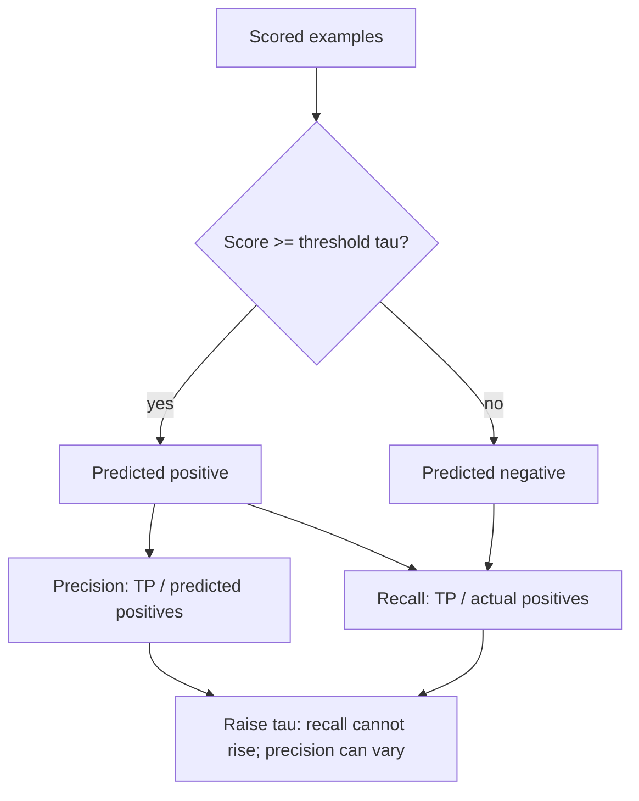

**Precision** and **recall** are complementary ratios of cells from a binary [confusion matrix](glossary://confusion-matrix). Precision is the fraction of predicted positives that are true positives. Recall is the fraction of actual positives the system finds. Both are properties of an *operating point* (hard labels, or scores cut by a [decision threshold](glossary://decision-threshold)), not of the model alone.

In information retrieval language (and in scikit-learn's precision-recall docs), precision is "how pure is the returned set?" and recall is "how complete is coverage of what should have been returned?" High precision with low recall means rare but trustworthy alarms. High recall with low precision means almost everything of interest is caught, along with many false alarms.

## Intuition

Precision asks: *when the system says yes, how often is it right?*  
Recall asks: *of everything that should have been found, how much did it find?*

Those are different product questions. A content filter that blocks 5 messages a day, all correctly, can have precision near 1.0 and still miss most harmful traffic (low recall). A filter that blocks half of all traffic can have high recall and low precision if most blocks are false. Accuracy often hides both failure modes under [class imbalance](glossary://class-imbalance): a large true-negative pile makes the headline score look fine while precision or recall on the rare class collapses.

Neither metric is "better." The right pair is the one that matches the cost of a false positive (FP) versus a [false negative](glossary://false-negative) (FN) for the action you ship: block, escalate, retrieve, quarantine, or page a human.

## Formula

From counts $\mathrm{TP}$, $\mathrm{FP}$, $\mathrm{FN}$ (true positive, false positive, false negative):

$$
\mathrm{precision}
=
\frac{\mathrm{TP}}{\mathrm{TP}+\mathrm{FP}},
\qquad
\mathrm{recall}
=
\frac{\mathrm{TP}}{\mathrm{TP}+\mathrm{FN}}
$$

Recall is also called sensitivity or true positive rate (TPR). Precision is also called positive predictive value (PPV). When $\mathrm{TP}+\mathrm{FP}=0$ (no positive predictions), precision is undefined; libraries use a convention such as $0$ or a warning (scikit-learn `zero_division`). When $\mathrm{TP}+\mathrm{FN}=0$ (no actual positive examples in the eval set), recall is undefined the same way.

**F1** is the harmonic mean of precision and recall (equal weight), standard in scikit-learn:

$$
\mathrm{F1}
=
\frac{2\cdot\mathrm{precision}\cdot\mathrm{recall}}{\mathrm{precision}+\mathrm{recall}}
=
\frac{2\,\mathrm{TP}}{2\,\mathrm{TP}+\mathrm{FP}+\mathrm{FN}}
$$

**F$_\beta$** (van Rijsbergen's effectiveness family; scikit-learn `fbeta_score`) tilts the harmonic mean. $\beta>1$ weights recall more; $\beta<1$ weights precision more:

$$
F_\beta
=
(1+\beta^2)\,
\frac{\mathrm{precision}\cdot\mathrm{recall}}{\beta^2\cdot\mathrm{precision}+\mathrm{recall}}
$$

**Precision-recall curve.** For a scored classifier, each threshold $\tau$ produces a pair $(\mathrm{recall}(\tau),\mathrm{precision}(\tau))$. Plotting those pairs yields the PR curve. Unlike ROC, the PR x-axis is recall and the y-axis is precision; the curve is usually more informative under heavy imbalance because it does not dilute errors with easy true negatives.

**Average precision (AP)** summarizes the PR curve as a recall-weighted mean of precision (scikit-learn definition):

$$
\mathrm{AP}
=
\sum_n (R_n - R_{n-1})\,P_n
$$

Here the operating points are ordered by increasing recall, so each recall increment is nonnegative. The arrays returned by scikit-learn's `precision_recall_curve` run in the opposite direction: thresholds increase and recall decreases. AP uses a stepwise sum, whereas trapezoidal PR-AUC linearly interpolates between points; the two can differ. Both summarize ranking and still leave the production threshold to choose. See the [scikit-learn curve contract](https://scikit-learn.org/stable/modules/generated/sklearn.metrics.precision_recall_curve.html).

On fixed scores and labels, raising $\tau$ cannot increase recall, but precision can move either way. For three examples with scores $0.9,0.8,0.7$ and labels $0,1,1$, a threshold of $0.7$ gives precision $2/3$ and recall $1$. Raising it to $0.85$ leaves only a false positive: both precision and recall become $0$.

## Worked numbers

A moderation classifier is evaluated on $1{,}000$ messages. $120$ are truly harmful; $880$ are safe. At the shipped threshold the system flags $100$ as harmful: $80$ true harms (TP) and $20$ safe (FP). Then $40$ harms are missed (FN) and $860$ safe messages stay unflagged (TN).

$$
\mathrm{precision}
=
\frac{80}{80+20}
=
0.80,
\qquad
\mathrm{recall}
=
\frac{80}{80+40}
=
\frac{80}{120}
\approx
0.667
$$

$$
\mathrm{F1}
=
\frac{2\cdot 0.80\cdot 0.667}{0.80+0.667}
\approx
0.727
$$

Accuracy is $(80+860)/1000=0.94$, which looks strong because safe traffic dominates. Product risk lives in the $20$ over-blocks and the $40$ leaks, not in the $0.94$.

If review cost is high and you raise the score threshold, you might move to TP $=60$, FP $=5$, FN $=60$:

$$
\mathrm{precision}
=
\frac{60}{65}
\approx
0.92,
\qquad
\mathrm{recall}
=
\frac{60}{120}
=
0.50
$$

Precision improved; more harm slipped through. That is a threshold move, not automatically a better model. Cost, capacity, and policy pick the point; F1 alone would not tell you which row is shippable.

## Example

```python
from sklearn.metrics import (
    precision_score,
    recall_score,
    f1_score,
    precision_recall_curve,
    average_precision_score,
)

# Binary labels: 1 = harmful, 0 = safe (same counts as worked numbers)
y_true = [1] * 120 + [0] * 880
y_pred = (
    [1] * 80 + [0] * 40   # among true harms: 80 TP, 40 FN
    + [1] * 20 + [0] * 860  # among safe: 20 FP, 860 TN
)

print(precision_score(y_true, y_pred))  # 0.8
print(recall_score(y_true, y_pred))     # ~0.6667
print(f1_score(y_true, y_pred))         # ~0.727

# From continuous scores: PR curve and average precision
# scores: higher means more likely harmful
# precision_recall_curve(y_true, scores) -> (precision, recall, thresholds)
# average_precision_score(y_true, scores) summarizes ranking quality
```

Operational checklist when the numbers move in production:

1. Confirm the positive class definition and label window match the dashboard.
2. Log the threshold (or multi-band policy) with model and feature versions.
3. Report precision and recall *with support* (how many actual positives existed), plus the number of predicted positives.
4. Slice by language, tenant, channel, and length; global PR can hide a bad slice.
5. Review examples just above and just below $\tau$; that is where product behavior flips.

## Diagram



The same scores can yield many $(P,R)$ pairs. Shipping chooses one pair (or a small set of bands: auto-block, human review, allow).

## Retrieval and RAG

In set-based retrieval, if $R$ is the relevant document set for a query and $S$ is the returned set:

$$
\mathrm{precision}
=
\frac{|R \cap S|}{|S|},
\qquad
\mathrm{recall}
=
\frac{|R \cap S|}{|R|}
$$

Ranked retrieval often reports [Recall@k](glossary://recall-at-k), the fraction of relevant documents present in the top $k$, rather than a single binary cut. A yes/no measure of whether *any* gold document appeared is Hit@k; it equals Recall@k only when there is one relevant document. First-stage retrieval seeks enough recall inside a candidate budget; a [reranker](glossary://reranker) then spends compute to improve what the generator sees. A later stage that only reranks these candidates cannot recover missing evidence. High measured recall with wrong answers warrants checking ranking, packing, citation, and generation, but also whether the relevance labels cover every piece of evidence the answer needs. The [Stanford IR text](https://nlp.stanford.edu/IR-book/html/htmledition/evaluation-of-unranked-retrieval-sets-1.html) gives the underlying set definitions.

## Trade-offs

| Pressure | Typical move | Effect on metrics |
|----------|--------------|-------------------|
| Misses are expensive (fraud, safety leak, medical triage) | Lower $\tau$, prefer high recall / $F_2$ | More FP load, lower precision |
| False alarms are expensive (hard block, automatic quarantine, human queue full) | Raise $\tau$, prefer high precision / $F_{0.5}$ | More FN misses |
| Rare positives | Prefer PR curve / AP over ROC-AUC alone | ROC can look strong while precision at high recall is poor |
| Compare ranking models | AP or PR-AUC on fixed labels | Still need a shipped operating point |
| Multi-class | Macro vs micro vs weighted averages | Macro treats classes equally; micro pools counts; weighted follows support |

Do not maximize F1 by default when $c_{\mathrm{FP}}$ and $c_{\mathrm{FN}}$ differ by orders of magnitude. Equal weight on precision and recall does not mean equal dollar cost for an FP and an FN. F1 also omits true negatives; evaluate the chosen threshold against the actual error costs and review capacity.

## Why it matters here

Safety classifiers, policy gates, routing, eval gates, fraud, and RAG pipelines all turn scores into discrete actions. Precision and recall are the language of that action at the threshold you actually ship: purity of alarms versus completeness of coverage. Headline accuracy and [ROC-AUC](glossary://roc-auc) can look healthy while the operating point fails users. Measure both ratios with support, slice them, and retune $\tau$ when the score distribution, labels, or traffic mix shift.

## Related terms

- [Confusion matrix](glossary://confusion-matrix)
- [Decision threshold](glossary://decision-threshold)
- [Class imbalance](glossary://class-imbalance)
- [False negative](glossary://false-negative)
- [Recall@k](glossary://recall-at-k)
