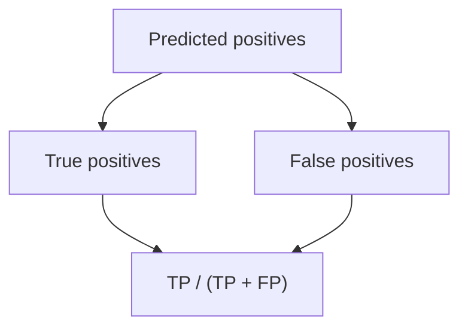

Precision is the fraction of predicted positive cases that are actually positive. It answers an operational question: when a system raises an alert, requests review, or returns a supposedly relevant document, how often is that intervention justified? Precision concerns the quality of selected items, not the fraction of all positive items recovered.

## Denominator and threshold

For binary classification, $\operatorname{precision}=\mathrm{TP}/(\mathrm{TP}+\mathrm{FP})$. True positives are correctly selected cases; false positives are unnecessary interventions. Increasing a decision threshold often reduces false positives, but precision need not increase monotonically on every finite dataset. Precision is sensitive to class prevalence: the same true-positive and false-positive rates can produce worse precision when positives become rarer.

If nothing is selected, $\mathrm{TP}+\mathrm{FP}=0$ and precision is undefined. Record this case separately; a measured zero requires selected cases with no true positives. Metric libraries expose conventions for the empty case, such as scikit-learn's [`zero_division` option](https://scikit-learn.org/stable/modules/generated/sklearn.metrics.precision_score.html).

## Example

An access-review gate flags ten requests. Six genuinely require approval and four are safe. Precision is $6/(6+4)=0.60$: 60% of reviewer work addresses a real positive. This number says nothing about the requests the system failed to flag. If the full batch contained twelve review-required requests, recall would separately report $6/12=0.50$.

To see the prevalence effect, consider a gate with recall $0.9$ and false-positive rate $0.01$. In a hypothetical batch with $1{,}000$ positives and $9{,}000$ negatives, it selects $900$ TP and $90$ FP, for precision $900/990 \approx 0.909$. In another batch with $100$ positives and $9{,}900$ negatives, the same conditional rates yield $90$ TP and $99$ FP: precision falls to $90/189 \approx 0.476$. A balanced evaluation set can therefore overstate the purity of a deployment queue.

## Why it matters here

Moderation queues, anomaly alerts, retrieval results, and human escalation all have finite capacity. Reporting precision beside recall, absolute counts, uncertainty, and the chosen threshold prevents a seemingly accurate classifier from overwhelming reviewers with false alarms.

## Related terms

- [Recall](glossary://recall)
- [F1 score](glossary://f1-score)
- [Confusion matrix](glossary://confusion-matrix)
