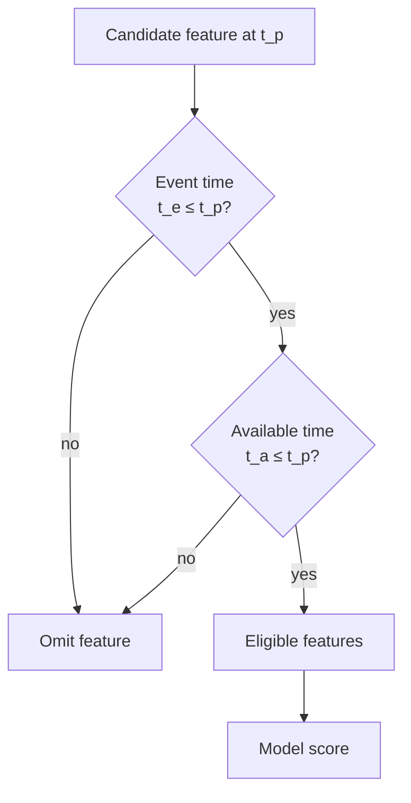

A **prediction timestamp** $t_p$ is the information cutoff assigned to a model score. In request-time serving it is often when the request arrives; a replay or batch job can use an explicit historical as-of time instead. An observed fact that happened after $t_p$, or a value that only became readable after $t_p$, must not enter the features for that historical score.

In live serving, $t_p$ is usually "now" at request time. In offline training and batch scoring, you assign each historical row an explicit $t_p$ and rebuild features as if the service were scoring at that past clock. Feature stores name the same idea differently (Feast's entity-dataframe `event_timestamp`, Databricks `timestamp_lookup_key`), but The schema is one clock that bounds allowed history.

## Intuition

Think of $t_p$ as a vertical line on a timeline. Left of the line: candidates for features. Right of the line: labels, outcomes, and forbidden future facts.

Three different clocks often share one table and cause bugs when mixed:

| Clock | Question it answers |
| --- | --- |
| Event time $t_e$ | When did this fact happen in the world? |
| Availability time $t_a$ | When could a serving system have read it? |
| Prediction time $t_p$ | When was this score requested? |

Event time alone is not enough. A heartbeat with $t_e = 08{:}55$ that only lands in the store at $t_a = 09{:}10$ still leaks if you use it for a $t_p = 09{:}00$ score. Record availability for the serving path you are reproducing; a raw event's ingestion time may precede the time an aggregate was computed and published. Preserve revisions too: a corrected 08:30 value published at 10:00 cannot replace the original value in a 09:00 replay.

Future-dated *known covariates* are different from future observations. Tomorrow's weekday or a deployment scheduled and published before $t_p$ can be eligible for tomorrow's forecast. The prohibition concerns information unavailable at the cutoff, not the calendar date a known plan describes.

The label may be written hours later. That is fine. Features describe the world *before* the decision; labels describe what happened *after*.

## Formula

For an observed-event feature value $x$ used on a row with prediction timestamp $t_p$:

$$
x \text{ is eligible} \iff t_e(x) \le t_p \;\land\; t_a(x) \le t_p
$$

(with your schema's inclusive/exclusive rule documented and tested; Feast treats the entity timestamp as an inclusive upper bound).

A [point-in-time join](glossary://point-in-time-join) then picks, among eligible values for the entity key, the latest eligible row (optionally within a TTL or lookback window $\tau$):

$$
x^*(t_p) = \arg\max_{\,x:\, t_e(x)\le t_p,\; t_a(x)\le t_p,\; t_p - t_e(x) \le \tau} t_e(x).
$$

This replay schema depends on the implementation, even when a join is named "point in time." [Feast's documented event-time join](https://docs.feast.dev/getting-started/concepts/point-in-time-joins) and [Databricks' timestamp lookup](https://docs.databricks.com/aws/en/machine-learning/feature-store/time-series) require timestamp semantics to match your information cutoff. Check the deployed implementation's availability filtering; an event-time-only join can still allow backfills. Define a deterministic revision tie-break for equal event times, and an explicit missing value when no eligible row exists.

For example, Feast's [current `get_historical_features` source](https://github.com/feast-dev/feast/blob/master/sdk/python/feast/feature_store.py) exposes `filter_by_created_timestamp=False`. Enabling it filters configured creation timestamps against the entity timestamp; feature views without a `created_timestamp_column` are unaffected. Verify this option exists in your installed version and that the creation timestamp really represents serving availability.

[Feature freshness](glossary://feature-freshness) is the age relative to the same clock:

$$
\mathrm{age}(x) = t_p - t_{\mathrm{as\_of}}(x).
$$

In forecasting notation, $t_p$ is the forecast origin: the $h$-step forecast $\hat{y}_{t+h|t}$ is conditioned only on information available at origin $t$.

## Example

A job-risk model scores training job `J-204` at $t_p =$ `2026-05-01 09:00`. Will it miss SLA by end of day? The label `missed_sla` is known only at 17:00. Features must be built from what the scorer could have known at 09:00.

| Source | $t_e$ | $t_a$ | Eligible at 09:00? |
| --- | --- | --- | --- |
| Heartbeat | 01:00 | 01:01 | yes |
| Heartbeat | 08:30 | 08:31 | yes |
| Heartbeat | 08:55 | 09:10 | **no** (arrived after $t_p$) |
| Heartbeat | 12:00 | 12:01 | **no** (future event) |
| Post-SLA escalation | 16:40 | 16:41 | **no** (label proxy) |

```python
from datetime import datetime

prediction_ts = datetime.fromisoformat("2026-05-01T09:00:00")

heartbeats = [
    {"event": datetime.fromisoformat("2026-05-01T01:00:00"),
     "available": datetime.fromisoformat("2026-05-01T01:01:00")},
    {"event": datetime.fromisoformat("2026-05-01T08:30:00"),
     "available": datetime.fromisoformat("2026-05-01T08:31:00")},
    {"event": datetime.fromisoformat("2026-05-01T08:55:00"),
     "available": datetime.fromisoformat("2026-05-01T09:10:00")},
    {"event": datetime.fromisoformat("2026-05-01T12:00:00"),
     "available": datetime.fromisoformat("2026-05-01T12:01:00")},
]

def eligible(row, tp: datetime) -> bool:
    return row["event"] <= tp and row["available"] <= tp

visible = [h for h in heartbeats if eligible(h, prediction_ts)]
latest = max(visible, key=lambda h: h["event"], default=None)
hours_since = (
    (prediction_ts - latest["event"]).total_seconds() / 3600
    if latest is not None else None
)
# hours_since == 0.5  (08:30 heartbeat; 08:55 rejected as late-arriving)
```

The toy uses naive datetimes on one agreed clock. Use consistently timezone-aware timestamps in a real join, and define the fallback for `None` rather than treating an unseen heartbeat as age zero.

If training quietly uses the 08:55 or 12:00 rows because "they exist in the warehouse now," offline AUC rises and production collapses. That is [feature leakage](glossary://feature-leakage) caused by ignoring $t_p$.

## How it works offline and online

**Online.** The request arrives. Serving assigns $t_p$ and reads the online store or on-request transforms. A latest-value API may not support historical reads. If the request waits and a new feature arrives after its assigned $t_p$, either use an as-of snapshot or define the cutoff as the later snapshot acquisition time and log it. Otherwise the claimed request-time cutoff and the actual feature set disagree.

**Offline training / batch score.** You build an entity table with keys plus $t_p$ per row (labels optional). Historical retrieval runs a point-in-time join: for each row, scan feature history backward from that row's $t_p$ within TTL, keeping only values that satisfy the eligibility rule. Feast's `get_historical_features` requires this column on the entity dataframe for that reason.

**Parity.** The same $t_p$ must drive train, eval, and serve semantics. Shared column names with different cutoffs produce [training-serving skew](glossary://training-serving-skew): offline rows look fresher or denser than live scores.

```text
entity row:  entity_id=J-204  prediction_ts=2026-05-01T09:00Z  label=missed_sla
feature join: event_ts <= prediction_ts AND available_ts <= prediction_ts
serve path:   prediction_ts = request_time; same filters and windows
```

## Diagram

A feature must pass both time checks. Outcomes arriving later may join as labels, never as features for that earlier prediction.



## Worked clocks

One audit row makes most bugs obvious. Keep these columns next to each other for every training example and every disputed production score:

| field | example | role |
| --- | --- | --- |
| `prediction_ts` | 09:00 | cutoff for this score |
| `feature_event_ts` | 08:55 | when the fact happened |
| `feature_available_ts` | 09:10 | when serving could read it |
| `label_ts` | 17:00 | when the outcome was known |
| `ingested_to_warehouse_ts` | next day | warehouse arrival time; distinct from source availability $t_a$ |

Rule of thumb for each feature under a [feature schemas](glossary://feature-contract):

1. Did the event happen at or before $t_p$?
2. Was the value available at or before $t_p$?
3. Is it valid under The schema (type, null policy, freshness $\tau$)?

Fail any of the three and the feature is illegal for that row.

## Production failure modes

| Failure | What goes wrong |
| --- | --- |
| Warehouse "as of now" join | Training sees corrected/backfilled facts that did not exist at $t_p$ |
| Event time only | Late-arriving streams look historical and inflate offline skill |
| Timezone / DST mismatch | `09:00` local vs UTC shifts the cutoff by hours |
| Inclusive vs exclusive bound | Off-by-one rows at exact $t_p$ disagree between train and serve |
| Label fields as features | Finished-at, failure reason, and escalation notes encode the answer |
| Wrong horizon | Features use data from inside the [forecast horizon](glossary://forecast-horizon) that production cannot know yet |

When offline quality looks "too good," recompute one entity through train and serve at the same $t_p$ and diff every field before blaming the model.

## Why it matters here

LeetLLM production lessons (feature engineering, batch/streaming pipelines, feature stores, forecasting) all share one question: what did the scorer know at the prediction timestamp? That single clock is the simplest guardrail against leakage, the join key for historical feature retrieval, and the reference for freshness SLAs. Get $t_p$ wrong and every metric downstream is fiction; get it right and offline training can honestly mimic live serving.

## Related terms

- [Point-in-time join](glossary://point-in-time-join)
- [Feature leakage](glossary://feature-leakage)
- [Feature freshness](glossary://feature-freshness)
- [Forecast horizon](glossary://forecast-horizon)
- [Training-serving skew](glossary://training-serving-skew)
