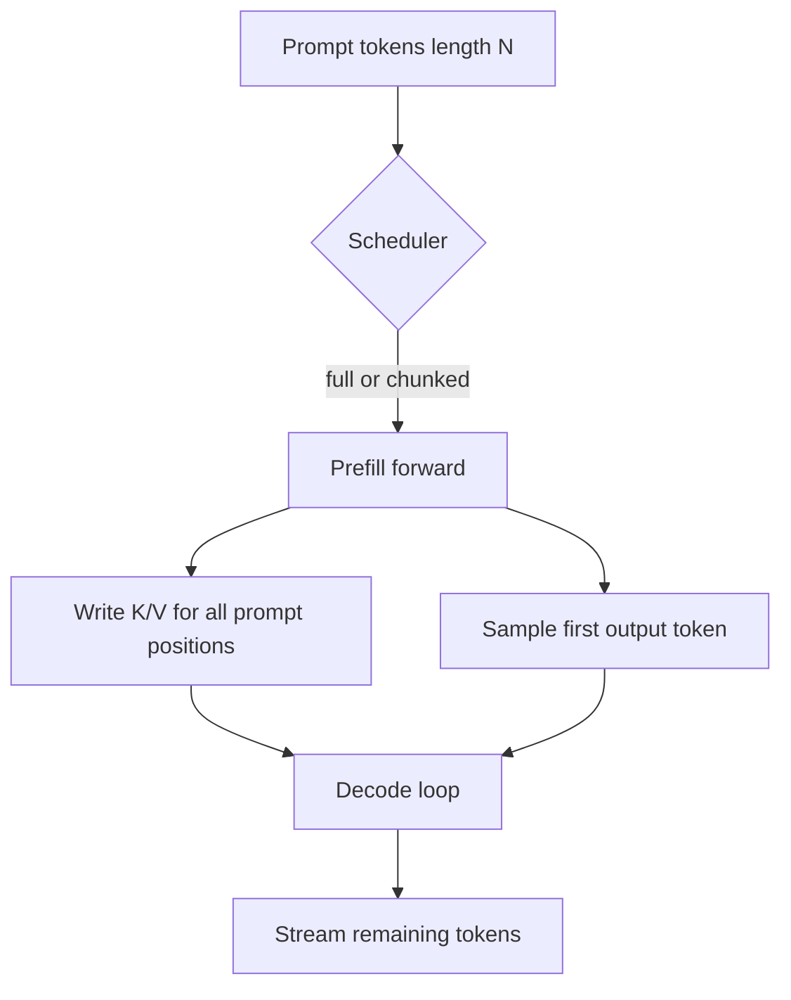

**Prefill** is the LLM inference phase that processes the prompt before autoregressive generation begins. On a cold request, one forward pass (or multiple chunked passes) computes hidden states for the input and writes keys and values for its positions into the [KV cache](glossary://kv-cache). Reusable cached prefixes skip that work for the matching positions. The final prompt position's logits provide the first output token; the ordinary [decode phase](glossary://decode-phase) then generates the rest of the answer one token at a time, reading that cache.

Serving literature (for example [DistServe, OSDI 2024](https://arxiv.org/abs/2401.09670)) treats prefill as the step that turns a user prompt of length $N$ into the first generated token and the initial KV state. That work largely drives [TTFT](glossary://ttft). Decode drives inter-token latency after the stream starts.

## Intuition

Prefill processes all prompt positions in parallel and populates the KV cache. Decode then produces one new token per sequence step while reusing that cache.

During prefill the engine already knows all $N$ input tokens, so it can form large matrix-matrix multiplies: many prompt positions share the same weight loads. Tensor cores stay busy. Arithmetic intensity (FLOPs per byte moved from [HBM](glossary://hbm)) is high, so long prompts are often **compute-bound**.

During decode only one new token (per sequence) is known. Linear layers collapse toward matrix-vector products and every step reloads weights plus a growing KV tensor. Intensity drops and the step is often **memory-bandwidth bound**.

So the same model and weights produce two different hardware shapes:

| Phase | Tokens processed | Work shape | Typical bottleneck (low concurrency) | User metric |
|-------|------------------|------------|--------------------------------------|-------------|
| Prefill | All $N$ prompt tokens at once | Matrix-matrix over $N$ | FLOPs / tensor cores | TTFT |
| Decode | 1 new token per step (per seq) | Near matrix-vector + KV reads | HBM bandwidth | [TPOT](glossary://tpot) / [ITL](glossary://itl) |

A product can stream tokens very fast after a long silence. Prefill (plus queue time) is often that silence.

## How it works

For a decoder-only transformer with a causal mask:

1. **Tokenize and pack.** Convert the prompt (system, tools, history, user text, image tokens) into ids of length $N$. Apply chat templates and any multimodal embedding expansion first; those tokens count toward prefill cost.
2. **Forward over the prompt.** At each layer, project all $N$ positions to $Q$, $K$, $V$. With causal self-attention, position $i$ attends only to positions $\le i$. Modern kernels (FlashAttention-style) avoid materializing a full $N \times N$ score matrix in HBM, but the **work** still scales as $O(N^2)$ in sequence length for dense attention.
3. **Write the KV cache.** Store $K$ and $V$ for every prompt position, every layer, every KV head. Decode will append only new tokens from here on.
4. **First token.** The last prompt position's logits yield the first output token (greedy, sampling, or constrained decode). Streaming APIs can send that token as soon as this step finishes.

Prefill runs a full transformer forward pass, with cost determined by prompt length, batch of concurrent prefills, attention implementation, and any cached prefix.

### Chunked prefill

A single multi-thousand-token prefill can monopolize a GPU for a long scheduling step and stall concurrent decode streams (head-of-line blocking). **Chunked prefill** ([SARATHI](https://arxiv.org/abs/2308.16369)-style "piggyback" batches) splits a long prompt into chunks and interleaves them with decode work from other requests. Current [vLLM V1](https://docs.vllm.ai/en/stable/configuration/optimization/#chunked-prefill) enables it by default when supported and prioritizes decode. Its `max_num_batched_tokens` is a shared per-step budget: scheduled decode tokens consume capacity before prefills use the remainder.

Trade-off: smaller chunks improve ITL for ongoing generations; larger chunks can finish prefills sooner (better TTFT for new arrivals) and raise batch efficiency. Chunking still pays roughly $O(N^2)$ dense attention work overall. Later chunks attend to earlier KV and run smaller GEMMs with more scheduling steps, adding overhead. Actual latency and throughput depend on the kernels and concurrent load.

### Prefix cache hits

If a [prefix cache](glossary://prefix-cache) hits on a shared system prompt or tool schema, the engine skips recomputing that prefix's KV and prefills only the uncached suffix. Hit rate and keying (exact tokenized prefix) matter as much as raw model speed for TTFT on agent and IDE workloads.

### Prefill-decode disaggregation

Colocating long prefills with decode on the same GPU couples TTFT and TPOT: a heavy prefill can delay concurrent decode, and decode tokens consume some of the shared batch's capacity. DistServe-style systems put prefill and decode on separate GPU pools, transfer KV over a suitable interconnect, and scale each pool for its own SLO. That removes direct GPU phase interference at the cost of KV transfer bandwidth and replicated model weights across the pools.

## Formula

Rough complexity for one request of prompt length $N$ (one head, constants dropped):

| Component | Prefill cost order |
|-----------|-------------------|
| Linear / FFN layers | $O(N)$ activations through fixed weights (high intensity GEMMs) |
| Dense causal attention | $O(N^2)$ in sequence length |
| KV write | $O(N)$ keys and values stored per layer |

Attention dominates growth for long context even when linear layers dominate absolute time at moderate $N$. Doubling $N$ roughly doubles linear work and about **quadruples** dense attention work.

A useful mental model for wall time under a compute roof:

$$
T_{\mathrm{prefill}} \approx \frac{\mathrm{FLOPs}(N)}{\eta \cdot \mathrm{PeakFLOP/s}} + T_{\mathrm{overhead}}
$$

where $\eta$ is achieved efficiency and $T_{\mathrm{overhead}}$ covers tokenization, scheduler gaps, and cache lookup, excluding initial queue time. For TTFT:

$$
\mathrm{TTFT} \ge T_{\mathrm{queue}} + T_{\mathrm{prefill}} + T_{\mathrm{first\ sample}}
$$

Prefix-cache hits remove recomputation of cached positions, while suffix queries still attend to the prefix. For $P$ cached tokens and $S$ uncached tokens, dense suffix attention includes prefix-to-suffix and suffix-to-suffix interactions, with cost $O(SP + S^2)$. Uncached suffix work and decode continue after a cache hit.

## Diagram

The diagram shows a cold prefill followed by ordinary autoregressive decoding.

## Example

A support bot sends an 8,000-token prompt: 1,200-token system + tools, 6,000-token retrieved policy PDF, 800-token user thread. The latency breakdown below is illustrative; measure each stage on the target hardware:

| Slice | Time |
|-------|------|
| Queue + tokenize | 40 ms |
| Prefill (cold, full prompt) | 520 ms |
| First token sample / ship | 15 ms |
| **TTFT** | **~575 ms** |
| Remaining 299 tokens of a 300-token answer at 28 ms ITL | ~8.37 s decode |

Users feel the half-second blank before anything appears, even though decode is fine.

Three changes that mainly reduce **prefill** work:

1. **Cut retrieval.** Drop the PDF to 2,000 tokens ($N$: 8k $\to$ 4k). Linear work roughly halves and dense attention work falls to about a quarter. The TTFT gain depends on their contributions and fixed overhead.
2. **Prefix cache.** Pin the 1,200-token system+tools block. On a hit, recompute only ~6,800 tokens. Hit rate on that prefix becomes a first-class TTFT lever.
3. **Chunked scheduling.** Without chunking, one 8k prefill may freeze other users' streams for the whole step. A 2k token budget requires at least four prefill steps, and more when concurrent decodes consume part of that budget. It can protect fleet ITL while changing this request's TTFT; measure that trade-off under load.

If p95 TTFT is bad while tokens/sec looks great, celebrate less and instrument prefill: prompt length histograms, cache hit rate, and whether large prefills are blocking the batch.

## Latency drivers

What actually moves prefill time in production:

- **Prompt length $N$:** text, chat history, tool schemas, RAG chunks, and multimodal image tokens all count.
- **Cache path:** prefix/KV reuse vs cold compute; invalidation from one-character system-prompt edits.
- **Attention and kernels:** FlashAttention-class kernels; GQA/MQA mainly cut **decode** bandwidth and KV capacity (fewer KV heads to store and stream), with a secondary prefill win from smaller KV writes; context length limits.
- **Batch and scheduler:** concurrent prefills, [continuous batching](glossary://continuous-batching), chunk size / `max_num_batched_tokens`, prefill-first vs decode-first policy.
- **Hardware shape:** achieved TFLOPS, tensor-parallel width (can cut prefill latency, adds communication), HBM capacity for the KV write.
- **Interference:** colocated decode tokens in the same step; preemption and recompute under KV pressure.

**What fails in production.** Long-context RAG ships multi-document prompts and TTFT blows past the product SLO while dashboards still show healthy "tokens per second." Another failure mode: a single 32k prefill without chunking stalls every interactive session on the GPU. A third: teams "optimize decode" with quantization and speculative decoding while the real complaint is cold system prompts that never hit a prefix cache.

Debug by splitting request time into queue, cache lookup, prefill compute, first sample, and decode gaps. Bucket by $N$ and cache hit/miss. If TTFT tracks $N$ and cache miss rate, fix prompts and caching before retuning decode.

## Why it matters here

Prefill is why context length, prompt design, prefix caching, and batching policy can dominate LLM latency **before** the first token streams. Curriculum topics on TTFT vs TPS, KV cache, continuous batching, and serving architecture all hang on this phase: prefill answers "when does generation start?"; decode answers "how fast does the rest move?"

## Related terms

- [Decode phase](glossary://decode-phase)
- [TTFT](glossary://ttft)
- [KV cache](glossary://kv-cache)
- [Prefix cache](glossary://prefix-cache)
- [Continuous batching](glossary://continuous-batching)
