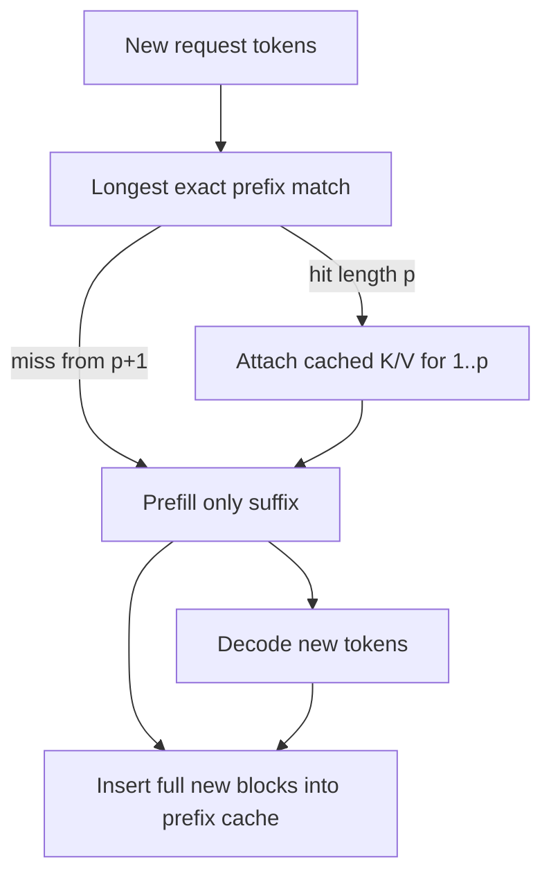

A **prefix cache** reuses previously computed [KV-cache](glossary://kv-cache) tensors for an **identical token prefix** so a new request can skip that part of [prefill](glossary://prefill). Also called **prompt caching** or **context caching** at the API layer. The model still prefills the unmatched suffix and still decodes new tokens; only the shared beginning is free from recompute.

It reuses attention state **across requests**. With the same weights, adapters, positions and input embeddings, matching token prefixes have the same KV state in exact arithmetic. [Real kernels can differ with batch shape](https://docs.vllm.ai/en/stable/features/batch_invariance/) and floating-point rounding, so reuse preserves the computation's meaning while fresh logits may differ in their final bits and sampled answers may change.

## Intuition

Three caches get mixed up in serving discussions:

| Cache | Scope | What is reused | Match rule |
|---|---|---|---|
| **KV cache** (within one request) | One generation | Past $K$/$V$ while decoding | Implicit: the sequence itself |
| **Prefix cache** | Across requests (or rounds) | Prompt $K$/$V$ for a shared start | Exact token prefix (often full blocks) |
| **Semantic cache** | Across requests | Whole answer or intermediate text | Embedding similarity, not tokens |

Without a prefix cache, every request pays full prefill over its entire prompt, even when 90% of that prompt is a fixed system policy, tool schema, or long document. With one, the engine looks up the longest already-computed prefix, attaches those KV blocks, and runs prefill only on the rest.

Reuse requires a **token-exact** prefix match. A single space, reordered JSON key, chat-template bump, LoRA adapter id, or image hash change can cause a miss. Front-load stable text and put per-request noise at the end.

## How it works

### Causal fact that makes reuse safe

In causal self-attention, $k_j$ and $v_j$ at a layer depend only on inputs $1..j$, their positions and fixed model state, not on future tokens. Two requests with the same first $p$ inputs and model state can therefore reuse $K_{1:p}$ and $V_{1:p}$. The remaining suffix still attends into them correctly. Text token IDs alone are insufficient when adapters or multimodal embeddings differ.

### Lookup and attach (engine view)

Typical flow on admit:

1. Tokenize the full prompt (and any multimodal placeholders).
2. Walk token sequence in **block** units (vLLM-style [PagedAttention](glossary://pagedattention) pages) or along a [radix tree](glossary://radix-tree) ([RadixAttention](glossary://radixattention) in SGLang).
3. Find the longest prefix whose blocks are already resident and valid.
4. Increment refcounts on hit blocks so the scheduler does not evict them mid-request.
5. Allocate new blocks for the unmatched suffix and any decode growth.
6. Prefill only from the first uncached token onward; decode as usual.

[vLLM's Automatic Prefix Caching](https://docs.vllm.ai/en/stable/design/prefix_caching/) hashes each full block from:

- the **parent** block hash (so position in the prefix chain is part of the key),
- the **token IDs** inside the block,
- **extra** factors: LoRA id, multimodal image hashes, optional `cache_salt` for multi-tenant isolation.

Only **full** blocks enter the cache map. A 16-token block with 15 matching tokens is a miss for that block; the engine stops the hit at the last complete matching block.

[SGLang's RadixAttention](https://arxiv.org/abs/2312.07104) keeps a radix tree over token sequences with LRU eviction so branching multi-turn and agent trees share roots within the cache instance. Same idea (exact prefix KV reuse); different index structure.

### Provider APIs

Hosted APIs expose the same physics with product names:

- **[OpenAI prompt caching](https://developers.openai.com/api/docs/guides/prompt-caching):** eligible matching prefixes can be reused at model-specific lookup boundaries. Current models support implicit and explicit breakpoint controls; earlier models use automatic boundaries. Responses API usage reports `input_tokens_details.cached_tokens`.
- **[Anthropic prompt caching](https://platform.claude.com/docs/en/build-with-claude/prompt-caching):** put `cache_control` on content blocks for explicit breakpoints, or at request level for automatic placement. The cached prefix follows `tools` → `system` → `messages` order.

Both require matching prefix content and applicable model/configuration conditions. Minimum eligible lengths, lookup boundaries and lifetime determine whether matching content actually hits. Cache reads can lower latency and cost, while some models also charge for cache writes. The cache reuses model state; generation still produces the answer.

## Diagram



```text
Request A:  [ system | tools | policy | doc | Q1 ]
Request B:  [ system | tools | policy | doc | Q2 ]
             \___________ cacheable prefix ___________/ \ suffix /

Hit: reuse KV for the shared span; recompute suffix linear layers,
     but suffix attention still reads the shared document's KV.
```

## Formula

Token-level [cache hit rate](glossary://cache-hit-rate) for prefix reuse:

$$
HR_{\mathrm{tok}}
=
\frac{\sum \text{cached prompt tokens}}{\sum \text{prompt tokens}}
$$

If you model only the linear layers on the uncached suffix $S = N_{\mathrm{prompt}} - N_{\mathrm{cached}}$, prefill time looks like:

$$
T_{\mathrm{prefill}}
\approx
c \cdot S
$$

That is an order-of-magnitude teaching model (real kernels and batching matter). **Residual attention still pays for the cached prefix:** each new suffix token attends over the full prompt length $P + S$, so attention work is closer to $O(S \cdot (P + S))$ (plus linear layers on $S$). When $P$ is large and the step is attention-bound, warm-hit TTFT gains are smaller than the linear model suggests. Decode cost is almost unchanged: APC leaves per-step attention over the full context during generation.

**Worked numbers.** Shared system + tools + policy + document: $P = 8{,}000$ tokens. User question: $S = 200$ tokens. Cold prefill processes $8{,}200$ tokens; on a warm hit only ~$200$ suffix tokens recompute linear layers, but attention still looks into the attached 8k prefix KV. At a toy linear $c = 0.05\,\mathrm{ms/token}$ (ignoring residual attention):

| Case | Uncached tokens | Linear-only toy prefill | Caveat |
|---|---|---|---|
| Cold | $8{,}200$ | $410\,\mathrm{ms}$ | Full prompt compute |
| Warm prefix hit | $200$ | $10\,\mathrm{ms}$ | Modeled linear contribution; residual attention and overhead also matter |

Still a large TTFT win on document Q&A and agents with fat scaffolds when linear/prefill GEMMs dominate. If the workload is attention-bound at long $P$, or answers are long and the GPU is decode-bound, wall-clock savings shrink even with $HR_{\mathrm{tok}}$ near $1$.

Block granularity (vLLM-style). With block size $B=16$, a match of $10$ shared tokens yields only $\lfloor 10/16\rfloor = 0$ cached full blocks: **zero** prefix hit until the shared span reaches a full block boundary (and those blocks stay resident).

## Example

An IDE assistant sends the same stack each completion:

```text
[ system instructions | repo coding standards | tool schemas | open-file context | cursor ]
  \______________ stable across many keystrokes ______________/ \____ changes often ____/
```

Pin the stable scaffold first. With a $1{,}200$-token fixed prefix and $300$-token changing local context, a hit skips recomputing those $1{,}200$ tokens of prefill on every keystroke. Telemetry that only counts "requests with any hit" will look great; better metrics report **tokens** (or full blocks) reused, TTFT with/without the scaffold, and eviction rate under memory pressure.

```python
# Conceptual: structure for hits (not a real SDK)
messages = [
    {"role": "system", "content": SYSTEM},          # static: first
    {"role": "user", "content": TOOL_SCHEMA_JSON},  # static: second
    {"role": "user", "content": open_file_snippet}, # dynamic: last
]
# OpenAI Responses path: response.usage.input_tokens_details.cached_tokens
# Self-hosted: enable_prefix_caching=True (vLLM) / RadixAttention default (SGLang)
```

vLLM-shaped workloads that benefit most: **repeated long-document questions** (manual or report cached once) and **multi-round chat** (history prefix reused each turn). Gains fail when each prompt is unique, or when decode length dominates prefill.

## Trade-offs

| Pressure | What goes wrong |
|---|---|
| **Memory** | Cached prefixes compete with live KV for [HBM](glossary://hbm). Hot roots need residency; cold private branches should evict first (LRU on free queues is common). |
| **Hit quality** | Timestamps, request ids, or non-deterministic JSON early in the prompt destroy the shared prefix. |
| **Routing** | Sticky or prefix-aware routing keeps warm KV on the right replica; routing to a cold replica misses even if another worker has the prefix. Random routing can reduce hits, depending on which replicas are warm. |
| **Isolation** | Shared prefix caches can create timing side channels across tenants; use `cache_salt` (or separate pools) so only same-trust keys share blocks. |
| **Composition** | Hybrid attention, sliding windows, speculative draft/target caches, and multimodal embeddings need extra hash components so the cache key covers the complete model state. |

Debug path: split eligible-for-reuse vs actual hit, log $N_{\mathrm{cached}}$, TTFT, and eviction. A "prefix cache enabled" flag with near-zero $HR_{\mathrm{tok}}$ usually points to prompt layout, tokenizer/chat-template drift, or cache pressure.

## Why it matters here

Prefix caching is one of the highest-ROI LLM serving optimizations for agents, chat, code completion, and structured scaffolds: it cuts prefill cost and TTFT without changing model quality, but only if you design prompts and routing around exact, stable prefixes and measure token-level hits under real memory limits.

## Related terms

- [KV cache](glossary://kv-cache)
- [Prefill](glossary://prefill)
- [Cache hit rate](glossary://cache-hit-rate)
- [RadixAttention](glossary://radixattention)
- [Radix tree](glossary://radix-tree)
- [PagedAttention](glossary://pagedattention)
