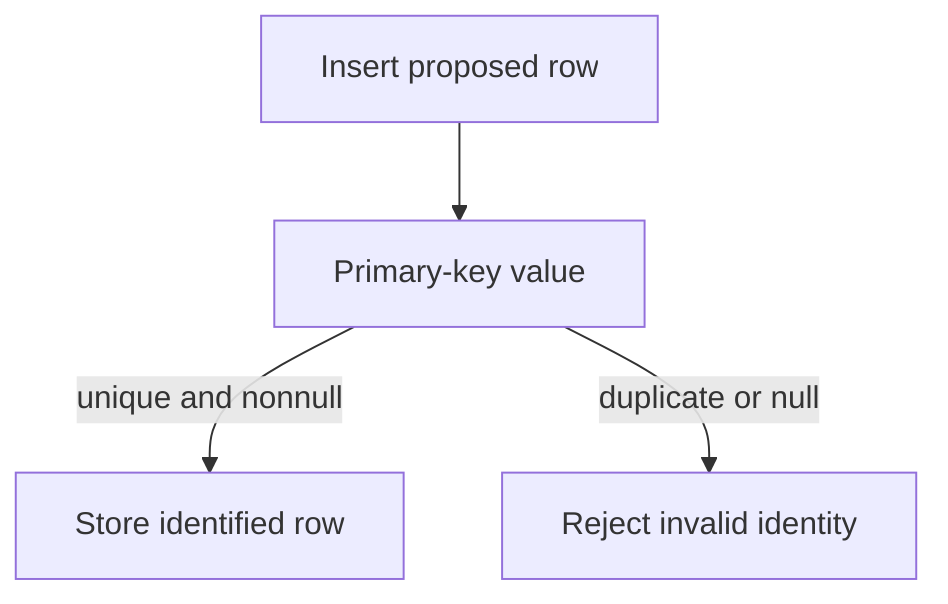

A **primary key** identifies one row in a database table. Its values must be unique, and relational databases normally require them to be non-null. Other tables can refer to that identity through foreign keys, which lets an application reconstruct a document, source version, permission, or evaluation record reliably.

A primary key can contain one column or multiple columns. A composite key such as `(chunk_id, principal)` means the pair must be unique, even though the same chunk and the same principal can each appear in multiple different pairs.

## SQLite's historical null exception

PostgreSQL automatically applies `NOT NULL` to primary-key columns. Ordinary SQLite rowid tables preserve a [documented historical exception](https://www.sqlite.org/lang_createtable.html#the_primary_key): `id TEXT PRIMARY KEY` can accept a null value unless the definition explicitly includes `NOT NULL`, the table is `STRICT` or `WITHOUT ROWID`, or another documented exception applies. For a beginner SQLite schema, write `id TEXT PRIMARY KEY NOT NULL` to enforce the identity contract visibly.



## Example

```sql
CREATE TABLE documents (
    id TEXT PRIMARY KEY NOT NULL,
    title TEXT NOT NULL
);
```

Inserting a duplicate document ID fails. Inserting a null ID also fails under SQLite, rather than silently creating a row with no usable document identity.

## Why it matters here

Retrieval citations, document versions, permission records, idempotency markers, and evaluation lineage depend on stable row identities. Declaring the database-specific non-null rule prevents application assumptions from diverging from the schema's actual behavior.

## Related terms

- [SQL](glossary://sql)
- [Data model](glossary://data-model)
- [PostgreSQL](glossary://postgresql)
- [Idempotency](glossary://idempotency)
