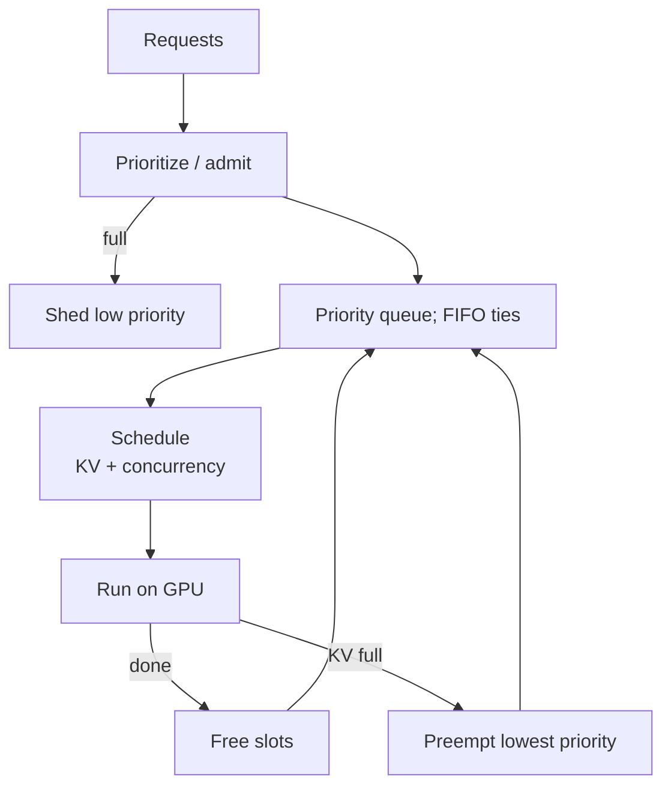

**Priority scheduling** is a service-order rule: when capacity frees, the scheduler runs the highest-priority ready work next. Priority may encode urgency, tenant tier, deadline, cost class, or product lane. Arrival order is the **tie-breaker** when priorities match.

Classical OS texts treat priority scheduling as a generalization of shortest-job-first: SJF uses predicted burst length as the priority key; production systems use explicit ranks. In LLM serving the same idea shows up at two layers: an upstream job queue (chat vs bulk embeddings) and the engine's [inference scheduler](glossary://inference-scheduler) that orders waiting requests under continuous batching (for example vLLM's `fcfs` vs `priority` policy).

## Intuition

A [FIFO work queue](glossary://fifo-work-queue) is fair to *arrival time*. Priority is fair to *declared importance*. Interactive chat with a tight [TTFT](glossary://ttft) budget and an overnight embedding job should not share the same service order on one GPU pool: the chat request must jump the queue even if it arrived later.

The price is **starvation** (also called indefinite blocking in Silberschatz / Galvin-style OS notes): a steady stream of high-priority work can keep low-priority work waiting forever. A pure min-heap can still starve low-priority work. Add aging, per-tenant caps, reserved capacity, or load shedding so ordinary work completes.

Convention note: many systems (Unix `nice`, vLLM `priority`, Python min-heaps) treat **lower numbers as higher priority**. Document the scale so readers know whether "priority 10" is more urgent than "priority 1."

## How it works

### Selection rule

At each decision point (worker idle, engine iteration, or preemption event):

1. **Order ready work** by priority key, then by arrival / sequence for ties.
2. **Admit** the winner if resource checks pass (GPU slots, KV blocks, concurrency cap, token budget).
3. **Optionally preempt** a lower-priority running item when a higher-priority one arrives and resources are tight (common under KV pressure in LLM engines).

Under continuous batching, the decision repeats every model iteration: finished sequences free KV, waiting work is re-ranked, and the running set may change. vLLM's documented `priority` policy handles requests by assigned priority (lower value earlier) with arrival time deciding ties; FCFS is the default.

### Priority sources

| Source | Typical use | Risk if wrong |
|---|---|---|
| Product lane | Interactive chat vs batch API | Batch floods chat latency |
| Tenant tier | Paid / free / internal evals | Free tier starves paid, or reverse |
| Deadline / SLA class | Tool calls with hard timeouts | Stale work keeps running |
| Operator override | Incident / canary traffic | Forgotten high priority becomes permanent |
| Derived fairness key | Round-robin or share within a tenant | One noisy user fills the high class |

Gateway layers often assign the number; engines just sort. Backend-only priority still needs an upstream component that *sets* the priority honestly.

### Fairness mechanisms

Without one of these, priority becomes "who shouts loudest":

- **Aging:** raise effective priority as wait time grows so low-priority jobs eventually run.
- **Per-tenant or per-class quotas:** cap concurrent high-priority work so one tenant cannot monopolize the class.
- **Reserved capacity:** hold a slice of GPU / KV for low-priority or background lanes.
- **Load shedding:** when overloaded, drop or reject low-priority arrivals so admitted high-priority work still meets the [SLO](glossary://slo).
- **Upstream fair queues:** round-robin across tenants *before* work hits a priority-ordered backend queue (otherwise one power user re-fills the high lane).

## Formula

**Non-preemptive priority** (single server, work-conserving): let the ready set be jobs $J_1,\ldots,J_n$ with priorities $p_i$ (lower $p$ better) and arrival times $a_i$. The next job is the lexicographic minimum of $(p_i, a_i)$:

$$
j^\star = \arg\min_i \bigl(p_i,\; a_i\bigr)
$$

so arrival (or a monotonic sequence number) breaks ties only when priorities match. Once admitted, a job runs to completion. For a job $j$ that is still waiting, delay includes residual service of the job currently running, service of every higher-priority job already ready (and any that arrive while $j$ waits), plus equal-priority jobs that arrived earlier than $j$.

**Aging (linear sketch):** after waiting $w$ seconds, effective priority might be

$$
p_{\mathrm{eff}} = p_{\mathrm{base}} - \alpha\, w
$$

with $\alpha > 0$ so long waiters gain priority. Recompute ordering as time advances; a heap of insertion-time keys does not age itself. Enforcing a hard queue-age limit during sustained overload also requires admission control or reserved service capacity.

**Head-of-line cost under pure FIFO** (why priority exists): if a bulk job of length $S_{\mathrm{bulk}}$ sits ahead of a chat job of length $S_{\mathrm{chat}}$, chat waits about $S_{\mathrm{bulk}}$ even when $S_{\mathrm{chat}} \ll S_{\mathrm{bulk}}$. Priority with chat ranked above bulk removes that term when the bulk job has not yet started (or when preemption is allowed).

## Worked numbers

One GPU worker, no preemption of work already running, lower number = higher priority:

| Job | Priority | Service | Arrival |
|---|---:|---:|---:|
| Bulk embed A | 10 | 30 s | $t=0$ |
| Bulk embed B | 10 | 30 s | $t=1$ |
| Chat C | 0 | 2 s | $t=2$ |

**FIFO order:** A (30s), B (30s), C (2s). Chat waits until $t=60$ before start; response around $t=62$.

**Priority order:** A starts at $t=0$ (only ready job). At $t=2$, C is waiting but A is non-preemptively running. When A finishes at $t=30$, C beats B and runs for 2s; B finishes last. Chat starts at $t=30$ instead of $t=60$.

If the policy is **preemptive** and the engine can pause A (swap or recompute KV later), C can start at $t=2$. That helps TTFT but costs resume overhead and can thrash under constant high-priority arrivals.

## Example

Interactive chat (priority 0) and bulk embedding (priority 10) share one worker pool. A min-heap with a sequence number keeps equal-priority jobs stable and avoids comparing non-orderable payloads:

```python title="priority-queue.py"
import heapq
from dataclasses import dataclass, field


@dataclass(order=True)
class Job:
    priority: int
    seq: int
    name: str = field(compare=False)


class PriorityScheduler:
    """Lower priority number runs first; seq breaks ties FIFO-within-class."""

    def __init__(self) -> None:
        self._heap: list[Job] = []
        self._seq = 0

    def submit(self, priority: int, name: str) -> None:
        heapq.heappush(self._heap, Job(priority, self._seq, name))
        self._seq += 1

    def next_job(self) -> str | None:
        if not self._heap:
            return None
        return heapq.heappop(self._heap).name


sched = PriorityScheduler()
sched.submit(10, "embed-batch-a")
sched.submit(10, "embed-batch-b")
sched.submit(0, "chat-user")
assert sched.next_job() == "chat-user"
assert sched.next_job() == "embed-batch-a"
```

In vLLM-style serving, the engine must also enable the policy (for example `--scheduling-policy priority`) and clients pass a per-request priority. Lower values are handled earlier; equal priorities fall back to arrival time. The OpenAI-compatible chat API rejects a nonzero request priority when the model isn't served with priority scheduling; it doesn't silently ignore that value.

## Diagram



## Trade-offs

| Choice | Helps | Hurts |
|---|---|---|
| Strict priority classes | Protects interactive SLOs | Starves bulk without aging or reserved capacity |
| Preemptive priority | Fast TTFT for urgent work | Resume / recompute cost; thrash under flash crowds |
| Priority only at gateway | Simple engines stay FCFS | Backend FIFO can re-order unfairly if flooded |
| Priority only in engine | One heap for waiting + running | Still need honest priority assignment upstream |
| Many fine-grained ranks | Express granular policy | Hard to reason about; metrics explode |

Production failures usually look like: p95 chat is fine in load tests, then a free-tier scrape or eval farm opens the high-priority lane (or all work shares one priority), bulk never drains, queue age for low priority grows without bound, and operators only notice when overnight jobs miss the morning window.

## Why it matters here

LLM systems mix latency-sensitive and throughput-oriented work on scarce GPUs. Priority scheduling is how you separate service order from arrival order: chat over bulk embed, paid over free, incident traffic over backfill, deadline tool calls over background summarize. Interviews and production design reviews both test whether you can name the data structure (heap / multilevel queues), the tie-break, and the starvation controls (aging, quotas, reserved capacity, shedding) that keep low-priority work from dying silently.

## Related terms

- [Continuous batching](glossary://continuous-batching)
- [FIFO work queue](glossary://fifo-work-queue)
- [Inference scheduler](glossary://inference-scheduler)
- [Load shedding](glossary://load-shedding)
- [Backpressure](glossary://backpressure)
