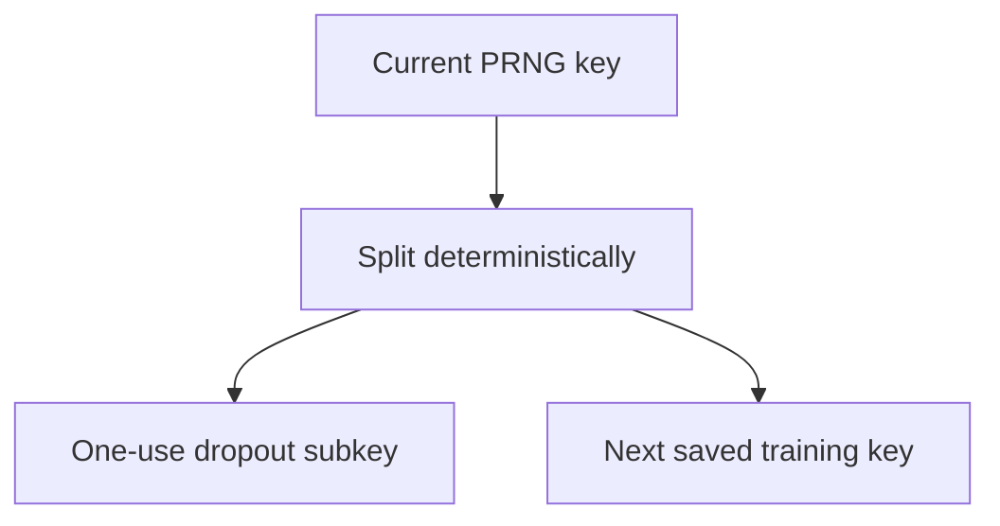

A **pseudorandom number generator (PRNG) key** is explicit random state passed into computations that need reproducible randomness. In JAX, sampling doesn't implicitly advance a hidden global random generator. A program splits a key into independent subkeys and threads the next key into later steps.

## Splitting is a state transition

Given a current key, `next_key, dropout_key = jax.random.split(key)` creates two deterministic descendants. Use `dropout_key` once for the current random operation and store `next_key` in the returned training state. Repeating the same original key produces the same random values, even across apparently separate function calls.

Checkpointing must preserve the key together with parameters, optimizer state, and data position. Restoring only a seed can change the random sequence if the resumed code splits keys a different number of times or in a different order.

## Example

A three-step training run uses one dropout subkey per step. At step two, the checkpoint stores the remaining parent key. Resuming from that saved key reproduces step-three dropout. Resuming from the original seed instead repeats step-one randomness unless the program replays every intervening split exactly.

Accidentally applying the same subkey to two layers correlates their dropout masks. The loss may still decrease, so inspect actual key flow rather than assuming a finite loss proves random operations are independent.

## Why it matters here

PRNG keys connect JAX's pure-function style to reproducible training, data augmentation, dropout, and checkpoint recovery. Incorrect key reuse can invalidate a research comparison without producing an obvious runtime error.

## Related terms

- [Dropout](glossary://dropout)
- [Model checkpoint](glossary://model-checkpoint)
- [Optimizer state](glossary://optimizer-state)
- [Reproducible environment](glossary://reproducible-environment)
