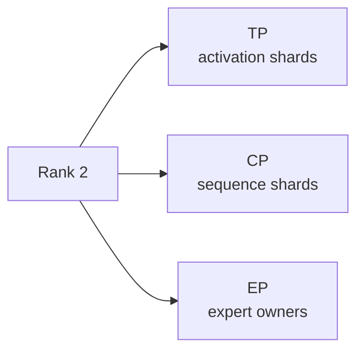

A **process group** is a communication context for a subset of distributed ranks. Group membership defines who participates in an all-reduce, all-gather, reduce-scatter, broadcast, or all-to-all operation; the backend implements those operations for that group.

One rank can belong to several groups at once. Tensor-parallel group may exchange activation shards, context-parallel group may exchange sequence information, and expert-parallel group may dispatch tokens to expert owners. Same physical processes are regrouped for different mathematical operations.

## Overlapping views

Group creation gives ranks a communication view over existing processes. Rank 2 might use a TP group during attention projection, a CP group while exchanging sequence context, then an EP group while dispatching tokens. Collective order and tensor contracts must match across participants. PyTorch's ordinary new_group creation also requires all world-group ranks, including nonmembers, to create groups in the same order. Multiple NCCL groups need one globally consistent collective order across ranks and groups. Violating these contracts can hang healthy GPUs.

## Example

With eight ranks, two tensor-parallel groups could be `[0,1,2,3]` and `[4,5,6,7]`. A collective submitted by rank 2 to the first group communicates only with ranks 0, 1, and 3; ranks 4 through 7 do not participate.

## Why it matters here

Parallelism numbers describe group sizes, not automatically extra GPUs. Multiplying every configured size together without checking group construction can produce impossible world-size arithmetic.

## Related terms

- [Distributed rank](glossary://distributed-rank)
- [All-reduce](glossary://all-reduce)
- [Tensor parallelism](glossary://tensor-parallelism)
- [Context parallelism](glossary://context-parallelism)
- [Expert parallelism](glossary://expert-parallelism)
