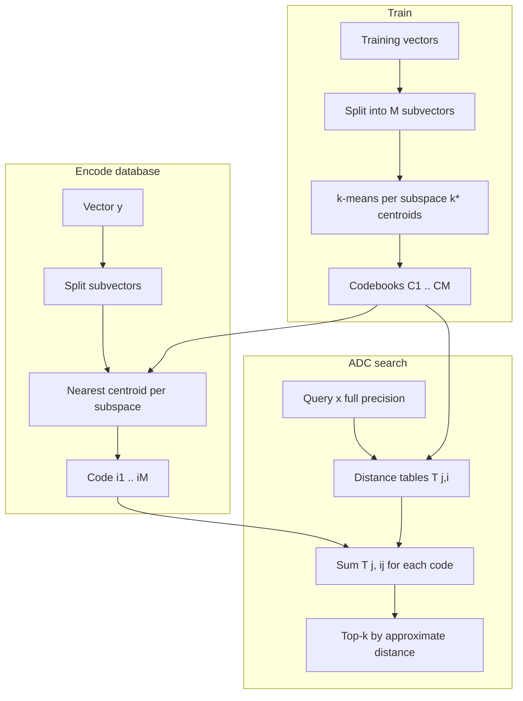

**Product quantization (PQ)** compresses high-dimensional vectors by splitting each vector into $M$ contiguous subvectors and independently quantizing every subvector with its own small codebook. The stored representation is a short *code*: $M$ centroid ids (typically one byte each when each subcodebook has $256$ entries). Approximate distances can then be scored from those codes with table lookups, without keeping full float32 vectors in the hot path.

PQ for nearest neighbor search was introduced by Jégou, Douze, and Schmid (*Product quantization for nearest neighbor search*, IEEE TPAMI 2011). FAISS implements it as `ProductQuantizer` / `IndexPQ` and, with an inverted file, as residual **IVFADC** (`IndexIVFPQ`). Vector databases and libraries reimplement the same pattern under different names. This entry covers PQ as a codec for embedding indexes; product quantization can also be applied to other vectors, including model weights.

## Intuition

A single full-precision vector quantizer with a huge codebook cannot store $2^{64}$ centroids. PQ builds an enormous *effective* codebook as a **Cartesian product** of $M$ tiny codebooks:

$$
C = C_1 \times C_2 \times \cdots \times C_M, \qquad |C| = (k^\star)^M
$$

With $M = 8$ and $k^\star = 256$, you get $(256)^8 = 2^{64}$ possible reconstructions while storing only $M \cdot k^\star \cdot (d/M)$ floats for the codebooks and $M$ bytes per database vector (when $k^\star = 256$).

Memory example for a RAG corpus:

| Setup | Per-vector bytes | $N = 50\mathrm{M}$, $d = 768$ |
| --- | --- | --- |
| float32 flat | $768 \times 4 = 3072$ | $\approx 154$ GB |
| PQ $M=96$, $8$ bits | $96$ | $\approx 4.8$ GB codes |
| PQ $M=64$, $8$ bits | $64$ | $\approx 3.2$ GB codes |

Index storage also includes ids, IVF lists, and codebooks. Even with that overhead, this reduction can bring a multi-ten-million-vector corpus within a particular RAM budget. PQ is one option alongside scalar compression, disk-backed indexes, or additional machines.

The cost is reconstruction error: neighbors ranked by approximate distance can disagree with exact $L_2$ or inner product. Production systems usually treat PQ as a *candidate generator*, then optionally rerank top hits with full-precision vectors or a cross-encoder.

## How it works

### Split and train

Given $x \in \mathbb{R}^d$ with $d$ divisible by $M$, split into subvectors of dimension $d_\mathrm{sub} = d/M$:

$$
x = \big[u_1(x),\; u_2(x),\; \ldots,\; u_M(x)\big], \qquad u_j(x) \in \mathbb{R}^{d_\mathrm{sub}}
$$

For each subspace $j$, run k-means on training subvectors to learn a codebook $C_j = \{c_{j,0},\ldots,c_{j,k^\star-1}\}$. FAISS uses $k^\star = 2^{\texttt{nbits}}$; the common 8-bit choice gives 256 centroids, while 4-bit PQ is also used by fast-scan implementations.

Lloyd assignment per subspace:

$$
i_j(x) = \arg\min_{i=0..k^\star-1} \big\| u_j(x) - c_{j,i} \big\|_2,\qquad q_j(u_j(x))=c_{j,i_j(x)}
$$

The product quantizer reconstructs by concatenating chosen centroids:

$$
q(x) = \big[q_1(u_1(x)),\; \ldots,\; q_M(u_M(x))\big]
$$

Stored code: the $M$ indices $(i_1,\ldots,i_M)$. Decoding maps those indices back to $q(x)$.

### Asymmetric vs symmetric distance (ADC / SDC)

For query $x$ and database vector $y$:

| Method | Query | Database | Approximate distance |
| --- | --- | --- | --- |
| **SDC** (symmetric) | $q(x)$ | $q(y)$ | $d\big(q(x), q(y)\big)$ |
| **ADC** (asymmetric) | full $x$ | $q(y)$ | $d\big(x, q(y)\big)$ |

ADC is the default for search quality: keep the query unquantized, quantize only the corpus. Squared Euclidean distance factors over subspaces:

$$
\widetilde{d}(x, y)^2 = \|x - q(y)\|_2^2 = \sum_{j=1}^{M} \big\| u_j(x) - q_j\big(u_j(y)\big) \big\|_2^2
$$

**Query setup (ADC):** for each subspace $j$ and each of the $k^\star$ centroids, precompute

$$
T[j, i] = \big\| u_j(x) - c_{j,i} \big\|_2^2
$$

**Per database code:** if $y$ stored codes $(i_1,\ldots,i_M)$, approximate distance is $M$ table lookups and adds:

$$
\widetilde{d}(x, y)^2 = \sum_{j=1}^{M} T[j, i_j]
$$

No square roots are needed for ranking (monotone). SDC instead precomputes centroid-to-centroid tables; it is useful when queries are also stored as codes, but ADC usually has lower distance distortion for similar work.

Inner-product search uses an analogous table of partial inner products (FAISS `compute_inner_prod_table`). Quantization training still minimizes $L_2$ reconstruction error, so the codec is slightly biased toward Euclidean geometry even when you search with IP.

### IVFADC: residual PQ inside inverted lists

Exhaustive scan of all PQ codes is still $O(N)$ in the number of vectors. The classic non-exhaustive design (**IVFADC**) is:

1. Coarse quantizer $q_c$ (k-means / IVF) assigns $y$ to a cell.
2. Encode the **residual** $r(y) = y - q_c(y)$ with PQ, not the raw vector.
3. At query time, probe $w$ (FAISS `nprobe`) nearest coarse cells and run ADC only on those lists.

Residual encoding often reduces reconstruction error at the same code length, but the improvement depends on the data and trained codebooks. For squared-L2 ADC in a probed cell with coarse centroid c, compare the query residual x - c with the reconstructed database residual; comparing x directly with that residual would omit the coarse centroid. FAISS `IndexIVFPQ` implements residual encoding by default (`by_residual` on).

## Formula

Effective codebook size (identical $k^\star$ per subspace):

$$
k = (k^\star)^M
$$

Code length in bits:

$$
\ell = M \cdot \lceil \log_2 k^\star \rceil
$$

Codebook storage (floats), product k-means:

$$
\texttt{codebook floats} = M \cdot k^\star \cdot d_\mathrm{sub} = k^\star \cdot d
$$

Expected squared-L2 reconstruction error decomposes across disjoint coordinate subspaces (here MSE means the expected sum of squared coordinate errors, not a per-coordinate average):

$$
\mathrm{MSE}(q) = \sum_{j=1}^{M} \mathrm{MSE}(q_j)
$$

ADC ranking objective (query $x$, database vectors $y_i$; $q_{\mathrm{PQ}}$ is the product quantizer, not the query):

$$
j^\star \approx \arg\min_i \big\| x - q_{\mathrm{PQ}}(y_i) \big\|_2
$$

(or $\arg\max$ of approximate IP when the metric is inner product).

Index fidelity against exact geometric top-$k$ set $E_k$ for approximate set $A_k$:

$$
\mathrm{ANN\text{-}recall@}k = \frac{|A_k \cap E_k|}{k}
$$

Task recall against human-relevant documents is separate; both can fail independently.

## Worked numbers

Take a tiny $d=4$ vector, $M=2$ so $d_\mathrm{sub}=2$, and toy codebooks of size $k^\star=2$:

$$
x = [0.9,\; 0.1,\; -0.4,\; 0.7]
$$

Subvectors: $u_1 = [0.9,\; 0.1]$, $u_2 = [-0.4,\; 0.7]$.

Suppose subspace 1 learned centroids $\{[1.0, 0.0],\; [0.0, 1.0]\}$ and subspace 2 learned $\{[-0.5, 0.5],\; [0.5, -0.5]\}$.

Nearest: $u_1 \to [1.0, 0.0]$ (id $0$), $u_2 \to [-0.5, 0.5]$ (id $0$). Stored code: $(0, 0)$ (two indices). Reconstruction:

$$
q(x) = [1.0,\; 0.0,\; -0.5,\; 0.5]
$$

Squared reconstruction error: $\|x - q(x)\|_2^2 = 0.1^2 + 0.1^2 + 0.1^2 + 0.2^2 = 0.07$.

For a query $x_q = [1.0, 0.0, -0.3, 0.6]$, ADC table for subspace 1:

$$
T[1,0] = \|[1,0]-[1,0]\|^2 = 0, \quad T[1,1] = \|[1,0]-[0,1]\|^2 = 2
$$

Subspace 2:

$$
T[2,0] = \|[-0.3,0.6]-[-0.5,0.5]\|^2 = 0.05, \quad T[2,1] = \ldots
$$

Database code $(0,0)$ scores $T[1,0]+T[2,0] = 0.05$ with two lookups. That approximate squared distance, rather than the exact squared distance $\|x_q - x\|_2^2=0.04$, is what ranks candidates in this squared-L2 PQ example.

## Diagram



## Example

Support-ticket RAG: $N = 50{,}000{,}000$ chunks, $d = 768$ float32 bi-encoder embeddings (L2-normalized, searched with inner product).

**Flat baseline storage.** $50\mathrm{e}6 \times 768 \times 4 \approx 154$ GB of vectors alone. Use exact search offline as the reference for ANN-recall@k; its cost often makes it unsuitable as the online default.

**PQ codes.** Choose $M = 96$ ($d_\mathrm{sub} = 8$), $\texttt{nbits} = 8$ ($k^\star = 256$). Each vector becomes $96$ bytes:

$$
\frac{96}{3072} \approx 0.031 \quad (\sim 32\times \text{ smaller than float32})
$$

Codes $\approx 4.8$ GB plus codebooks: $M \cdot 256 \cdot 8$ floats $\approx 0.8$ MB (tiny).

**Operational FAISS sketch (flat PQ, exhaustive over codes):**

```python
import faiss
import numpy as np

d, M, nbits = 768, 96, 8
assert d % M == 0

index = faiss.IndexPQ(d, M, nbits, faiss.METRIC_INNER_PRODUCT)
index.train(xb_train)   # representative sample of production embeddings
index.add(xb)           # stores PQ codes, not full floats in the PQ path

D, I = index.search(xq, k=100)
# optional: rerank I with full-precision xb rows or a cross-encoder
```

**Production shape (IVF + residual PQ):**

```python
nlist, nprobe = 16_384, 32
quantizer = faiss.IndexFlatIP(d)
index = faiss.IndexIVFPQ(
    quantizer, d, nlist, M, nbits, faiss.METRIC_INNER_PRODUCT
)
index.train(xb_train)
index.add(xb)
index.nprobe = nprobe
D, I = index.search(xq, k=100)
```

Factory string form: `"IVF16384,PQ96"` (defaults to 8 bits per subquantizer). Measure ANN-recall@10 / @100 against `IndexFlatIP` on a held-out query set *before* locking $M$ and `nprobe` for latency SLOs.

## Sizing and trade-offs

| Knob | Effect of increasing | Cost / risk |
| --- | --- | --- |
| $M$ (subquantizers) | Longer codes, lower MSE, higher recall | More bytes per vector; more adds per distance |
| $k^\star$ / `nbits` | Finer centroids per subspace | Train time; codebook RAM; slow assignment if large |
| $d_\mathrm{sub} = d/M$ | Larger chunks capture joint structure | Fewer subspaces if $M$ drops; $M$ must divide $d$ |
| IVF `nlist` / `nprobe` | Coarse filter (with IVFPQ) | Probe too low $\to$ miss whole lists; probe high $\to$ latency |
| Residual vs raw PQ | Residuals usually lower error inside IVF cells | Must train PQ on residuals matching coarse assignment |

Practical defaults many systems start from: $\texttt{nbits}=8$, choose $M$ so code size hits a memory budget (e.g. $32$–$96$ bytes for $d=768$), then raise $M$ or add rerank if ANN-recall@k is short of target. The original paper notes that for a *fixed bit budget*, fewer subspaces with larger $k^\star$ often beat many tiny subspaces; in libraries, $k^\star=256$ is fixed for speed and you mostly dial $M$.

**What fails in production**

- **$M$ too small for the embedding.** Codes collapse neighborhoods; gold chunk ranks poorly under ADC even when it is in the candidate set. Raise $M$, train better codebooks, or keep full-precision vectors for a refine stage.
- **Trained on the wrong distribution.** Codebooks fit old model outputs, one tenant, or English-only text. After an embedding model swap or rechunk, retrain PQ (and IVF) on the new distribution before encoding vectors with updated centroids.
- **IVF probe vs PQ confusion.** Low `nprobe` drops neighbors before PQ distance is ever computed. Diagnose with IVF-Flat first; if Flat is fine and PQ is not, the codec is the problem.
- **Metric mismatch.** Embeddings trained for cosine / normalized IP, index built or trained under a different contract. Quantization error compounds a broken geometry.
- **Silent quality regression.** p95 latency improves after enabling PQ while task recall@k falls on short queries, rare entities, or multilingual slices. Slice evals and keep a flat baseline on a sample.
- **No refine path.** Treating approximate PQ ranks as final rankings for high-stakes retrieval. Common pattern: PQ/IVFPQ retrieves $100$–$1000$ ids, then exact distance or a cross-encoder reranks to the prompt budget.

Compared with [HNSW](glossary://hnsw): HNSW keeps (or graph-links) higher-precision vectors and spends RAM on edges; PQ spends bits on lossy codes so larger $N$ fits. They combine in some stacks (graph or IVF for candidates, PQ for payload compression). Compared with scalar quantization: SQ quantizes per dimension with shared scales; PQ quantizes *blocks* with learned vector centroids and usually wins the memory-vs-recall curve for high-$d$ embeddings.

## Why it matters here

Dense retrieval and RAG can hit memory limits as their corpora grow. Product quantization reduces vector storage, while the index structure, hardware, and search settings determine latency. When retrieved evidence is missing, check whether the gold vector was ever a top candidate under approximate distance. Understanding $M$, codebooks, ADC tables, residual IVFADC, and ANN-recall@k turns product knobs into measurable index engineering instead of folklore.

## Related terms

- [Quantization](glossary://quantization)
- [FAISS](glossary://faiss)
- [IVF](glossary://ivf)
- [ANN search](glossary://ann-search)
- [Recall@k](glossary://recall-at-k)
