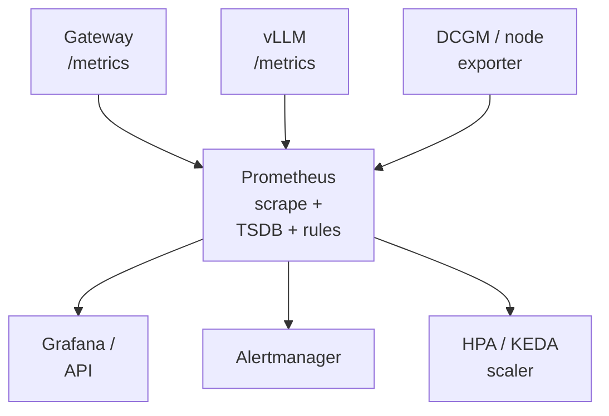

**Prometheus** is an open-source systems monitoring and alerting toolkit (CNCF project) that **scrapes** numeric metrics over HTTP, stores them as labeled time series, evaluates rules and alerts, and answers fleet questions with **PromQL**. A series is identified by a metric name plus key/value **labels** (for example `vllm:num_requests_waiting{model_name="..."}`). The default collection path is a **pull model**: the server periodically GETs each `/metrics` endpoint.

For AI/ML engineers, Prometheus is the usual backend for model-server health: queue depth, [KV-cache](glossary://kv-cache) pressure, [TTFT](glossary://ttft) / inter-token histograms, token counters, error rates, and the custom signals that drive [autoscaling](glossary://autoscaling). It is built for **numeric time series** and reliability under partial outage, not for per-request billing accuracy or full request reconstruction (use [tracing](glossary://tracing) and logs for that).

## Intuition

Think of Prometheus as a **periodic census of numbers**. Every scrape interval (often 15s–60s), it snapshots whatever each target exposes. Counters keep growing forever (until restart). Gauges bounce with current state. Histograms accumulate bucketed observations so you can estimate percentiles later; traces supply request-level timelines.

That design matches production LLM serving: you care whether waiting requests climbed after a deploy, whether p95 TTFT crossed an [SLO](glossary://slo), and whether GPU KV usage is pinned near 1.0. You rarely need every prompt text in the metrics store. Put high-cardinality detail (request id, user id, raw error strings) in traces or logs; keep metrics **low-cardinality and aggregatable**.

## How it works

### Architecture (pull scrape)

```text
App / exporter  <--HTTP GET /metrics--  Prometheus server (TSDB)
                                            |
                         recording rules / alert rules
                                            |
                         Grafana / API / Alertmanager
```

1. **Instrument** the process (client library) or run an **exporter** next to a binary without a Prometheus endpoint.
2. **Discover** targets (static list, Kubernetes SD, file SD, …).
3. **Scrape** text or OpenMetrics exposition at a fixed interval; each successful scrape stores samples with a timestamp.
4. **Query** with PromQL (instant or range). Dashboards and alerts are consumers of the same data.
5. Optional: **Pushgateway** for short-lived batch jobs; **remote write** to long-term storage; OpenTelemetry Collector can export metrics into Prometheus-compatible backends.

Official design notes: multi-dimensional data model, PromQL, autonomous single-server nodes (no required distributed storage), pull over HTTP, service discovery. Prometheus prefers **reliability for ops** over perfect accounting: it is a poor choice as the sole source of truth for metered billing.

### Data model

A sample is roughly:

$$
\{\,\text{metric},\; \ell_1{=}v_1,\; \ldots,\; \ell_k{=}v_k\,\} \;\mapsto\; (t,\; x)
$$

where $x$ is usually a float (or a composite **native histogram** sample). Two series with the same name but different label sets are different series. Cardinality is roughly:

$$
\text{series} \approx \prod_i |\text{values of label } i|
$$

Uncontrolled labels (user id, document id, full exception message) turn one logical metric into millions of series and break scrapes, queries, and cost.

### Metric types (instrumentation)

| Type | Behavior | Typical LLM use |
|------|----------|-----------------|
| **Counter** | Monotonic increase (or reset on restart); name often ends `_total` | `prompt_tokens_total`, `request_success_total`, HTTP 5xx counts |
| **Gauge** | Up or down freely | `num_requests_waiting`, `kv_cache_usage_perc`, concurrent sessions |
| **Histogram** | Observations into buckets + sum + count | TTFT, e2e latency, prompt/generation length distributions |
| **Summary** | Client-side φ-quantiles over a window + sum + count | Rare in new AI stacks; hard to aggregate across replicas |

**Counters:** never use for "currently running requests." Use `rate()` / `increase()` on counters; do not chart the raw cumulative total as a "QPS" line without a rate.

**Gauges:** current queue depth, fraction of KV blocks in use ($0$–$1$), loaded adapter count.

**Histograms:** for latencies and sizes where percentiles matter. Classic histograms expand into series:

- `<name>_bucket{le="…"}` (cumulative upper bounds)
- `<name>_sum`, `<name>_count`

Native histograms store the distribution as composite samples (preferred when libraries support them). Summaries expose precomputed per-process quantiles; use histograms to compute fleet-wide p95.

### PromQL patterns you will actually write

Request rate from a counter (per-second average over a window):

```promql
sum(rate(http_requests_total{job="gateway"}[5m]))
```

Error ratio:

```promql
sum(rate(http_requests_total{status=~"5.."}[5m]))
/
sum(rate(http_requests_total[5m]))
```

Approximate p95 from a classic latency histogram (must keep the `le` label through the sum):

```promql
histogram_quantile(
  0.95,
  sum by (le) (rate(http_request_duration_seconds_bucket[5m]))
)
```

Token throughput from cumulative token counters:

```promql
sum(rate(vllm:generation_tokens_total[1m]))
```

Prefix-cache hit rate from hit and query counters (never store only a pre-averaged hit-rate gauge if you care about arbitrary windows):

```promql
sum(rate(vllm:prefix_cache_hits_total[5m]))
/
sum(rate(vllm:prefix_cache_queries_total[5m]))
```

## Example

A [vLLM](glossary://vllm) OpenAI-compatible server exposes Prometheus metrics at `/metrics` with the `vllm:` prefix. Example names below are realistic but **version-sensitive**: always verify the live `/metrics` exposition for your server build. After traffic, a scrape shows engine state and request distributions, for example:

```text
# TYPE vllm:num_requests_running gauge
vllm:num_requests_running{model_name="meta-llama/Llama-3.1-8B-Instruct"} 8.0

# TYPE vllm:num_requests_waiting gauge
vllm:num_requests_waiting{model_name="meta-llama/Llama-3.1-8B-Instruct"} 12.0

# TYPE vllm:kv_cache_usage_perc gauge
vllm:kv_cache_usage_perc{model_name="meta-llama/Llama-3.1-8B-Instruct"} 0.91

# TYPE vllm:generation_tokens_total counter
vllm:generation_tokens_total{model_name="meta-llama/Llama-3.1-8B-Instruct"} 27453.0

# TYPE vllm:time_to_first_token_seconds histogram
vllm:time_to_first_token_seconds_bucket{le="0.1",model_name="..."} 140.0
vllm:time_to_first_token_seconds_bucket{le="+Inf",model_name="..."} 140.0
vllm:time_to_first_token_seconds_sum{model_name="..."} 5.6
vllm:time_to_first_token_seconds_count{model_name="..."} 140.0
```

Concrete questions PromQL answers on this surface:

| Question | Signal |
|----------|--------|
| Are we queueing? | `vllm:num_requests_waiting` sustained $> 0$ |
| Is KV the bottleneck? | `vllm:kv_cache_usage_perc` near $1.0$ while waiting climbs |
| Did TTFT get worse? | `histogram_quantile(0.95, sum by (le) (rate(vllm:time_to_first_token_seconds_bucket[5m])))` |
| Tokens out / s | `rate(vllm:generation_tokens_total[1m])` |
| Finish mix | `rate(vllm:request_success_total[5m])` by `finished_reason` (`stop`, `length`, `abort`) |

Wire the same gauges into HPA custom metrics or a [KEDA](glossary://keda) Prometheus trigger when CPU utilization is a useless scale signal for GPU inference.

## Diagram



## Label discipline

| Prefer (bounded) | Avoid on metrics (unbounded) |
|------------------|------------------------------|
| `model_name`, route, provider, status class | user id, tenant id as free text |
| `finished_reason`, cache hit/miss class | full prompt hash per request |
| region, version, pod (if intentional) | request id, document id, raw exception |

Every extra label multiplies series. A metric with 5 models × 20 routes × 50 pods is already thousands of series before you add error strings. Put identifiers needed for one-request forensics on spans; keep counters bounded-cardinality.

## What fails in production

| Failure | What you see | Fix direction |
|---------|--------------|---------------|
| **Cardinality explosion** | Scrape timeouts, OOM, "too many series," slow queries | Drop high-cardinality labels; relabel at scrape; sample in traces instead |
| **Wrong type** | "Rate" of a gauge, or raw counter plotted as QPS | Counters → `rate`/`increase`; gauges as-is; histograms for percentiles |
| **Averaged percentiles** | `avg(…{quantile="0.95"})` across pods | Aggregate histogram buckets, then `histogram_quantile` |
| **Coarse buckets** | p95 jumps or sits on bucket edges; SLO looks green/red wrongly | Buckets (or native histogram resolution) around the SLO threshold |
| **Counter resets / restarts** | Spikes or dips in rates after deploys | `rate` handles resets; align alerts with rollout windows |
| **Scrape gaps / staleness** | Flat lines, missing series after target death | Check target health, scrape interval, network policy, path `/metrics` |
| **Metrics-only debugging** | Dashboard red, still no root cause | Join with traces and structured logs; metrics show *that*, not always *why* |
| **Billing from Prometheus** | Under/over count vs true usage | Use authoritative metering path; metrics for ops, not invoices |

Debug path when a serving dashboard "looks wrong":

1. Compare the pod's raw `/metrics` output with Grafana.
2. Confirm metric names, types, and labels match the query.
3. Check scrape success and interval on the Prometheus target page.
4. For AI servers, plot **together**: waiting requests, running requests, KV usage, TTFT histogram, generation token rate, error/finish reasons.
5. For a broken single-request path, inspect [OpenTelemetry](glossary://opentelemetry) traces to reconstruct each tool-calling agent hop.

## Trade-offs

- **Pull vs push:** Pull makes "is this target up?" a first-class check and keeps apps simple. Some short-lived service-level batch jobs suit Pushgateway; it isn't a universal solution for every short job, and pushed series need explicit lifecycle cleanup.
- **Local TSDB vs remote write:** Local is simple and reliable for the scrape node; long retention and multi-cluster views usually need remote storage.
- **Histogram vs summary:** Histograms aggregate and let you change φ and windows in PromQL. Summary quantile estimation adds client-side computation and fixed error/window choices; its quantiles can't be merged into a fleet percentile. Measure cost for the actual library and configuration.
- **Resolution vs cost:** Tighter scrape intervals and more histogram buckets improve incident forensics and burn the series budget.

## Why it matters here

LLM products fail in production as **capacity and latency systems** as often as they fail as models. Prometheus is how teams instrument waiting queues, KV pressure, token throughput, and percentile SLOs with the same language used for the rest of the cloud stack. Good instrumentation (right types, bounded labels, histograms at the SLO boundary) turns "the model feels slow" into a measurable change you can alert on, scale on, and bisect after a deploy. Bad instrumentation (user-id labels, mean latency only, no queue gauges) leaves GPU clusters flying blind.

## Related terms

- [OpenTelemetry](glossary://opentelemetry)
- [Observability](glossary://observability)
- [SLO](glossary://slo)
- [p95 latency](glossary://p95-latency)
- [TTFT](glossary://ttft)
