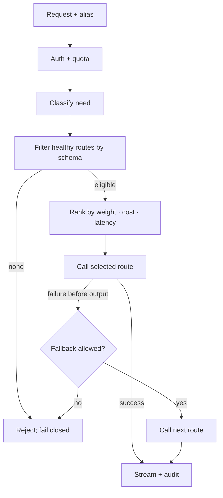

A **provider route** is a named, configured path from your application to one concrete generation (or embedding) endpoint: which vendor, which model or deployment, which region and credentials, which capability schema, and which limits apply. Clients usually call a stable product alias such as `support-fast` or `code-reason`. The route is the binding that turns that alias into a real upstream call.

A [routing policy](glossary://routing-policy) decides which route to use for a tenant, task class, and health signal. A provider route is the *selected target*: the endpoint plus the product rules that travel with it. Production systems (API gateways, LiteLLM-style proxies, multi-provider marketplaces) keep many routes and switch among them per request.

## Intuition

Hardcoding `openai.chat.completions.create(model="gpt-4o")` in every service makes model choice invisible. A provider route makes that choice a first-class object you can version, log, A/B, kill, and failover.

An alias is a stable lookup key; a route is the full configuration record resolved from that key. Two routes can share a model family and still differ on region, data retention, tool support, or spend ceiling. Two requests with the same prompt can land on different routes when plan, latency budget, or provider health differ.

| Concept | Question it answers |
|---|---|
| **Model name** | Which weights (or API model id) should generate tokens? |
| **Provider route** | Where and under what schema do we call those weights? |
| **Routing policy** | Why did this request get this route? |
| **Fallback lane** | If this route cannot finish, which other legal route may try? |

## What a route binds

A useful route record is more than `provider + model`. In practice it packages:

| Field | Why it matters |
|---|---|
| **Identity** | Stable route id / product alias (`support-fast`, `eu-private-reason`) |
| **Upstream** | Provider, model id, deployment, base URL, region |
| **Auth** | API key, workload identity, or customer BYOK binding |
| **Capabilities** | Context window, tools, JSON/schema mode, streaming, vision |
| **Policy** | Data residency, zero-retention, PII class allowed, tool allowlist |
| **Economics** | Input/output $/token (or fixed infra cost), [quota](glossary://quota) buckets |
| **Reliability** | Timeouts, retry class, [circuit breaker](glossary://circuit-breaker) scope, ordered fallbacks |
| **Health** | Cool-down state, recent error rate, measured latency/throughput |

If the endpoint or contractual bindings differ, treat them as different routes even when the marketing model name is the same. Health changes the state of an existing route while its identity stays fixed. A deployment with an explicitly verified retention schema has different data-handling behavior from an endpoint that permits prompt storage or training; verify The schema for the actual endpoint because provider names alone do not establish it.

## How it works

At request time the path is roughly:

1. **allow** at the [API gateway](glossary://api-gateway): auth, body size, rate/spend limits.
2. **Classify** the request: task type, tenant/plan, data sensitivity, context length, tool needs, latency budget.
3. **Filter** candidate routes that honor the full schema (region, schema, tools, privacy).
4. **Score or rank** remaining routes (static order, weights, cost, latency, load).
5. **Call** the selected upstream; stream tokens through without buffering the full answer.
6. **On failure before user-visible output**, optionally move to a [fallback lane](glossary://fallback-lane) that still passes the same schema filter.
7. **Log** route id, policy version, inputs to the decision, upstream model id, cost, latency, and failure reason.

Gateways and proxies implement the mechanical parts. LiteLLM's router, for example, maps a shared `model_name` alias onto multiple deployments and supports strategies such as weighted shuffle, least-busy, latency-based, usage-aware, and lowest-cost selection, plus cooldowns and ordered fallbacks. OpenRouter-style marketplaces expose a `provider` preference object (order, only/ignore, sort by price/latency/throughput, data-collection and ZDR constraints) so each request can constrain *which* endpoints may serve a model. Your product still owns The schema: which aliases exist, which tenants may use them, and which fallbacks are legal.

### Selection sketch

After filtering healthy, schema-compatible routes $R = \{r_1,\ldots,r_n\}$, common ranking rules include:

**Static priority** (ordered preference): try $r$ with minimum `order`, then the next.

**Weighted pick**: if route $i$ has weight $w_i > 0$,

$$
P(\text{pick } i) = \frac{w_i}{\sum_j w_j}.
$$

**Price-biased load balance** (marketplace pattern): among stable providers with unit prices $p_i$, weight by inverse square of price so cheaper endpoints get more traffic while still sharing load:

$$
P(\text{pick } i) \propto \frac{1}{p_i^{2}}.
$$

Example: prices \$1, \$2, \$3 per million tokens give relative weights $1$, $1/4$, $1/9$. The cheapest endpoint is $9\times$ more likely than the dearest among the three, not $3\times$.

**Expected call cost** for a planned completion (before generation finishes):

$$
\hat{C} = c_{\mathrm{in}} \cdot T_{\mathrm{in}} + c_{\mathrm{out}} \cdot \hat{T}_{\mathrm{out}},
$$

where $c_{\mathrm{in}}, c_{\mathrm{out}}$ are dollars per token on that route, $T_{\mathrm{in}}$ is known prompt size, and $\hat{T}_{\mathrm{out}}$ is a reserved or expected output length. Reconcile with actual usage for [metered billing](glossary://metered-billing) after the stream ends.

```python title="select-provider-route.py"
from dataclasses import dataclass

@dataclass(frozen=True)
class Route:
    id: str
    private_ok: bool
    tools_ok: bool
    max_ctx: int
    cost_per_1k_out: float
    healthy: bool
    weight: float = 1.0

@dataclass(frozen=True)
class Need:
    private: bool
    tools: bool
    tokens: int  # Prompt plus reserved output, for this sketch's combined limit.

def candidates(routes: list[Route], need: Need) -> list[Route]:
    out = []
    for r in routes:
        if not r.healthy:
            continue
        if need.private and not r.private_ok:
            continue
        if need.tools and not r.tools_ok:
            continue
        if need.tokens > r.max_ctx:
            continue
        out.append(r)
    return out

def pick_cheapest(routes: list[Route], need: Need) -> Route | None:
    ok = candidates(routes, need)
    if not ok:
        return None
    return min(ok, key=lambda r: (r.cost_per_1k_out, r.id))
```

This toy ranking compares output prices only. A production cost ranking should estimate the full call cost above and check separate input/output limits where the endpoint exposes them.

## Diagram



## Example

A coding assistant exposes three product aliases. Behind them sit named provider routes:

| Alias | Route id | Upstream | schema notes |
|---|---|---|---|
| `complete-local` | `route.local.qwen-coder` | Self-hosted vLLM, region `us-central` | Sub-200 ms target, no egress of repo text |
| `edit-standard` | `route.api.mid-tools` | Provider A, 128k context, tools on | Default for multi-file edits |
| `debug-hard` | `route.api.frontier-long` | Provider B, 200k context, tools on | Slow path for long traces |

Request: tenant `acme`, plan `pro`, task `inline_complete`, prompt $800$ tokens, no tools, latency budget $150$ ms, code may not leave the VPC.

1. Policy classifies need: private, no tools, short context, tight latency.
2. Filter drops `route.api.*` because private code cannot leave the VPC.
3. Only `route.local.qwen-coder` remains; it is healthy and under its TPM [quota](glossary://quota).
4. Call succeeds; audit log stores `route_id=route.local.qwen-coder`, `policy_version=2026-03-12`, `reason=private_inline`.

Later the same user asks for a multi-file refactor of a public repository that the tenant permits sending to approved external endpoints. Policy selects `route.api.mid-tools`. Provider A returns `429` before any tokens stream. a schema-compatible [fallback lane](glossary://fallback-lane) `route.api.mid-tools-b` (same privacy and tool surface, another permitted region) is tried once within the shared deadline. For the original VPC-only code, both external routes remain ineligible even if the local route is unavailable. Tools, edit quality, privacy, and residency are all part of the product schema.

## Trade-offs

| Choice | Gain | Cost |
|---|---|---|
| One route for everything | Simple ops | Overpays, over-latencies, single outage domain |
| Many fine-grained routes | Fit cost/latency/policy per task | Config surface, eval matrix, harder mental model |
| Aggressive cheapest-first ranking | Lower unit cost | Quality cliffs, more fallbacks, tail latency |
| Failover to any healthy model | Higher availability | Silent schema breaks (schema, tools, privacy) |
| Strict ZDR / region-only routes | Compliance | Smaller capacity pool, higher price, fewer fallbacks |

Route catalogs should grow only when a new binding changes a real constraint (privacy, tools, region, cost tier, model quality class). Renaming the same deployment five ways without capability differences is noise.

## What fails in production

- **Wrong-route bugs look like model bugs.** A "stupid answer" is often the cheap route, a truncated context route, or a fallback without tools. Log the route before you retrain anything.
- **Alias ≠ behavior.** OpenAI-compatible JSON does not mean identical tool calling, strict JSON mode, or refusal policy. Capability claims on the route must be tested, not assumed.
- **Thundering-herd failover.** Opening the circuit on route A and dumping $100\%$ of traffic onto B without B's own rate limits and breakers cascades the outage.
- **Mid-stream swap.** Once tokens have been shown, you generally cannot silently restart on another model. Fallback policy must distinguish transparent failures (timeout/rate limit before output) from partial streams.
- **Quota and reservation skew.** Two concurrent requests both reserve against the same route budget and overspend, or a failed primary still burned tokens that the fallback did not account for.
- **Stale health.** Routing on 30-minute-old latency while the provider is failing *now* keeps sending traffic into a dead endpoint. Pair measured scores with short cool-downs and breakers.
- **Data-policy drift.** A cost-optimized marketplace route may log prompts; a "same model" enterprise route may not. Treat data handling as part of the route identity.

When debugging, reconstruct: policy inputs → candidate set → selected `route_id` → upstream status → fallback reason → final cost and latency. Many incidents close at the route decision, not inside the weights.

## Why it matters here

Provider routes are where product policy becomes a concrete model call: cost, latency, safety, residency, tools, and outage behavior change without rewriting the user's prompt. Curriculum lessons on gateways, multi-tenant serving, eval gates, and incident review all assume you can name the route that ran, explain why it was chosen, and prove the fallback still honored the same schema. Without explicit routes, every service invents its own model string and you cannot audit or recover cleanly.

## Related terms

- [Routing policy](glossary://routing-policy)
- [Fallback lane](glossary://fallback-lane)
- [API gateway](glossary://api-gateway)
- [Quota](glossary://quota)
- [Circuit breaker](glossary://circuit-breaker)
