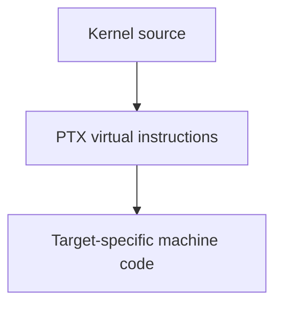

Parallel Thread Execution (PTX) is NVIDIA's virtual instruction-set representation for GPU programs. Compilers can translate higher-level kernel code into PTX, which a later compilation stage maps into machine instructions for a target GPU. PTX is lower level than CUDA C++ or Triton source and remains a virtual instruction stream.

## One source can pass through several representations

Kernel source expresses the computation. Compiler intermediate forms reorganize it. PTX expresses operations, registers, memory spaces, and parallel execution in a virtual instruction set. A later compilation stage chooses target-specific machine instructions and allocates physical resources. NVIDIA documents this model in the [PTX instruction-set reference](https://docs.nvidia.com/cuda/parallel-thread-execution/).

Inspecting PTX can reveal an unexpected conversion or memory operation. Assess achieved bandwidth, occupancy, and end-to-end speed with the final binary and runtime measurements on the intended device.

## Example

A kernel author expects a matrix operation to use Tensor Cores but sees a different execution path in the profiler. They inspect generated PTX and final machine code, then check dtype, alignment, and target architecture to identify which instructions executed.

## Why it matters here

PTX connects GPU-language lessons to compiler and runtime behavior. Pin compiler and target settings when comparing generated kernels. A newer PTX feature can require an appropriate toolchain or driver, and architecture-specific features can narrow portability. Keep a supported fallback; after compilation, validate numerical output and performance.

## Related terms

- [CUDA](glossary://cuda)
- [Triton](glossary://triton-language)
- [CUTLASS](glossary://cutlass)
- [Tensor Core](glossary://tensor-core)
- [Nsight Compute](glossary://nsight-compute)
