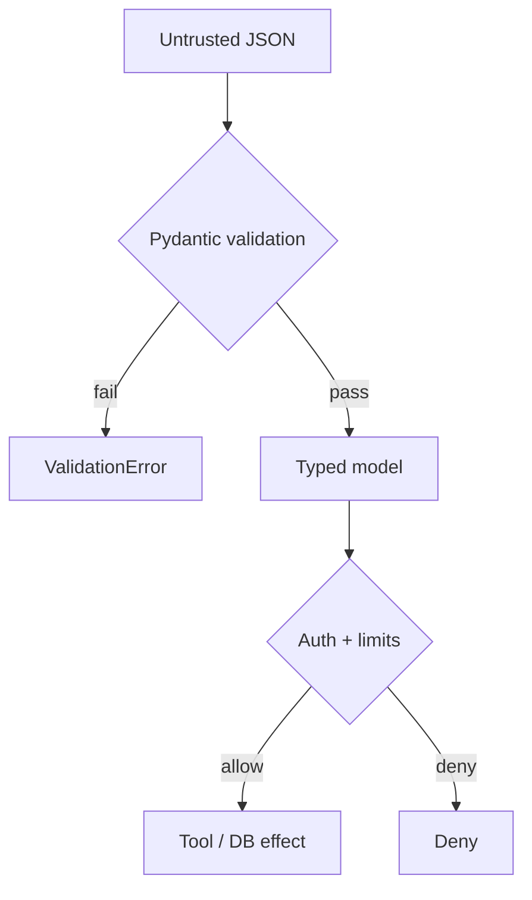

**Pydantic** is a Python library for runtime data validation and serialization driven by type annotations. You declare a class that subclasses `BaseModel` (or use a `TypeAdapter` for a single type), annotate fields with standard Python types and constraints, then pass untrusted input through `model_validate` / `model_validate_json`. If the data can be coerced into that shape, you get a typed instance; otherwise Pydantic raises a structured `ValidationError`. The core validation engine in Pydantic V2 is **pydantic-core**, written in Rust.

Pydantic validates declared fields and local validators against The schema you define. Application code still owns persistence, authentication, rate limits, safety, and other business rules. It answers: "Does this payload match The schema I declared?"

## Intuition

Python type hints are checked by tools like mypy at *edit time*. At *runtime*, a dict from an HTTP body, a queue message, or an LLM completion is just nested Python objects. Nothing stops `"price_cents": "twelve"` from reaching a tool executor.

Pydantic turns the annotation into an executable schema. The same class definition:

1. Rejects or coerces bad input before your handler runs.
2. Serializes clean objects with `model_dump()` / `model_dump_json()`.
3. Emits a [JSON Schema](glossary://json-schema) via `model_json_schema()` for OpenAPI, tool specs, and provider [structured output](glossary://structured-output).

That triple use (validate in, serialize out, document as schema) is why FastAPI, LangChain, Hugging Face libraries, and several LLM SDKs sit on Pydantic for request and model-output partitions.

## How it works

1. **Declare fields.** Subclass `BaseModel`. Fields without defaults are required. `T | None` permits an explicit null but does not make the field omittable in V2; use `T | None = None` for a nullable field that may be omitted. Use `Field(...)` for bounds (`ge`, `le`, `min_length`), descriptions, and aliases.
2. **Compile a core schema.** At class creation, Pydantic builds an internal schema consumed by pydantic-core (not something you write by hand for ordinary models).
3. **Validate input.** Common entry points:
   - constructor: `MyModel(**kwargs)`
   - `MyModel.model_validate(obj)` for dicts or (with `from_attributes=True`) ORM objects
   - `MyModel.model_validate_json(raw)` for JSON `str` / `bytes` in one step
4. **Coerce or reject.** In the default **lax** mode, supported conversions often occur (`"123"` → `int` 123, ISO strings → `datetime`). **Strict** mode rejects many coercions, but rules depend on the field type and input mode: JSON has no native date objects, so some date strings remain accepted even in strict JSON validation. Both modes enforce declared constraints such as ranges and enums.
5. **Fail with structured errors.** One `ValidationError` can list many field errors (`type`, `loc`, `msg`, `input`). Downstream code can log, return HTTP 422, or repair/retry model output.
6. **Serialize and export schema.** Valid instances dump to dicts/JSON. `model_json_schema()` produces a Draft 2020-12 / OpenAPI-aligned schema dict for docs and tool definitions.

Extra keys default to **ignore** (`ConfigDict(extra='ignore')`). Use `extra='forbid'` when unknown fields are a security or schema risk (agent tool args, money movements). Use `extra='allow'` only when you intentionally preserve unknown keys.

Custom logic goes in `@field_validator` / `@model_validator` (and related hooks). That is still structural or local semantic checking (format, cross-field consistency), not "may this engineer deploy this release."

## Example

An agent may emit a tool call for a release action. The LLM text is untrusted until it passes the model:

```python
from enum import Enum
from pydantic import BaseModel, ConfigDict, Field, ValidationError


class Action(str, Enum):
    run_eval = "run_eval"
    deploy_canary = "deploy_canary"
    escalate = "escalate"


class ReleaseAction(BaseModel):
    model_config = ConfigDict(extra="forbid")

    action: Action
    release_id: str = Field(pattern=r"^r[0-9]+$")
    canary_percent: float | None = Field(default=None, gt=0, le=10)
    reason: str = Field(min_length=1, max_length=500)


def parse_tool_args(raw_json: str) -> ReleaseAction:
    return ReleaseAction.model_validate_json(raw_json)


# Valid structured output from the model
ok = parse_tool_args(
    '{"action":"deploy_canary","release_id":"r17","canary_percent":5,"reason":"private suite passed"}'
)
assert ok.action is Action.deploy_canary

# Invalid: unknown action + extra key the tool must not accept
try:
    parse_tool_args(
        '{"action":"deploy_prod","release_id":"r17","canary_percent":50,"note":"skip gate","reason":"x"}'
    )
except ValidationError as e:
    # e.errors() is a list of dicts: type, loc, msg, input, ...
    print(e.error_count())  # 2+ (enum + extra forbidden)
```

Same model as a schema for providers that accept JSON Schema (or SDKs that convert Pydantic models for you):

```python
schema = ReleaseAction.model_json_schema()
# Use schema in a tool "parameters" object or response_format json_schema
```

| Input fragment | Outcome |
|---|---|
| missing `release_id` | `ValidationError`, type `missing` |
| `canary_percent: 50` | fails `le=10` |
| `action: "deploy_prod"` | fails enum |
| extra `"note"` with `extra="forbid"` | fails extra-forbid |
| valid JSON matching the model | typed `ReleaseAction` ready for policy + execution |

After validation, still run **authorization** (may this principal access the release?) and **release policy** (did the pinned eval suite pass?). Pydantic establishes shape and type validity; authorization and release policy remain separate checks.

## Diagram



## Trade-offs

| Choice | Benefit | Cost / risk |
|---|---|---|
| Lax coercion (default) | Tolerant of stringy JSON and form data | Silent type changes; `"1"` becomes `1` |
| Strict mode | Rejects many implicit coercions | More validation failures; JSON and Python input have different conversion rules |
| `extra='ignore'` | Forward-compatible with additive producers | Strips fields you may have wanted to store or audit |
| `extra='forbid'` | Tight [API schemas](glossary://api-contract) for tools | Breaks when producers add optional metadata |
| Deep nested models | Clear hierarchical specifications | Schema churn; more repair/retry load on LLM outputs |
| Heavy custom validators | Encode domain rules next to types | Harder to map to pure JSON Schema for constrained decoding |

Production failure modes that show up in LLM systems:

- **Hallucinated fields or enums** that pass free-form JSON mode but fail Pydantic; handle with structured output, retry, or a repair pass.
- **Schema drift** between the prompt, the tool registry, and the Python model (rename a field in one place only).
- **Over-tight constraints** that reject mostly-good model output (`max_length` too small, enums that lag product).
- **Under-tight constraints** that accept wrong types coerced from strings and then write bad rows.
- **Treating validation as truth**: a valid `release_id` can still name an unapproved artifact; keep a separate policy layer.

## Why it matters here

LLM systems move messy text into code paths that call tools, write databases, and charge money. Pydantic is the standard Python place to pin those handoffs to a named shape, export the same shape as JSON Schema, and fail with field-level errors instead of a vague "the model failed." In LeetLLM labs and production services, debugging a typed interface is faster than chasing silent `None`s and stringly-typed tool args.

## Related terms

- [JSON Schema](glossary://json-schema)
- [Structured output](glossary://structured-output)
- [API schemas](glossary://api-contract)
- [Tool calling](glossary://tool-calling)
- [FastAPI](glossary://fastapi)
