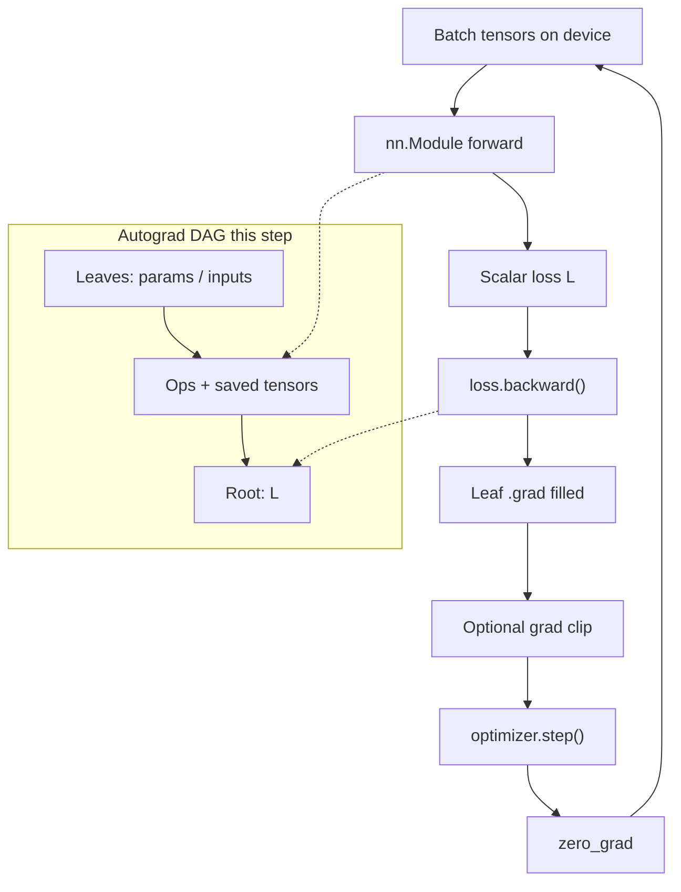

**PyTorch** is an open-source Python framework for multidimensional [tensor](glossary://tensor) computation, reverse-mode automatic differentiation, neural-network modules, optimizers, and accelerator execution (CPU, [CUDA](glossary://cuda) GPUs, and other backends). You write ordinary Python that calls tensor ops; those ops run as kernels on a device and, when gradients are needed, autograd records a dynamic graph so one `backward()` call fills parameter gradients. That combination is why PyTorch is the default coding surface for research, fine-tuning, and many production training stacks (and the implementation layer under libraries such as [Hugging Face Transformers](glossary://hugging-face-transformers)).

PyTorch combines primitives for building and training models: `torch.Tensor` for data and parameters, `torch.autograd` for reverse-mode AD, `torch.nn` for layered models and losses, `torch.optim` for parameter updates, plus data loaders, distributed training (DDP / [FSDP](glossary://fsdp)), and optional compilation (`torch.compile`).

## Intuition

Think in four layers that always show up in a training step:

1. **Tensors** hold numbers with `shape`, `dtype`, and `device`. Weights, activations, masks, and losses are all tensors.
2. **Modules** (`nn.Module`) group parameters and define `forward`. Calling the module runs the forward graph; parameters are leaf tensors with `requires_grad=True`.
3. **Autograd** builds a directed acyclic graph (DAG) *as you execute* ops. Leaves are inputs/parameters; the root is usually a scalar loss. `loss.backward()` walks the graph and accumulates $\partial L / \partial \theta$ into each leaf's `.grad`.
4. **Optimizers** read `.grad` and apply an update rule (SGD, [AdamW](glossary://adamw), …), then you clear grads before the next step.

The graph is **dynamic**: each forward builds the graph for the operations actually executed. By default, `backward()` frees saved intermediates needed for another backward through that graph; `retain_graph=True` changes that lifetime. Control flow (`if`, loops, variable sequence length) determines which differentiable operations enter the graph. This eager execution model is documented in the official autograd notes and the Paszke et al. (2017) autodiff paper.

## How it works

**Forward.** In normal grad mode, a differentiable op with an input that requires gradients records its backward operation, usually visible as the result's `grad_fn`. Nondifferentiable operations and disabled grad recording are exceptions. Intermediate activations needed for the local derivative are **saved for backward** (for example $x \mapsto x^2$ saves $x$).

**Backward.** Calling `backward()` on a scalar root starts reverse-mode AD: each `Function` applies a vector-Jacobian product (VJP) with the upstream gradient, accumulates into leaf `.grad` fields, and propagates toward the leaves. For a scalar loss $L$, this is exactly [backpropagation](glossary://backpropagation). Gradients **accumulate** by default, so you must zero them each step (`optimizer.zero_grad(set_to_none=True)` is the usual pattern).

**Non-scalar outputs.** If the root is not a scalar, you pass a vector $v$ the same shape as the root and obtain the vector-Jacobian product $v^\top J$ rather than materializing the full Jacobian. Training almost always reduces to a scalar first (`mean`/`sum` over the batch).

**Grad modes.** `torch.no_grad()` skips recording (optimizer updates, frozen-weight paths). `torch.inference_mode()` is stricter and slightly cheaper for pure eval. `model.eval()` / `model.train()` toggle module behavior (dropout, batch norm stats); use a grad mode to control autograd recording.

**Device and dtype.** Storage lives on a device (`cpu`, `cuda:0`, …). Most ops require operands on the same device and raise on a mismatch; careless `.cpu()` / `.to(...)` / host-device shuttling still burns bandwidth even when nothing crashes. [Mixed precision](glossary://mixed-precision) (`torch.autocast`, optional GradScaler for FP16) runs matmuls in BF16/FP16 while keeping sensitive reductions wider.

## Diagram



## Formula

Reverse-mode AD never builds the full Jacobian of the network. For an intermediate $h = f(x)$ and upstream $u^\top = \partial L / \partial h$, each op returns the VJP:

$$
\frac{\partial L}{\partial x} = u^\top \frac{\partial f}{\partial x}
$$

Stacked by the chain rule through every op from $L$ down to parameters $\theta$, this yields $\nabla_\theta L$ in time comparable to a constant factor times the forward pass (standard reverse-mode complexity for a scalar objective).

For the common linear map $h = x W^\top$ (batch $x$, weight $W$) with upstream $g = \partial L / \partial h$:

$$
\frac{\partial L}{\partial W} = g^\top x, \qquad \frac{\partial L}{\partial x} = g W
$$

(exact layouts match `nn.Linear`; the point is outer-product / matmul structure, not hand-written Jacobians). Softmax + cross-entropy fuse to $\partial L / \partial z = p - y$ on the logits for a single example (or `reduction='sum'` over the batch); that fused path is what `F.cross_entropy` implements under the hood. Default `reduction='mean'` averages over the batch, so the autograd gradient on the logits is $(p - y)/N$ (or the weighted equivalent), not batch-size-independent $p - y$.

A plain SGD step after autograd:

$$
\theta \leftarrow \theta - \eta\, \nabla_\theta L
$$

AdamW and other adaptive methods replace that rule but still consume the same `.grad` tensors.

## Example

Minimal training step covering the essentials: shapes, device, dtype, grad accumulation, and the zero-grad / backward / step order.

```python
import torch
import torch.nn as nn
import torch.nn.functional as F

device = torch.device("cuda" if torch.cuda.is_available() else "cpu")
model = nn.Sequential(
    nn.Linear(16, 32),
    nn.ReLU(),
    nn.Linear(32, 3),
).to(device)
opt = torch.optim.AdamW(model.parameters(), lr=1e-3)

x = torch.randn(8, 16, device=device)
y = torch.randint(0, 3, (8,), device=device)

model.train()
logits = model(x)                      # forward; builds autograd DAG
loss = F.cross_entropy(logits, y)      # scalar root
opt.zero_grad(set_to_none=True)        # clear stale .grad
loss.backward()                        # reverse-mode AD → param.grad
torch.nn.utils.clip_grad_norm_(model.parameters(), max_norm=1.0)
opt.step()                             # update leaves from .grad

# Sanity checks used in real debugging
assert logits.shape == (8, 3)
assert all(p.grad is not None for p in model.parameters() if p.requires_grad)
```

Same ideas at LLM scale: replace `nn.Sequential` with a causal LM, `x` with `input_ids` / labels, and often wrap with `torch.autocast(device_type="cuda", dtype=torch.bfloat16)` and DDP or FSDP for multi-GPU. With gradient accumulation, clear gradients once before the accumulation group, call backward for each suitably scaled micro-batch loss, then clip and step once for the group.

Eval / serve path (no graph, no dropout):

```python
model.eval()
with torch.inference_mode():
    logits = model(x)
```

## Debug path

PyTorch failures in production and in labs are usually ordinary state bugs:

| Symptom | Likely cause | Check |
| --- | --- | --- |
| Shape / broadcast error | Wrong axis order or batch packing | Print `tensor.shape` at every stage; name axes ($B$, $T$, $D$) |
| RuntimeError device mismatch | Batch on CPU, weights on CUDA (or reverse) | `tensor.device`, `next(model.parameters()).device` |
| Loss finite, all `.grad` is `None` or zero | Detached graph, frozen params, wrong loss root | `loss.requires_grad`, `param.requires_grad`, no accidental `.detach()` / `no_grad` around forward |
| Loss goes `NaN` | Exploding grads, bad LR, FP16 without scaling | Grad norms, clip, BF16 or GradScaler, finite input checks |
| Weights never move | Forgot `opt.step()`, or `zero_grad` after `backward` but before `step` | Compare `param.data` before/after step; confirm the forward was not under `no_grad` / `inference_mode` |
| OOM on backward | Saved activations dominate memory | Smaller batch / sequence, [activation checkpointing](glossary://activation-checkpointing), FSDP, lower precision |
| Train metrics look fine, eval broken | Left `model.train()` on (dropout/BN); unwanted gradient recording can separately waste memory | Set `eval()` for module behavior and inference/no-grad to avoid recording |

Shrink first: one deterministic batch, fixed seed, print shapes/dtypes/devices, confirm nonzero grads, confirm at least one parameter changes after `step()`.

## Trade-offs

**Strengths.** Eager execution matches how engineers debug: breakpoints, print shapes, Python control flow, hooks on modules and tensors. Autograd and `nn.Module` make custom losses, LoRA adapters, and research prototypes straightforward. The same tensor API scales from a laptop MLP to multi-node FSDP with NCCL collectives, with training integrations such as Transformers, Lightning, torchtune, and DeepSpeed.

**Limits.** Eager Python can leave GPU utilization on the table for small ops; `torch.compile` / export paths help but add graph-break and cold-compile cost. Naive multi-request *serving* of large LMs is usually weaker than dedicated engines ([vLLM](glossary://vllm), TensorRT-LLM, TGI) that own continuous batching and paged KV caches. Distributed training adds correctness surface (seed, sampler, gradient sync, sharded checkpoints). In-place ops and version counters can surprise you when tensors share storage.

Use PyTorch as the system of record for training correctness and for reference logits. Move high-QPS inference to a specialized runtime only after parity checks against a pinned PyTorch (or Transformers) baseline.

## Why it matters here

LeetLLM uses PyTorch as the main tool for tensor reasoning, neural-network labs, training loops, fine-tuning, mixed precision, and transformer internals. If you can read a step of `forward → loss → zero_grad → backward → clip → step` and explain shape, device, dtype, and whether the graph is connected, you can diagnose most training failures instead of treating the framework as a black box.

## Related terms

- [Tensor](glossary://tensor)
- [Backpropagation](glossary://backpropagation)
- [Gradient](glossary://gradient)
- [Optimizer](glossary://optimizer)
- [CUDA](glossary://cuda)
