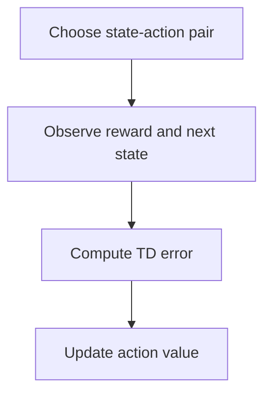

Q-learning is a temporal-difference reinforcement-learning algorithm that estimates the long-run value of taking an action in a state. Its action-value table, $Q(s,a)$, is updated from observed transitions without requiring a known transition model. The standard update bootstraps from the highest currently estimated action value in the next state.

## Update and exploration

For learning rate $\alpha$ and discount $\gamma$, update $Q(s,a)\leftarrow Q(s,a)+\alpha[r+\gamma\max_{a'}Q(s',a')-Q(s,a)]$. The bracketed expression is a temporal-difference error. A greedy policy can fail to discover better actions if those actions are never sampled. Exploration can address coverage, but production systems must not treat unsafe real-world actions as harmless experiments.

This is **off-policy** learning: the target uses a greedy next action even when an exploratory behavior policy collected the transition. At a genuine terminal state there is no future return, so the target is just $r$. A time-limit truncation may still need bootstrapping. Tabular convergence also requires sufficient state-action coverage and suitable learning-rate conditions. Function approximation requires its own convergence assumptions.

## Example

Suppose the current value of requesting evidence is 10. The observed immediate reward is -4, the highest next-state action value is 70, the discount is 0.9, and the learning rate is 0.5. The target becomes $-4+0.9(70)=59$. The updated value is $10+0.5(59-10)=34.5$. Additional transitions can move the estimate toward the expected return, provided important outcomes receive adequate coverage.

## Why it matters here

Q-learning makes delayed consequences, bootstrapping, coverage gaps, and policy safety concrete before readers encounter more elaborate agent optimization. It also highlights why logged actions, simulation, authorization, and offline evaluation matter before exploring expensive or dangerous decisions.

## Related terms

- [Bellman equation](glossary://bellman-equation)
- [Markov decision process](glossary://markov-decision-process)
- [Reward function](glossary://reward-function)
