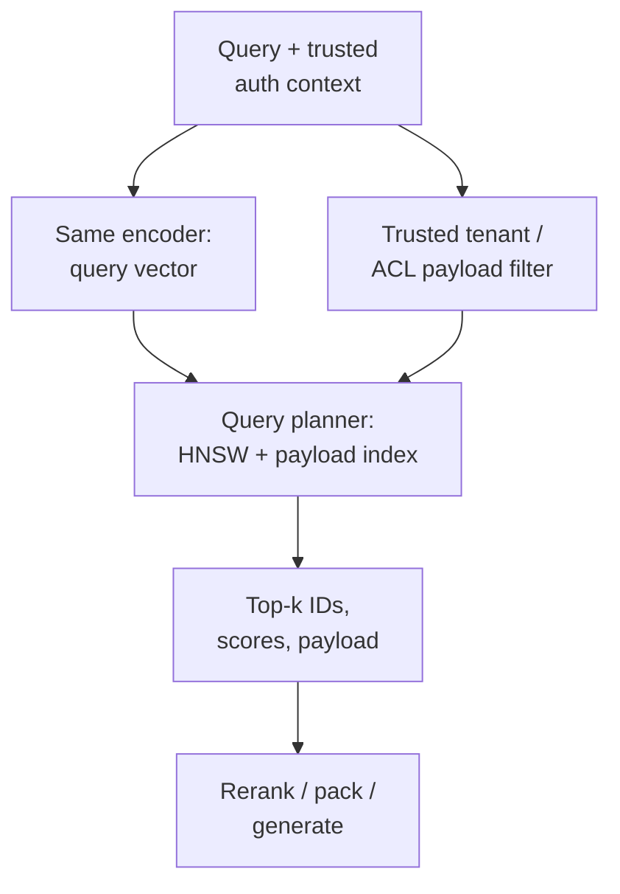

**Qdrant** (pronounced *quadrant*) is an open-source vector database and similarity search engine for production [dense retrieval](glossary://dense-retrieval). You store **points** (an id, one or more vectors, and optional JSON **payload** metadata) inside a **collection**, then query nearest neighbors under a fixed distance metric with structured filters. Qdrant runs as a client-server service (HTTP and gRPC; official clients for Python, TypeScript, Rust, Go, Java, .NET) that you self-host or run as Qdrant Cloud. Its service owns durable storage, [HNSW](glossary://hnsw) graph indexes, payload indexes, query planning, sharding, and filtered ANN. Your application supplies embeddings and calls that search infrastructure.

The Python client also offers an in-process local mode for prototyping. Use the Qdrant server or Qdrant Cloud for distributed service. The product focus that matters for production LLM systems is **filterable search**: combine embedding geometry with hard product constraints (tenant, ACL, version, region) during retrieval, before selecting the final top-$k$.

## Intuition

Three layers always show up in production RAG:

1. **Geometry.** An encoder maps chunks into $\mathbb{R}^d$. Nearby vectors mean similar meaning under a chosen metric.
2. **Index serving.** Qdrant stores those vectors, builds HNSW (and optional sparse indexes), and returns top-$k$ under latency and memory budgets.
3. **Product constraints.** Payload fields restrict which points are eligible: `tenant_id`, security labels, document type, version, `is_current`.

[FAISS](glossary://faiss) solves (2) as a library you embed in process. [pgvector](glossary://pgvector) keeps vectors in Postgres so (2)+(3) share SQL and WAL. [Pinecone](glossary://pinecone) sells (2)+(3) as a managed API. Qdrant is a dedicated vector DB: full control of payload schema and filterable HNSW, with ops ownership if you self-host.

The hard failure mode is not "ANN math is slightly approximate." It is "the gold chunk is nearest *and* allowed, but the filter and index path never surface it," or the reverse: a strong neighbor leaks across a tenant boundary because the filter was wrong or missing.

## How it works

### Data model

| Object | Role |
| --- | --- |
| **Collection** | Named set of points that share vector size(s) and distance metric(s) |
| **Point** | Record: unique id (uint64 or UUID), vector(s), optional JSON payload |
| **Payload** | Structured metadata for filters, multitenancy, and app fields returned with hits |
| **Segment** | Internal storage unit; optimizers build indexes per segment |
| **Shard / replica** | Horizontal split and replication for scale and HA (distributed mode) |

A point can hold:

- One **unnamed** dense vector, or several **named** dense vectors (e.g. `text` + `image` with different sizes and metrics).
- **Sparse** named vectors (dot product only) for lexical / learned-sparse signals in [hybrid search](glossary://hybrid-search).
- Nested JSON payload (filters use dot paths and nested conditions).

Distance metrics for dense vectors, set at collection creation:

| Metric | Qdrant name | Typical use |
| --- | --- | --- |
| Cosine similarity | `Cosine` | Dual-encoder / API embeddings trained for cosine; Qdrant normalizes vectors on upload **and normalizes the query at search time**, then scores as dot product |
| Dot product | `Dot` | Maximum inner product (MIPS); also the metric for sparse vectors |
| Euclidean | `Euclid` | $L_2$ geometry |
| Manhattan | `Manhattan` | $L_1$ geometry |

Match the metric to how the encoder was trained. Changing model, dimension, or metric means a new collection (or a new named vector and re-embed), not a silent config tweak.

### Write path

1. **Create the collection** with `size` and `distance` matching your embedding contract.
2. **Create payload indexes** for every field you will filter on (`keyword`, `integer`, `float`, `bool`, `geo`, `datetime`, `text`, `uuid`). Indexes are *not* automatic.
3. **Upsert points** in batches. Same id replaces vector and payload (idempotent replace).
4. **Optimizers** flush segments and build HNSW when non-indexed vector volume crosses `indexing_threshold` (default on the order of tens of thousands of KB of vectors). Small collections may stay on exact scan until that threshold.
5. **Delete or overwrite** when sources leave the corpus or lose ACL grants. Soft-deleted points still affect graph connectivity until optimizers vacuum them.

Best practice from Qdrant docs: create payload indexes **before** bulk ingest so filterable HNSW can add payload-aware edges while the graph is built. Adding indexes later often requires rebuilding HNSW (heavy on large collections).

### Read path

1. Embed the query in the **compatible** space, dimension, and metric convention used by the corpus. An asymmetric retriever may use distinct query and document encoder paths trained together.
2. Build a **filter** in trusted server code from auth context (never from free-form model text alone).
3. Call search / query with the vector, filter, `limit`, and search params such as `hnsw_ef`.
4. Optionally fuse dense + sparse ([hybrid search](glossary://hybrid-search)), then [rerank](glossary://reranker) and pack context for the generator.

### Filterable HNSW and the query planner

Naive **post-filter** (ANN first, drop non-matches) loses recall when the filter is selective: the true neighbor may never enter the unfiltered top-$k$. Naive **pre-filter** (restrict the graph first) can shatter HNSW connectivity so traversal dies in a local pocket.

Qdrant’s **filterable HNSW** extends the graph with extra edges derived from indexed payload values so filtered regions stay traversable. At query time a **planner** chooses strategy per segment from filter cardinality, payload indexes, and thresholds such as `full_scan_threshold`:

| Filter selectivity | Typical planner behavior |
| --- | --- |
| High (many points match) | Walk HNSW, skip nodes that fail the filter |
| Very low (tiny allow-list) | Prefer payload index + exact scan over the candidates |
| Mid-range | Rely on filter-aware graph edges; raise `hnsw_ef` if filtered recall is weak |

Payload indexes also estimate cardinality so the planner can pick a path. Filtering on unindexed fields is slow and can thrash the cluster; strict mode can **reject** those queries so misconfiguration fails fast instead of as a p95 spike.

For multitenancy, the usual design is **one collection per embedding model**, partition with a payload field such as `group_id` / `tenant_id`, index that field (`is_tenant: true` co-locates tenant data for sequential reads), and always filter by tenant from the auth layer. Hundreds or thousands of collections per cluster is the anti-pattern (resource overhead). Very large tenants can use dedicated shards / tiered multitenancy; most products start with payload partitioning.

### HNSW knobs

| Parameter | When | Effect |
| --- | --- | --- |
| `m` | Build | Max edges per node; higher → better recall, more RAM |
| `ef_construct` | Build | Candidate pool while inserting; higher → better graph, slower build |
| `hnsw_ef` (`ef`) | Query | Candidate pool while searching; higher → better recall, higher latency |
| `full_scan_threshold` | Query plan | Prefer exact scan when the filtered set is small enough |
| `payload_m` + `m=0` | Multitenant build | Set `payload_m` (e.g. 16) and `m=0` to build per-payload-value subgraphs and skip a global graph |

Defaults are often near `m = 16` and `ef_construct = 100`, but they are release and collection-config dependent. `ef_construct` is build-time; `hnsw_ef` is an optional query-time override. Set `hnsw_ef` explicitly when recall/latency experiments must be reproducible. Evaluate both filtered and unfiltered recall and latency with production filter shapes.

### Hybrid and quantization (short)

Named dense + sparse vectors on the same points support hybrid retrieval (e.g. dense cosine + sparse BM25-style weights with IDF modifier). Fusion (RRF or score-based) can run in the query API. Scalar / product / binary quantization trades memory and speed for some geometric error; measure ANN-recall@k before shipping.

## Formula

Filtered nearest neighbor under distance $d$ and predicate $f$ on payload:

$$
j^\star = \arg\min_{i:\, f(p_i)=\mathrm{true}} d(q, x_i)
$$

For maximum inner product (or cosine after L2-normalization, which Qdrant applies for `Cosine` on upload and again on the query at search time):

$$
j^\star = \arg\max_{i:\, f(p_i)=\mathrm{true}} \langle q, x_i \rangle
$$

After unit normalization of both sides, $\langle q, x \rangle = \cos(q, x)$.

Filter selectivity of $f$ on corpus $D$:

$$
\sigma(f) = \frac{|\{x \in D : f(x)=\mathrm{true}\}|}{|D|}
$$

Low $\sigma$ is where post-filter ANN can collapse: under the simplifying assumption that filter membership is independent of neighbor rank, expected matches in an unfiltered top-$k$ are $\sigma \cdot k$. Real metadata can correlate with geometry, so measure rather than assume that expectation. Index quality vs exact geometry on the *allowed* set:

$$
\mathrm{ANN\text{-}recall@}k = \frac{|A_k \cap E_k|}{|E_k|}
$$

where $A_k$ is approximate filtered top-$k$ and $E_k$ is exact filtered top-$k$. When both sides return a full $k$ hits, $|E_k|=k$ and the denominator is simply $k$. If filters leave fewer than $k$ exact matches, use $|E_k|$. When there are no exact matches the ratio is undefined; report an empty-result case separately or declare an evaluation convention. This ratio measures index fidelity against exact neighbors. Report task recall@k separately on labeled queries, alongside filtered ANN-recall@k under production filters.

## Diagram



## Example

Multi-tenant support RAG: one collection, cosine dense embeddings of size $1024$, payload partition by `tenant_id`, filters for visibility and currency.

```python
from qdrant_client import QdrantClient, models

client = QdrantClient(url="http://localhost:6333")
name = "support_chunks"
dim = 1024

client.create_collection(
    collection_name=name,
    vectors_config=models.VectorParams(
        size=dim,
        distance=models.Distance.COSINE,
        # Optional: keep full vectors on disk at large N
        # on_disk=True,
    ),
    hnsw_config=models.HnswConfigDiff(m=16, ef_construct=128),
)

# Index filter fields BEFORE bulk load so HNSW can add filter-aware edges
client.create_payload_index(
    collection_name=name,
    field_name="tenant_id",
    field_schema=models.KeywordIndexParams(
        type=models.KeywordIndexType.KEYWORD,
        is_tenant=True,
    ),
)
for field in ("security_label", "source_kind"):
    client.create_payload_index(
        collection_name=name,
        field_name=field,
        field_schema=models.PayloadSchemaType.KEYWORD,
    )
client.create_payload_index(
    collection_name=name,
    field_name="is_current",
    field_schema=models.PayloadSchemaType.BOOL,
)

# One chunk for tenant acme (embedding produced offline with the same model as query).
# Point ids are uint64 or UUID only; put natural keys in payload.
client.upsert(
    collection_name=name,
    points=[
        models.PointStruct(
            id=12003,  # or a UUID string such as "550e8400-e29b-41d4-a716-446655440012"
            vector=embedding_1024,  # list[float], length dim
            payload={
                "tenant_id": "acme",
                "document_id": "doc_return_policy_v3",
                "chunk_id": "chunk_12",
                "source_kind": "policy",
                "security_label": "support",
                "is_current": True,
                "version": 3,
            },
        )
    ],
)

query_vec = embed_query("Which checks block production for release r17?")
hits = client.query_points(
    collection_name=name,
    query=query_vec,
    query_filter=models.Filter(
        must=[
            models.FieldCondition(
                key="tenant_id",
                match=models.MatchValue(value="acme"),  # from auth, not from the LLM
            ),
            models.FieldCondition(
                key="security_label",
                match=models.MatchAny(any=["public", "support"]),
            ),
            models.FieldCondition(
                key="source_kind",
                match=models.MatchValue(value="policy"),
            ),
            models.FieldCondition(
                key="is_current",
                match=models.MatchValue(value=True),
            ),
        ]
    ),
    limit=40,
    search_params=models.SearchParams(hnsw_ef=128),
    with_payload=True,
)
# hits.points: id, score, payload for reranking / prompt packing
```

On a large catalog, filtered HNSW performance depends on hardware, filters, index configuration, and load; benchmark the actual workload before promising millisecond latency. A cross-encoder can then rerank the shortlist. Order-of-magnitude storage for dense vectors alone (float32, before graph, payload, and quantization):

$$
N \times d \times 4\ \mathrm{bytes}
$$

e.g. $N = 10^{7}$, $d = 1024$ → about $40$ GB of vectors; HNSW edges and payload indexes add more. Plan RAM for hot segments, or use `on_disk` / quantization when the corpus no longer fits in memory.

A common miss is not "HNSW failed" but ops: filter still has `version: 2` after v3 was published, `is_current` stayed true on old points, payload indexes were never created, or the query embedding came from a different model than the collection. The nearest wrong chunk still looks confident to the LLM.

## Debug path

When retrieval looks broken on Qdrant:

1. **Collection health.** `get_collection`: status green/yellow/red, `optimizer_status`, `points_count` vs exact `count` API (collection info counts are approximate during optimizers).
2. **Embedding contract.** Dimension and distance match the model; no mixed model versions in one vector name; Cosine means Qdrant normalized on write.
3. **Payload indexes.** Every production filter key is indexed. Prefer creating indexes before ingest. Enable strict unindexed-filter blocking in production so missing indexes error loudly.
4. **Filtered vs unfiltered.** Run the same query with and without the filter. If unfiltered finds the gold id but filtered does not, check payload values, ACL writes, and `hnsw_ef` / filter cardinality (not "the LLM is dumb").
5. **ANN vs exact.** On a sample, compare approximate results to `exact=True` (or a full scan on a shard) for filtered ANN-recall@k. Raise `hnsw_ef` or rebuild graph quality (`m`, `ef_construct`) if geometry is the issue.
6. **Freshness.** After upsert/delete, confirm the new id is searchable and the old id is gone. Optimizers and replication lag can explain brief dual-version windows.
7. **Multitenant isolation.** Assert every query includes the tenant condition from auth. Log filter AST in staging. Never trust a model-supplied `tenant_id`.

## Trade-offs

| Choice | Strength | Cost |
| --- | --- | --- |
| **Qdrant (self-host)** | Filterable HNSW, rich payload, hybrid dense+sparse, full control, VPC | You own capacity, upgrades, backups, observability, incidents |
| **Qdrant Cloud** | Same API, less cluster toil | Vendor bill and shared-responsibility limits |
| **Pinecone** | Managed namespaces and ops | Less index/payload control; pricing model differs |
| **pgvector** | Vectors next to SQL ACLs and transactions | ANN + OLTP contention; filter-after-ANN needs care |
| **FAISS** | Best offline lab for index math | No durable multi-writer DB, no payload service |

Compare systems on **filtered recall**, update/delete visibility, multitenancy model, cost at your QPS and storage, backup/restore, observability, and unfiltered happy-path latency.

## Why it matters here

Curriculum RAG stops being a notebook once embeddings need tenants, ACL labels, deletes, and latency SLOs. Qdrant is a concrete reference for that boundary: points and payload, filterable HNSW, payload indexes you must create on purpose, and a planner that changes behavior with filter selectivity. Lessons on dense retrieval, HNSW, metadata filters, hybrid search, and multitenancy all land on the same operational truth: the vector database serves geometry and constraints; the application still owns embedding quality, authorization metadata, and evaluation under the filters production actually sends.

## Related terms

- [Dense retrieval](glossary://dense-retrieval)
- [HNSW](glossary://hnsw)
- [Metadata filter](glossary://metadata-filter)
- [ANN search](glossary://ann-search)
- [Hybrid search](glossary://hybrid-search)
