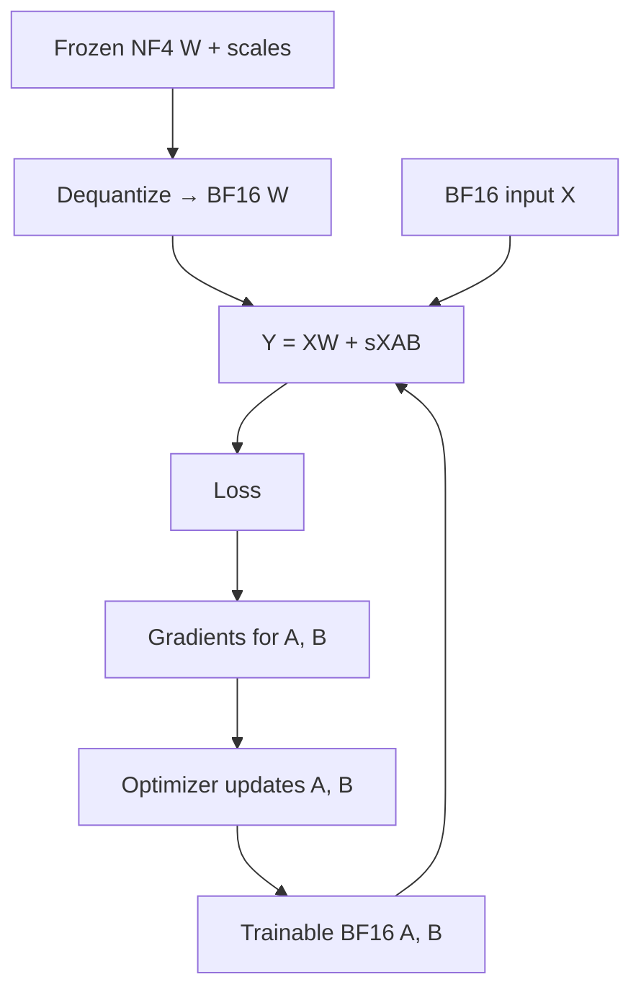

**QLoRA** (Quantized Low-Rank Adaptation) fine-tunes a large language model by freezing a **4-bit quantized** copy of the pretrained base and training ordinary [LoRA](glossary://lora) adapters in higher precision on top of it (Dettmers, Pagnoni, Holtzman, and Zettlemoyer, arXiv:2305.14314 / NeurIPS 2023). Gradients flow through the dequantized frozen base into the adapters only; the base weights themselves never receive updates. The paper's headline result is practical: finetune a 65B model on a single 48 GB GPU while matching full 16-bit finetuning task performance in their setups, cutting the roughly **>780 GB** 16-bit full-finetune footprint for LLaMA-65B down to **under 48 GB**.

QLoRA combines LoRA with three memory-saving techniques for training from a *quantized storage base*: **4-bit NormalFloat (NF4)**, **double quantization**, and **paged optimizers**.

## Diagram



## Intuition

Full fine-tuning stores base weights, gradients, and optimizer moments for every parameter. That is why a 65B 16-bit train does not fit on one workstation GPU. [LoRA](glossary://lora) freezes $W_0$ and trains thin factors $\Delta W = BA$, which removes most of the *trainable* state, but the **frozen base still sits in 16-bit** unless you quantize it.

QLoRA attacks that remaining base-weight bill. Weights live in a compact 4-bit storage format (NF4). For each matmul they are **dequantized on the fly** to a computation dtype (usually BF16), the forward/backward runs in that precision, and only adapter parameters get Adam-style state. You pay quantization error in the frozen path; you keep full adapter precision in the path that actually learns.

Critical production reading of the paper: default LoRA on $W_q$ and $W_v$ often fails to match full fine-tuning quality. Their recovery recipe puts LoRA on **all linear layers** of the transformer block. Target coverage matters alongside rank.

## Formula

For a linear layer, LoRA computes

$$
\mathbf{Y} = \mathbf{X}\mathbf{W} + s\,\mathbf{X}\mathbf{L}_1\mathbf{L}_2
$$

with frozen $\mathbf{W}$ and trainable low-rank factors $\mathbf{L}_1$, $\mathbf{L}_2$ (and scale $s$, typically $\alpha/r$ in library code). QLoRA replaces $\mathbf{W}$ with a double-dequantized 4-bit tensor and keeps adapters in BF16:

$$
\mathbf{Y}^{\mathrm{BF16}}
=
\mathbf{X}^{\mathrm{BF16}}\,
\mathrm{doubleDequant}\bigl(c_1^{\mathrm{FP32}},\, c_2^{\mathrm{k\text{-}bit}},\, \mathbf{W}^{\mathrm{NF4}}\bigr)
+
s\,\mathbf{X}^{\mathrm{BF16}}\,\mathbf{L}_1^{\mathrm{BF16}}\,\mathbf{L}_2^{\mathrm{BF16}}
$$

where

$$
\mathrm{doubleDequant}(c_1, c_2, \mathbf{W})
=
\mathrm{dequant}\bigl(\mathrm{dequant}(c_1, c_2),\, \mathbf{W}^{\mathrm{4bit}}\bigr)
=
\mathbf{W}^{\mathrm{BF16}}.
$$

Only $\partial E / \partial \mathbf{L}_i$ is stored and applied. Computing those gradients still needs the dequantized $\mathbf{W}^{\mathrm{BF16}}$ path; it does **not** require storing full-precision master copies of $\mathbf{W}$ or optimizer moments for $\mathbf{W}$.

### NF4 (4-bit NormalFloat)

Neural net weights are roughly zero-mean normal. NF4 is a **quantile quantization** datatype built for that: fixed bins from the standard normal, normalized into $[-1,1]$, with an exact zero so pads and true zeros stay exact. For each block of weights, absmax rescaling maps the block into that range, then each value is snapped to the nearest NF4 level. The paper reports NF4 beats FP4 and Int4 on zero-shot and language-modeling metrics at equal bit width.

The 16 reconstruction levels for NF4 (paper Appendix E) are fixed constants in $[-1,1]$, asymmetric around zero so both sign halves are covered without wasting a code on a second zero.

### Double quantization

Block-wise 4-bit quantization needs a scale (constant) per block. With FP32 scales and block size 64, scales alone cost $32/64 = 0.5$ bits per weight on average. **Double quantization** quantizes those scales again (paper default: FP8 with block size 256 after centering positive scales), cutting scale overhead to about

$$
\frac{8}{64} + \frac{32}{64\cdot 256} \approx 0.127
$$

bits per parameter, a savings of roughly **0.37 bits/param** (about **3 GB** on a 65B model). Weights use block size **64** for precision; secondary scales use **256** for memory.

### Paged optimizers

Long sequences plus [activation checkpointing](glossary://activation-checkpointing) can spike GPU memory when checkpointed activations are recomputed. Paged optimizers put Adam/AdamW state in **NVIDIA unified memory** so optimizer tensors can page to CPU RAM under pressure and page back for the update step, avoiding hard OOMs on borderline single-GPU runs (especially 33B on 24 GB and 65B on 48 GB).

## Worked numbers

Rough **weight storage** only (before activations, gradients, KV, fragmentation). Use **bits per parameter**, then divide by 8 for bytes:

| Setup | Bits / param | 7B base | 65B base |
|-------|--------------|---------|----------|
| FP16/BF16 base | 16 | ~14 GB | ~130 GB |
| NF4 weights only | 4 | ~3.5 GB | ~32.5 GB |
| NF4 + FP32 scales (block 64, no DQ) | 4.5 | ~3.9 GB | ~36.6 GB |
| NF4 + double-quant scales | $\approx 4.13$ | ~3.6 GB | ~33.5 GB |

Double quant is the scale term only: it cuts scale overhead from $0.5$ to $\approx 0.127$ bits/param (about **0.37 bits/param**, ~**3 GB** on 65B). It does **not** push a 65B base near 41 GB by itself; pure NF4+DQ weights stay near **~33.5 GB**.

QLoRA **training** memory is larger than weights alone because you still hold:

- dequant workspace / compute buffers for active layers,
- activations (sequence length $\times$ batch $\times$ depth), often cut with gradient checkpointing,
- LoRA parameters + Adam moments (2 moments per trainable param),
- optionally paged optimizer overflow.

Paper-scale anchors (same source):

- Full 16-bit finetune of LLaMA-65B: **>780 GB** GPU memory in their accounting.
- QLoRA 65B training: **<48 GB** (one professional GPU).
- Deployed Guanaco sizes they report: 7B about **5-6 GB** (body text "just 5 GB"; table lists 6 GB), 33B **21 GB**, 65B **41 GB**, vs Vicuna-13B at **26 GB** on their Vicuna-relative ranking. Those table "Size" figures are packaged deployment footprints, not the pure weight arithmetic above.

**Adapter side.** For rank $r=64$ on all linear layers (paper recovery setting: $r=64$, $\alpha=16$), trainable params stay a small fraction of the base, but far larger than "$W_q,W_v$ only." For a LLaMA-7B-style model with 32 blocks, width 4096, MLP width 11008, four square attention projections and three MLP projections, the adapter count is $32r[4(4096+4096)+3(4096+11008)]$: about 40 million at rank16 and 160 million at rank64, excluding any adapted output head. The optimizer bill scales with that actual count.

The BF16 adapter notation above describes the paper's computation. Library implementations can keep trainable adapters in FP32 (including PEFT's default promotion for stability); inspect parameter and gradient dtypes when budgeting.

```python
# Order-of-magnitude budget sketch; excludes activations, workspaces, and framework overhead
n_base = 7e9
bits_storage = 4 + 8 / 64 + 32 / (64 * 256)  # NF4 + double-quant scales ≈ 4.127
bytes_base = n_base * (bits_storage / 8)

n_adapter = 40e6  # LLaMA-7B-style attention + MLP projections at r=16
# BF16 weights + BF16 gradients + 2x FP32 Adam moments = 12 bytes/param.
# FP32 weights/gradients instead give 16; master copies or other buffers add more.
bytes_adapter_train = n_adapter * 12

print(f"base storage ~{bytes_base/1e9:.1f} GB")
print(f"adapter train state ~{bytes_adapter_train/1e9:.2f} GB")
# activations still dominate at long seq_len; enable gradient checkpointing
```

## Example

You need a support-tone specialist on a 13B open base, one 24 GB GPU, no multi-node budget.

1. Load the base with 4-bit NF4, double quant on, compute dtype BF16 (bitsandbytes + Transformers pattern below).
2. Attach LoRA to **all** attention and MLP projections your stack exposes (`q/k/v/o`, `gate/up/down` or model-specific names), including $W_q$ and $W_v$.
3. Train with supervised response loss on clean instruction pairs, [gradient checkpointing](glossary://activation-checkpointing) on, batch size 1 with gradient accumulation, and `paged_adamw_32bit` (or equivalent) if memory spikes on long rows.
4. Export **adapter weights + base revision + quant config + chat template**. Serve either by merging after dequant (single static model) or by keeping a quantized base and loading adapters (engine support varies).
5. Eval: task suite for the support domain **and** a general capability / safety regression suite. Match training and serve chat templates exactly.

```python
from transformers import AutoModelForCausalLM, BitsAndBytesConfig
from peft import LoraConfig, get_peft_model, prepare_model_for_kbit_training

bnb = BitsAndBytesConfig(
    load_in_4bit=True,
    bnb_4bit_quant_type="nf4",
    bnb_4bit_use_double_quant=True,
    bnb_4bit_compute_dtype="bfloat16",
)
base = AutoModelForCausalLM.from_pretrained(
    "meta-llama/Llama-2-13b-hf",  # example; pin a real revision in production
    quantization_config=bnb,
    device_map="auto",
)
base = prepare_model_for_kbit_training(base)

lora = LoraConfig(
    r=64,
    lora_alpha=16,  # paper experiment default; scale = alpha / r
    lora_dropout=0.1,  # paper: 0.1 up to 13B; 0.05 for 33B/65B
    bias="none",
    task_type="CAUSAL_LM",
    target_modules=[
        "q_proj", "k_proj", "v_proj", "o_proj",
        "gate_proj", "up_proj", "down_proj",
    ],
)
model = get_peft_model(base, lora)
model.print_trainable_parameters()
```

Before shipping, evaluate domain fit, tool JSON, refusals, and long-context behavior together. Check quantization error, data quality, and template compatibility on the intended model and task because any of them can contribute to failures.

## How it works

1. **Quantize once at load.** Base weights become NF4 blocks with (double-quantized) scales. No full-precision master of $W$ is kept for training in the standard setup.
2. **Attach LoRA.** Insert $A$, $B$ on chosen linear maps; initialize so $\Delta W$ starts near zero (standard LoRA: $B=0$).
3. **Forward.** For each layer: dequantize $\mathbf{W}$ to BF16, compute base matmul + LoRA branch, continue residual stream.
4. **Backward.** Autograd through the dequantized path yields gradients for $A$ and $B$ only. Base codes stay frozen.
5. **Optimize.** Update adapters with AdamW (often paged). Optionally checkpoint activations to cut peak VRAM.
6. **Export.** Save adapter tensors; record base id, quant type (`nf4`), double-quant flag, $r$, $\alpha$, target modules, template, and data revision.

## Sizing

| Goal | Starting point |
|------|----------------|
| Fit 7B QLoRA on 16-24 GB | NF4 + double quant + checkpointing; batch 1; moderate $r$ |
| Fit 33B on 24 GB | Same, plus paged optimizer; short-to-medium seq; accumulation |
| Fit 65B on 48 GB | Paper setting: NF4 + DQ + paged Adam; careful seq packing |
| Recover full-FT quality | LoRA on **all** linear layers; $r$ in $\{16,32,64\}$; tune learning rate alongside rank |
| Multi-tenant serve | Prefer adapter-only artifacts + shared base; see [adapter cache](glossary://adapter-cache) |

QLoRA still carries substantial memory costs from long sequences, large micro-batches, full activation storage without checkpointing, and tokenizer/chat-stack mismatches that waste context.

## Trade-offs

| Choice | Gain | Cost / risk |
|--------|------|-------------|
| NF4 vs FP4 | Better fidelity at 4-bit in the paper | Needs kernels that implement NF4 (bitsandbytes path) |
| Double quant | ~0.37 bits/param back | Slightly more dequant work; keep flag consistent train/serve |
| All linear LoRAs | Matches 16-bit FT more reliably | Larger adapters; more VRAM for multi-LoRA serving |
| Paged optimizer | Survives memory spikes | Occasional host↔device thrash if paging is frequent |
| Higher $r$ | More capacity | Overfit on small data; bigger adapter files |
| Merge after train | Simple dense serve | Must dequant/merge carefully; loses cheap multi-adapter swap |

## Debug path

When loss is fine but product quality is not:

1. **Template mismatch.** Train and serve chat formats must match byte-for-byte on special tokens.
2. **Target modules too narrow.** If only $q$ and $v$ adapted, quality may lag full FT; expand targets before cranking $r$.
3. **Base revision drift.** Adapter trained on base commit A will misbehave on silently updated base B.
4. **Quant config drift.** Train with `nf4` + double quant, serve with a different scheme → silent quality drop.
5. **Activation OOM.** Reduce seq length or enable checkpointing before blaming NF4.
6. **Data, not bits.** The paper stresses high-quality small data (e.g. OASST1-scale) over huge noisy corpora for chat behavior. Contradictory labels and missing refusal cases still win over clever memory savings.

## Why it matters here

QLoRA is the default way many teams specialize open models under real GPU budgets: one shared quantized base, many small adapters, eval gates that watch both the new skill and the regressions. It sits at the intersection of [parameter-efficient fine-tuning](glossary://parameter-efficient-fine-tuning), [quantization](glossary://quantization), and production [supervised fine-tuning](glossary://supervised-fine-tuning). Understanding NF4, double quant, and the full VRAM budget (including activations, gradients, and workspaces) helps teams fit a train job, recover quality, and ship a versioned adapter.

## Related terms

- [LoRA](glossary://lora)
- [Quantization](glossary://quantization)
- [Parameter-efficient fine-tuning](glossary://parameter-efficient-fine-tuning)
- [Activation checkpointing](glossary://activation-checkpointing)
- [Mixed precision](glossary://mixed-precision)
