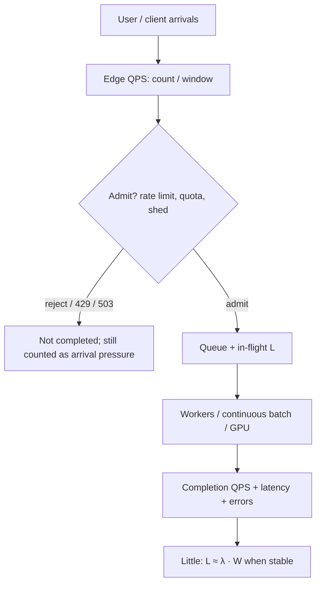

**Queries per second (QPS)** is the rate at which a service handles discrete request units in a measurement window, expressed as counts per second. In web and API systems the same idea is often called **requests per second (RPS)** or **throughput**; Google SRE lists that rate as the *traffic* golden signal and as a common throughput SLI, measured in requests per second for a user-facing service.

QPS is a **demand and capacity lens**, not a quality target by itself. Incoming product traffic is largely set by users (Google SRE notes you typically cannot set an SLO *for* external QPS the way you set one for latency). What you *can* set is how much QPS a given stack can sustain while still meeting latency, error, and quality goals. For AI systems the hard part is that "one query" can hide orders of magnitude more model work than another.

## Intuition

QPS counts arrivals or completions per second at a named boundary. It does not measure queueing time, work per request, token volume, or result quality.

| Related metric | Question it answers |
|---|---|
| **QPS / RPS** | How many request units per second? |
| **Concurrency $L$** | How many requests are in flight right now? |
| **Latency $W$** | How long does one request stay in the system? |
| **[Tokens per second](glossary://tokens-per-second)** | How much *model* work finishes per second? |
| **Error rate** | What fraction of those queries fail or are shed? |

In SRE terms, traffic (QPS) pairs with latency, errors, and saturation. A flat QPS graph with rising [p95 latency](glossary://p95-latency) often means the system is full: queues grow, and each request spends more time waiting even though the *count* of arrivals has not increased.

## Formula

Over a window of length $T$ seconds, if the service counts $N$ request units in that window:

$$
\mathrm{QPS} = \frac{N}{T}.
$$

**Arrival QPS** counts requests that hit the edge. **Completion QPS** (goodput when restricted to successful, SLO-meeting work) counts requests that finish. Under overload those two diverge: arrivals keep climbing while completions plateau or fall as queues and timeouts dominate.

Little's law (John D. C. Little, 1961) relates long-run averages in a **stable** system. Let $L$ be mean concurrency (requests in the system), $\lambda$ mean throughput (effective completions per second, the QPS the system actually finishes), and $W$ mean time in system (seconds). Then:

$$
L = \lambda W.
$$

Rearrangements used every day in capacity work:

$$
\lambda = \frac{L}{W}, \qquad W = \frac{L}{\lambda}, \qquad L = \lambda W.
$$

If each request needs mean service time $S$ seconds of serial worker capacity and you target utilization $\rho \in (0,1)$ (leave headroom for bursts and tail latency):

$$
\text{required workers (or concurrent slots)} \approx \frac{\lambda_{\mathrm{target}} \cdot S}{\rho}.
$$

That estimate assumes request cost is roughly uniform. For LLMs it is not; treat $S$ as a function of prompt length, output length, cache hits, tools, and model route, or size in **tokens/s** and concurrent sequences instead of bare QPS alone.

## Example

A product chat endpoint receives $N = 4{,}800$ HTTP requests in a $T = 60\,\mathrm{s}$ window at the API gateway:

$$
\mathrm{QPS}_{\mathrm{edge}} = \frac{4{,}800}{60} = 80.
$$

Those 80 QPS combine distinct workloads. A typical mix in the same minute:

| Slice | Share of QPS | Mean work behind one query | Rough GPU implication |
|---|---:|---|---|
| Cached short reply | 30 QPS | Near-zero generation | Cheap |
| Single-turn chat, ~300 in / 150 out tokens | 40 QPS | One prefill + decode | Dominant interactive load |
| Agent turn with 3 tool calls | 8 QPS | Several model + tool round trips | Multiplies latency and QPS to dependencies |
| Bulk embed batch API | 2 QPS | Thousands of vectors per request | High token throughput, low "query" count |

The request mix is necessary for sizing. The bulk embed lane might move more tokens than the chat lane while contributing little to the headline QPS number. Conversely, 80 QPS of long agent turns can saturate GPUs that handle 200 QPS of cache hits.

## Worked numbers

Suppose a stable GPU service has mean $L = 64$ requests inside its boundary, including any waiting queue, and mean time from admission to completion at that same boundary is $W = 8\,\mathrm{s}$. Little's law gives a completion rate of about:

$$
\lambda \approx \frac{L}{W} = \frac{64}{8} = 8\ \mathrm{QPS}.
$$

If product traffic wants $\lambda_{\mathrm{target}} = 40$ QPS of the *same* request shape with the same $W$, you need on the order of $40 / 8 = 5$ equivalent servers *before* N+1, regional fan-out, and [rate limit](glossary://rate-limit) / [load shedding](glossary://load-shedding) policy. If output length doubles and $W$ becomes $16\,\mathrm{s}$ at the same $L$, capacity drops to $\lambda \approx 4$ QPS per server: **same concurrency budget, half the QPS**.

A separate worker-pool illustration: if independent serial request slots have mean occupancy time $S = 2\,\mathrm{s}$ and you target slot utilization $\rho = 0.7$:

$$
\text{slots needed} \approx \frac{40 \cdot 2}{0.7} \approx 114
$$

concurrent request slots fleet-wide. Continuous GPU batching shares resources across sequences, so adding sequences often changes service time. Treat the slot estimate as an initial approximation. Size GPUs with load tests that measure p95 under production-shaped prompts, and keep active-sequence concurrency aligned with the queue boundary used for latency.

## Diagram



## How to measure

1. **Name the unit.** Chat turn, embed request, retrieval query, rerank call, tool invocation, or full agent trajectory. Mixing units into one counter creates false capacity claims.
2. **Name the measurement point.** Client, CDN, API gateway, model server, or dependency. Gateway QPS can exceed model QPS when cache, auth failures, or early rejects stop the path.
3. **Choose the window.** Instantaneous 1-second spikes, 1-minute averages, and peak-of-day differ. SRE notes that even "requests per second" always aggregates over some window; a 1-minute average can hide multi-second bursts that blow concurrency.
4. **Split success from failure.** Report successful completion QPS beside error and shed QPS. High arrival QPS with collapsing success rate is overload, not growth.
5. **Slice the shape.** Labels that matter for AI: route, model, tenant, cache hit/miss, input/output length buckets, tool depth, region. Without them you cannot tell cost from count.
6. **Pair with the other golden signals.** Always read QPS next to latency percentiles, error rate, and saturation (queue age, KV free blocks, GPU util, concurrent sequences).

Operational sketch (Prometheus-style rate of request counters):

```promql
# HTTP QPS at the counter's increment boundary (often response completion).
# Use a distinct counter incremented on ingress to measure true arrivals.
sum(rate(http_requests_total[1m]))

# Successful responses, if this counter increments on completion.
sum(rate(http_requests_total{status=~"2.."}[1m]))
```

## What fails in production

| Failure pattern | What you see | Typical cause |
|---|---|---|
| **Saturation cliff** | QPS flat or rising slowly, p95/p99 explode | Queueing; effective capacity reached |
| **Phantom capacity** | Load test "holds" high QPS | Synthetic short prompts; production has long outputs / cold KV |
| **Token vs query mismatch** | Low QPS, GPUs red | Few requests, huge prefill or long decode |
| **Dependency amplification** | Edge QPS modest, internal QPS huge | One user query fans out to retrieve + rerank + multi-tool calls |
| **Goodput collapse** | Arrivals high, SLO-meeting completions fall | Retries, timeouts, clients abandon; work still burns GPU |
| **Noisy neighbor** | Global QPS fine, one tenant's latency dies | Missing per-tenant QPS/[quota](glossary://quota) isolation |

[Load shedding](glossary://load-shedding) and admission control exist because infinite buffering converts a QPS spike into unbounded $L$ and therefore unbounded $W$. Rejecting early protects completion QPS for the work you keep.

## Sizing checklist

When someone asks "what QPS can we support?":

1. Fix the **request unit** and a **representative mix** (prompt/output length histograms, cache hit rate, tool depth).
2. Fix the **SLO** using tail latency (p95 TTFT, p95 E2E), error rate, quality gates, and mean latency.
3. Measure max **goodput QPS** under that mix: completions that still meet the SLO.
4. Convert goodput to fleet size with headroom ($\rho$, N+1, multi-region, deploy buffer).
5. Re-run when model, context length, or product mix changes; QPS capacity is not a constant of the GPU SKU alone.

For generative serving, also track [tokens per second](glossary://tokens-per-second), concurrent sequences, and KV memory. QPS is the product-facing rate; tokens/s and concurrency explain whether the GPU is empty or full.

## Why it matters here

LeetLLM capacity, serving, and reliability topics all revolve around demand that arrives as discrete product events (chat turns, retrievals, embeds) while the bottleneck is continuous model work. QPS is how you talk about the event rate; Little's law connects that rate to concurrency and latency; token and sequence metrics explain the cost behind each event. Without that stack of numbers, "scale the service" and "the model is slow" stay vague.

## Related terms

- [Tokens per second](glossary://tokens-per-second)
- [p95 latency](glossary://p95-latency)
- [Rate limit](glossary://rate-limit)
- [Load shedding](glossary://load-shedding)
- [Continuous batching](glossary://continuous-batching)
