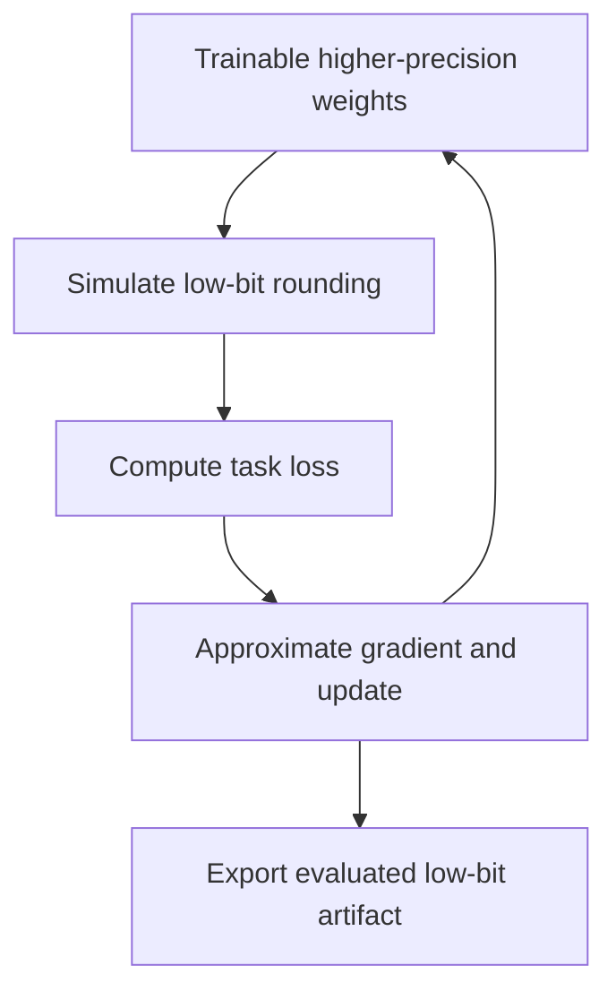

**Quantization-aware training (QAT)** exposes a model to the errors introduced by lower-precision numbers while its weights are still being optimized. During the forward pass, training simulates quantization and dequantization so the model learns under a coarse numeric grid. The optimizer typically maintains higher-precision weights, allowing gradient updates to adapt those weights before a final low-bit checkpoint is exported.

## Why training through rounding needs an approximation

Rounding is piecewise constant, so its ordinary derivative is zero almost everywhere. QAT implementations therefore commonly use a straight-through estimator: the forward pass applies a simulated quantize/dequantize operation, while the backward pass approximates that operation as locally differentiable. This lets useful gradient information reach the underlying higher-precision weights.

QAT is more expensive than post-training quantization because it requires an additional training or fine-tuning workflow. During that workflow, the model adapts to simulated precision loss and can learn to compensate for rounding error.

## Example

A local document assistant must run a model on a laptop while preserving structured-output accuracy. The model developer trains with simulated four-bit weights, then publishes a quantization-aware checkpoint. A runtime packages that checkpoint as a downloadable artifact, and package size depends on tensor formats, metadata, mixed-precision layers, and the chosen container. Compare the exact QAT artifact against both its full-precision source and a post-training-quantized alternative using the same documents, context length, JSON checks, latency measurements, and memory budget. Record byte sizes for each artifact and account for its formats and metadata when attributing size changes to QAT.

## Why it matters here

Gemma deployment and edge-model lessons contrast published QAT tags with ordinary four-bit files. The distinction explains why a model can adapt to low precision during training while still requiring a compatible runtime, adequate KV-cache headroom, and a workload-specific evaluation before release.

## Related terms

- [Post-training quantization](glossary://post-training-quantization)
- [Quantization](glossary://quantization)
- [Gradient](glossary://gradient)
- [Model checkpoint](glossary://model-checkpoint)
