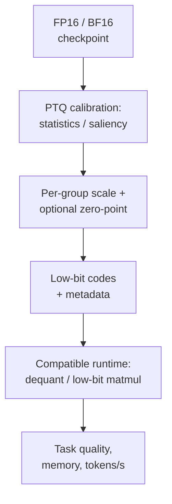

**Quantization** maps high-precision floating-point values (weights, activations, or caches) onto a lower-bit discrete grid, then stores the integer (or low-bit float) codes plus a small amount of scale metadata so values can be reconstructed approximately at runtime. The goal is fewer bytes per parameter and less memory traffic; the cost is rounding and clipping error that can raise perplexity, break brittle tool use, or degrade long-context quality if you do not measure the right slices.

It is distinct from, but can overlap with, [mixed precision](glossary://mixed-precision). Mixed precision selects numerical formats for different operations; quantization defines how values map to a reduced set of representable levels, often using scales. An FP8 workflow can involve both. Quantization targets integer grids (INT8, INT4, …) or low-bit types (NF4, FP4, FP8), with quantize/dequantize or rescaling operations. Jacob et al. (CVPR 2018) formalized a widely used integer affine map; LLM methods such as GPTQ, AWQ, and SmoothQuant use related uniform grids. [Product quantization](glossary://product-quantization) instead uses learned subvector codebooks, commonly for ANN embeddings, though codebook compression can also be applied to model weights.

## Intuition

Quantization maps many high-precision values onto fewer representable levels. Storage and bandwidth drop while approximation error rises. Decode in LLMs is often **memory-bandwidth bound**: each token must stream nearly the full weight tensor from [HBM](glossary://hbm). Cutting weights from 16 bits to 4 bits cuts that traffic by about $4\times$ before scale overhead, which is why a 70B model that needs roughly $140$ GB in FP16 can fall near $35$ GB of weights at 4-bit and fit fewer GPUs or a workstation.

Two errors dominate quality:

1. **Rounding error:** each value snaps to the nearest representable level inside the chosen range.
2. **Clipping / range error:** outliers force a large scale, so the dense bulk of the distribution wastes levels; or a too-tight range saturates extremes.

Per-group scales, activation-aware methods, and Hessian-aware updates all attack (1) and (2) differently. A few large activation outliers can ruin a whole tensor's INT8 grid, which is why weight-only 4-bit is often easier than naive W8A8 on large LLMs.

Three tensors matter in transformer serving (NVIDIA Model Optimizer / TensorRT-LLM framing):

| Tensor | Typical goal | Difficulty |
| --- | --- | --- |
| Weights | Fit the checkpoint; cut weight bandwidth | Usually easiest; roughly zero-centered |
| Activations | Enable INT8/FP8 GEMMs; cut intermediate traffic | Harder; channel outliers stretch the range |
| [KV cache](glossary://kv-cache) | Fit long context and larger batches | Sensitive; quality and concurrency both move |

## Formula

**Affine (asymmetric) uniform quantization.** Jacob et al. define the real value $r$ recovered from integer code $q$ with scale $S > 0$ and zero-point $Z$ (the integer that represents real $0$ exactly):

$$
r = S\,(q - Z)
$$

Forward quantization (NVIDIA-style $s$, $z$; same map) is:

$$
q = \mathrm{clip}\!\left(\mathrm{round}\!\left(\frac{x}{s}\right) + z,\; q_{\min},\; q_{\max}\right)
$$

$$
\hat{x} = s \cdot (q - z)
$$

**Symmetric** form sets $z = 0$ (common for many weight-only LLM kernels):

$$
q = \mathrm{clip}\!\left(\mathrm{round}\!\left(\frac{x}{s}\right),\; q_{\min},\; q_{\max}\right),\qquad
\hat{x} = s \cdot q
$$

**AbsMax scale** for a symmetric $N$-bit signed grid with max integer magnitude $q_{\max} = 2^{N-1}-1$ (SmoothQuant/AWQ style $\Delta$ / $s$):

$$
s = \frac{\max(|x|)}{q_{\max}}
$$

Empty or near-zero blocks need an $\epsilon$ floor (or special packing) so $s$ doesn't collapse to 0 and blow up dequant. For unsigned 4-bit levels $\{0,\ldots,15\}$ or signed $\{-8,\ldots,7\}$ / $\{-7,\ldots,7\}$, the grid bounds change; always match $s$ to the grid your kernel packs. Jacob's training view also writes the step from a range $[a,b]$ with $n$ levels as $s = (b-a)/(n-1)$ and nudges bounds so zero is exactly representable.

**Granularity** is which slice shares one $s$ (and optional $z$):

- **Per-tensor:** one scale for the whole matrix (simplest, often worst for outliers)
- **Per-channel / per-row:** one scale per output or input channel
- **Per-group (block):** one scale every $g$ weights (e.g. $g=128$), the usual LLM weight-only default; slightly more bits of metadata, much less error

## Worked numbers

Symmetric signed INT4 on a tiny weight vector $w = [0.15, -1.22, 2.40, -0.45]$ with $q_{\max}=7$:

$$
s = \frac{\max|w|}{7} = \frac{2.40}{7} \approx 0.34286
$$

| $w$ | $w/s$ | $q$ | $\hat{w}=s\cdot q$ | $|error|$ |
| --- | --- | --- | --- | --- |
| $0.15$ | $0.44$ | $0$ | $0.00$ | $0.15$ |
| $-1.22$ | $-3.56$ | $-4$ | $-1.37$ | $0.15$ |
| $2.40$ | $7.00$ | $7$ | $2.40$ | $0.00$ |
| $-0.45$ | $-1.31$ | $-1$ | $-0.34$ | $0.11$ |

Mean absolute error is about $0.10$. One group is fine; billions of independent rounding decisions need better schemes than pure round-to-nearest (RTN) when you go to 3–4 bits.

**Scale overhead (order of magnitude).** For $N=8\times 10^9$ weights, group size $g=128$, one FP16 scale per group: about $2 \cdot (N/g) \approx 125$ MB of scale storage, small next to $\sim 4$ GB of 4-bit codes, but not free when you also pack zeros or multi-level scales (GGUF K-quants, double quant in QLoRA).

```python
weights = [0.15, -1.22, 2.40, -0.45]
qmax = 7
scale = max(abs(w) for w in weights) / qmax
q = [max(-qmax, min(qmax, round(w / scale))) for w in weights]
hat = [qi * scale for qi in q]
print(scale, q, [round(h, 3) for h in hat])
```

## How it works

### What you quantize

1. **Weight-only (e.g. W4A16):** store weights in 4-bit; keep activations in FP16/BF16. Checkpoint and weight bandwidth shrink first. Dominant path for local GGUF files and many GPTQ/AWQ GPU packs. Runtime often **dequantizes on the fly** into FP16 for a standard GEMM, reducing weight memory use. Fusing dequantization with GEMM can reduce intermediate memory traffic and improve throughput. The matrix multiplication still performs the same multiply-adds.
2. **Weights + activations (e.g. W8A8, FP8):** both sides of GEMMs use low-bit arithmetic. Supported hardware can use INT8/FP8 Tensor Cores, which can improve matrix-operation throughput. Measure the target shapes and include scaling overhead. Activation outliers make naive W8A8 fail on large LLMs without a transform such as SmoothQuant (or outlier-preserving schemes like LLM.int8()).
3. **KV cache (INT8/FP8/FP4):** compress past keys/values so long context and multi-session batching fit. TensorRT-LLM documents FP8/INT8 KV paths; evaluate quality at production context lengths, including long prompts.

### Static vs dynamic activations

| Mode | How scales are set | Trade-off |
| --- | --- | --- |
| **Static (PTQ)** | Fix activation scales from a calibration set offline | Fast serve; fails if live traffic leaves the calibrated range |
| **Dynamic** | Compute scales per tensor/token at runtime | More robust range; extra overhead; still hurts if outliers exist |
| **Offline reparam (SmoothQuant)** | Move activation difficulty into weights once; combine with static or dynamic activation scales | Enables INT8 GEMMs on outlier-heavy LLMs with a calibrated transform |

### PTQ vs QAT

| Approach | Idea | When engineers use it |
| --- | --- | --- |
| **Post-training quantization (PTQ)** | Freeze a trained model; set scales (and sometimes adjust weights) with a small **calibration** set; no full retrain | Default for LLMs: cheap, hours not days |
| **Quantization-aware training (QAT)** | Insert fake quantize/dequantize during train/finetune; straight-through estimator (STE) for non-differentiable round | Recover accuracy when PTQ is not enough; more expensive |

In QAT, forward uses $\hat{x} = \mathrm{dequant}(\mathrm{quant}(x))$; backward treats round as identity (STE) so gradients flow into the full-precision shadow weights. Jacob et al. co-designed this simulated quantization with the integer inference graph.

Calibration data for PTQ should match the serve domain. A code model calibrated only on generic web text can keep WikiText perplexity while losing tool-calling or syntax fidelity. PTQ calibration estimates ranges for quantization grids. Probability [calibration](glossary://calibration) adjusts confidence scores to match observed frequencies.

### Methods you will meet in production

| Method | What it optimizes | Typical use |
| --- | --- | --- |
| **RTN** | Round each weight to nearest grid with AbsMax (or min-max) scale | Baseline; often OK at 8-bit, weak alone at 3–4 bit |
| **GPTQ** (Frantar et al., ICLR 2023) | Layer-wise minimize $\|WX - \widehat{W}X\|_2^2$ with approximate Hessian compensation as columns quantize | Accurate 3–4 bit weight-only; GPU serving packs |
| **AWQ** (Lin et al.) | Protect **salient** weight channels using **activation** magnitudes via per-channel scaling $s = s_X^\alpha$, not weight magnitude | 4-bit weight-only; strong on instruction/multimodal generalization |
| **SmoothQuant** (Xiao et al., ICML 2023) | Offline migrate activation outliers into weights: $Y = (X \mathrm{diag}(s)^{-1})(\mathrm{diag}(s)W)$ so both sides are INT8-friendly | W8A8 serving when you need integer GEMMs |
| **NF4 + QLoRA** (Dettmers et al.) | 4-bit NormalFloat for normally distributed weights; optional double quant of scales; frozen base + LoRA train | Fine-tune large models under VRAM limits |
| **FP8 (E4M3 / E5M2)** | Narrow float formats with native Tensor Core support on Hopper+ | W8A8-style serve without classical INT affine grids |
| **GGUF** | Container + block quant types (`Q4_K_M`, …), not an algorithm | Local/CPU-GPU hybrid via [llama.cpp](glossary://llama-cpp) |

GPTQ layer objective (Frantar et al.). For layer weights $\mathbf{W}$ and calibration inputs $\mathbf{X}$:

$$
\widehat{\mathbf{W}}^{\star} = \arg\min_{\widehat{\mathbf{W}}} \|\mathbf{W}\mathbf{X} - \widehat{\mathbf{W}}\mathbf{X}\|_2^2
$$

GPTQ solves this approximately with second-order (Hessian $\mathbf{H} \propto \mathbf{X}\mathbf{X}^{\top}$) updates: quantize blocks of columns, then compensate remaining unquantized weights so layer output error stays small. That is why GPTQ beats RTN at 3–4 bits without full retraining.

AWQ search (Lin et al.) scales input channels by activation-aware factors, then quantizes all weights (hardware-friendly vs leaving 1% of channels in FP16):

$$
\mathbf{s}^{\star} = \arg\min_{\mathbf{s}}
\bigl\|Q(\mathbf{W}\cdot\mathrm{diag}(\mathbf{s}))(\mathrm{diag}(\mathbf{s})^{-1}\cdot\mathbf{X}) - \mathbf{W}\mathbf{X}\bigr\|
$$

with a cheap search space $\mathbf{s} = \mathbf{s}_X^{\alpha}$ over a scalar $\alpha$.

SmoothQuant migration strength (Xiao et al.):

$$
s_j = \frac{\max(|X_j|)^{\alpha}}{\max(|W_j|)^{1-\alpha}}
$$

with $\alpha \approx 0.5$ a common starting point when splitting difficulty between activations and weights; larger $\alpha$ when activation outliers are severe.

## Diagram



## Example

Ship an ~8B instruct model on a 24 GB GPU for an internal coding assistant.

1. **Baseline weights:** $8 \times 10^9 \times 2$ bytes ≈ **16 GB** in FP16 (weights only).
2. **Weight-only 4-bit:** roughly $8 \times 10^9 \times 0.5$ ≈ **4 GB** of codes, plus scales (and zeros). Real GGUF `Q4_K_M` files often land near **4.5–5 GB** on disk after metadata and unquantized special tensors.
3. **Runtime:** still pay for [KV cache](glossary://kv-cache), activations, CUDA graphs, and batch state. At long context the cache can dominate; a "fits on disk" model still OOMs.
4. **Method choice:**
   - Laptop / mixed CPU-GPU: convert to [GGUF](glossary://gguf) `Q4_K_M` or `Q5_K_M`, run with layer offload.
   - Multi-user GPU server with vLLM / TGI / TensorRT-LLM: prefer AWQ or GPTQ W4A16 (or FP8 W8A8 on Hopper+) with kernels the engine actually ships.
5. **Gate before promote:** fixed prompt suite (facts, JSON/tool schemas, long docs, multilingual if needed), not WikiText alone. Compare against FP16/BF16 on the same template and sampling settings.

```bash
# Local path sketch (names vary by llama.cpp revision)
python convert_hf_to_gguf.py ./model --outtype f16 --outfile model-f16.gguf
llama-quantize model-f16.gguf model-Q4_K_M.gguf Q4_K_M
```

**What fails in production.** The model "fits" but quality collapses on structured tool calls; KV grows with context and the box OOMs even though weights are 4-bit; or an AWQ pack is loaded without fused kernels so latency is worse than FP16. Fix by matching artifact to kernels, measuring workload-shaped evals, and sizing **weights + KV + activations**, not file size alone.

## Sizing

Weights only, $N$ parameters, $b$ bits per weight (ignore scale overhead first):

$$
\mathrm{bytes}_{\mathrm{weights}} \approx N \cdot \frac{b}{8}
$$

| $b$ | ~bytes / param | 70B weights only |
| --- | --- | --- |
| 16 (FP16/BF16) | 2 | ~140 GB |
| 8 | 1 | ~70 GB |
| 4 | 0.5 | ~35 GB |
| 3 | 0.375 | ~26 GB |

Add group scales: for group size $g$ with one FP16 scale per group, extra $\approx 2 \cdot (N/g)$ bytes (zeros add more if asymmetric). Serving memory is **weights + KV + activations + fragmentation**. Quantizing weights alone does not fix a long-context OOM.

## Trade-offs

| Choice | Gain | Failure mode |
| --- | --- | --- |
| Aggressive 2–3 bit | Smallest files | Collapsed reasoning, broken format following |
| Weight-only 4-bit | Fits single GPU; often near-FP16 quality with GPTQ/AWQ | Slow if dequant kernels are weak; no free FLOP cut without hardware support |
| W8A8 SmoothQuant | Real INT8 GEMM throughput | Bad without outlier handling; static ranges can drift from live traffic |
| FP8 W8A8 (Hopper+) | Native low-bit Tensor Cores | Format (E4M3 vs E5M2) and engine support must match |
| KV FP8/INT8 | Longer context / bigger batch | Attention quality drop at long $T$; must A/B under real lengths |
| QAT | Can recover quality lost to PTQ | Train cost; recipe complexity; recovery depends on the recipe |
| Wrong calibration | Looks fine on generic PPL | Domain regressions in code, safety, or RAG answers |

**Production debug checklist when "quant made it dumb":**

1. Confirm the **bit-width and quantization scheme** (RTN, GPTQ, AWQ, or GGUF type). The 4-bit label alone omits the method and artifact details.
2. Confirm **runtime kernels** match the artifact (exllama / AWQ / marlin / TensorRT engines). Slow + bad often means unpack-on-CPU or missing fused kernels.
3. Separate **weight OOM** from **KV OOM**.
4. Match chat template, tokenizer, and max length to the base model.
5. Re-run a **workload-shaped** golden set; do not trust perplexity alone.
6. If quality fails at 4-bit, try group size 128, higher bits on sensitive layers, or Q5/Q6 before blaming the whole idea of quantization.

## Why it matters here

LeetLLM's inference track treats quantization as the first cost lever before multi-GPU sharding: fit the model, cut weight bandwidth, then measure quality under real prompts. Engineers who only know "make it 4-bit" cannot choose GPTQ vs AWQ vs GGUF, cannot size KV after weight compression, and will ship silent regressions. The durable skill is: map tensors to a grid with scale metadata, pick a PTQ method that matches the tensor and the kernel, and gate release on task evals plus memory and tokens/s.

## Related terms

- [QLoRA](glossary://qlora)
- [amax](glossary://amax)
- [Mixed precision](glossary://mixed-precision)
- [GGUF](glossary://gguf)
- [KV cache](glossary://kv-cache)
- [Product quantization](glossary://product-quantization)
