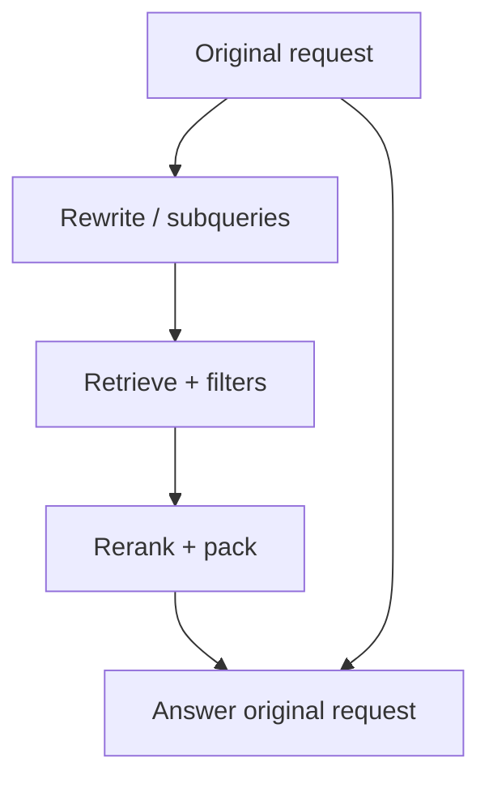

**Query rewriting** transforms a user's original request into one or more search queries that a retrieval system can answer more reliably. It sits *before* [candidate generation](glossary://candidate-generation). A system can retrieve with the rewritten forms alone or retain an original-query branch and fuse the results, which helps preserve exact identifiers. The rewrite is a recall tool, not a place to invent answers.

Ma et al. (EMNLP 2023) name the pipeline **Rewrite-Retrieve-Read**, contrasting it with plain retrieve-then-read. Given input $x$ (a question or chat turn), the rewriter produces $\tilde{x}$, a retriever returns context $doc$, and a reader predicts $\hat{y}$ from $[doc, x]$. The motivation is the gap between how users speak and how documents are written: short, ambiguous, multi-hop, or conversational language is a poor direct key into BM25 or dense ANN.

Classical IR already rewrote queries with relevance feedback and term expansion (Rocchio; Lavrenko and Croft's relevance models / RM3). LLM-era systems keep that goal and add generation: expand with pseudo-documents, invent a hypothetical answer for embedding search, split multi-hop questions, or train a small rewriter with reader feedback.

## Intuition

Users ask with shorthand, pronouns, typos, and chat history. Indexes often need a standalone query: expanded acronyms, resolved entities, split subquestions, domain synonyms, or preserved constraints. A good rewrite improves lookup; a bad rewrite smuggles assumptions the user never made.

The raw utterance may depend on chat history, while the index needs a standalone search key. Query rewriting resolves that mismatch without deciding the answer.

## How it works

Production rewriters are usually a small LLM (or a fine-tuned seq2seq model) called once or a few times per request. Common transforms:

| Variant | What it emits | When it helps |
| --- | --- | --- |
| **Standalone / conversational** | One decontextualized query from chat history | "What about the new policy?" needs prior turn entities |
| **Multi-query / multi-hop** | Several subqueries, often fused with RRF | Multi-hop questions where one search key is too broad or too narrow |
| **Lexical expansion** | Query plus extra terms or a pseudo-passage (Query2doc) | BM25 / sparse recall; entity-heavy web search |
| **HyDE** | Hypothetical answer text, embedded as the query vector | Zero-shot dense retrieval when query and doc styles differ |
| **Structured side channel** | Free-text query plus filters (product, date, tenant) | Hybrid stacks that need [metadata filters](glossary://metadata-filter) |
| **Trainable rewriter** | Small model optimized for reader reward | Stable cost; align rewrite to a frozen retriever + black-box reader |

Each variant should preserve user intent and ACLs. Rewrites must not widen access: tenant and permission filters ride with the rewritten query the same way they would with the original intent.

## Diagram



## Formula

### Rewrite-Retrieve-Read

Ma et al. write the three steps for a knowledge-intensive task with pairs $(x, y)$:

1. Rewrite: $\tilde{x} = \mathrm{Rewrite}(x)$ (prompted LLM, or a trainable $G_\theta$)
2. Retrieve: $doc = \mathrm{Retrieve}(\tilde{x})$
3. Read: $\hat{y} = \mathrm{Read}([doc, x])$

When the rewriter is trained with PPO against reader feedback, they use a task reward $R_{lm}$ on **downstream reader metrics** (answer exact match / F1 against gold $y$, or whether the gold answer appears in retrieved $doc$), not a score of the rewrite string alone, minus a KL penalty that keeps the policy near the warm-start rewriter:

$$
R(s_t, a_t) = R_{lm}(\hat{y}, y, doc) - \beta\,\mathrm{KL}(\pi_\theta \| \pi_0)
$$

Start a first production system with prompted multi-query rewriting; it can improve retrieval when raw $x$ is a poor search key. Add RL when a feedback loop and the expected gains justify training a rewriter.

### Query2doc expansion

Wang, Yang, and Wei (EMNLP 2023) generate a pseudo-document $d'$ with few-shot prompting, then expand the query. For sparse retrieval they repeat the original query $n$ times so short $q$ is not drowned by $d'$:

$$
q^{+} = \mathrm{concat}(\{q\} \times n,\ d')
$$

They report $n = 5$ as a default. For dense retrieval they concatenate once with a separator: $q^{+} = \mathrm{concat}(q,\ [\mathrm{SEP}],\ d')$. Their table reports BM25 MS-MARCO MRR@10 increasing from 18.4 to 21.4 and TREC DL2019 nDCG@10 from 51.2 to 66.2 (metrics on a 0–100 scale): gains of 3.0 and 15.0 points, not 3% and 15% relative. No retriever fine-tuning was required; dense gains were smaller once the dual encoder was already strong.

### HyDE query vector

Gao, Ma, Lin, and Callan (ACL 2023) do not rewrite to a shorter string for BM25. They instruct an LLM to write a *hypothetical* document that would answer the query, encode $N$ samples with an unsupervised contrastive encoder $f$, and average those vectors (optionally including the raw query embedding):

$$
\hat{\mathbf{v}}_{q} = \frac{1}{N}\sum_{k=1}^{N} f(\hat{d}_k),\qquad
\hat{d}_k \sim g(q, \mathrm{inst})
$$

$$
\hat{\mathbf{v}}_{q} = \frac{1}{N+1}\left[\sum_{k=1}^{N} f(\hat{d}_k) + f(q)\right]
$$

Retrieval is MIPS against real corpus vectors. The generated text can contain false details; the dense bottleneck of $f$ is meant to keep topical geometry and drop brittle hallucinations. HyDE rewrites the *query embedding* for dense search. Pair it with lexical retrieval when queries contain identifiers or error codes.

## Example

Support chat, turn 4, tenant `acme-corp`:

> User: "What about the new policy?"

History and workspace terms support a rewrite such as:

```text
standalone: 2026 vendor data retention policy exception approval process acme-corp
subquery_1: vendor data retention policy 2026
subquery_2: data retention exception approval workflow
filters: {tenant: "acme-corp", doc_type: "policy", year: 2026}
```

Run hybrid retrieval on the subqueries, fuse with RRF, keep the tenant filter on every path. The gold HR/legal chunks enter the candidate pool; the generator answers with citations.

**What fails if the rewrite invents content.** Suppose the rewriter emits `PTO policy carryover 2026` with no support in history. Dense and sparse both chase leave-policy docs. Recall@k on the real retention policy collapses, yet the LLM may still sound confident about PTO. The bug is upstream of generation: candidate generation never saw the right documents.

**Operational sketch** (one standalone rewrite + hybrid fan-out):

```python
def rewrite_and_retrieve(user_turn: str, history: list[str], tenant: str, k: int = 40):
    prompt = build_rewrite_prompt(user_turn, history)  # decontextualize; no free invent
    rewritten = llm.complete(prompt).strip()
    filters = {"tenant": tenant}  # from auth, never from the model alone
    bm25_hits = sparse_search(rewritten, filters=filters, k=k)
    dense_hits = dense_search(embed(rewritten), filters=filters, k=k)
    return rrf_fuse([bm25_hits, dense_hits])
```

Log `user_turn`, `history_ids`, `rewritten`, filters, per-retriever IDs, fused order, and whether a known gold chunk was present at each stage.

## Trade-offs

| Choice | Upside | Cost / risk |
| --- | --- | --- |
| Always rewrite | Cleaner keys for chat and multi-hop | Extra LLM latency and tokens on every request |
| Multi-query fan-out | Higher recall ceiling | $m$ retrievals + fusion; more noise for the reranker |
| Query2doc / long expansion | Strong BM25 lift on hard entity queries | Longer inverted-index query; slower sparse search |
| HyDE | Bridges query vs document style in dense space | $N$ generations + embeds; weak on exact IDs; not a lexical path |
| Trainable small rewriter | Cheaper than a frontier model per call | Needs warm-start data and a reward that tracks answer quality |
| Aggressive expansion | More terms, more hits | Topic drift, ACL-adjacent docs, faithfulness drop |

Ma et al. saw plain retrieve-then-read *hurt* HotpotQA when complex multi-hop questions were used as web queries; rewriting recovered and beat the baseline. That pattern shows up in product: multi-clause user questions are often worse search keys than two shorter rewrites.

## Debug path

If answers are wrong, separate rewrite quality from index quality:

1. **No rewrite needed.** Exact model IDs, ticket IDs, and error codes often want the original string (plus filters). Expanding them can dilute BM25.
2. **Rewrite changed intent.** Diff original vs rewritten; measure whether gold docs still match the rewrite on a labeled set.
3. **Recall@k rose, faithfulness fell.** The rewrite added unsupported entities; candidates are "relevant" to the wrong question.
4. **Filters dropped.** Tenant/ACL must be applied to rewritten queries the same as to raw ones; never let the model invent broader access.
5. **Latency.** One rewrite call plus multi-query retrieval can dominate TTFT. Cache by the full rewrite inputs, including relevant history/workspace context and model/prompt version; the same utterance can resolve to different entities in different conversations. Keep authorization filters on every retrieval even when a rewrite is cached, and cap subquery count.

Audit fields that earn their keep: original query, rewritten query (and subqueries), model/prompt version, retrieved candidates, ranking signals, filters, and final evidence used in the answer.

## Why it matters here

Query rewriting is high-impact for recall because [candidate generation](glossary://candidate-generation) can only rank evidence it first retrieves. In LeetLLM's RAG curriculum, rewrites, HyDE, multi-query fusion, and Corrective / Self-RAG-style loops all sit one layer above the index: they change *what* is asked of BM25 and dense search before packing and generation. Measure [Recall@k](glossary://recall-at-k) with and without rewriting on conversational, multi-hop, and exact-ID slices before celebrating answer-level gains.

## Related terms

- [RAG](glossary://rag)
- [Candidate generation](glossary://candidate-generation)
- [Hybrid search](glossary://hybrid-search)
- [Dense retrieval](glossary://dense-retrieval)
- [Recall@k](glossary://recall-at-k)
