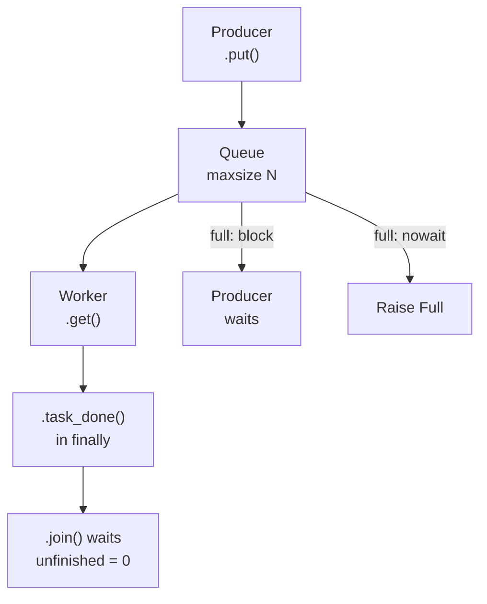

`queue.Queue` is Python's standard-library **thread-safe FIFO** for multi-producer, multi-consumer handoff. Producers call `put`; consumers call `get`. The class owns the locks, wait conditions, and wakeups so you do not write a manual monitor over a shared list. When `maxsize > 0`, a full queue blocks (or raises) on `put` instead of growing without bound.

`queue.Queue` synchronizes FIFO handoff among OS threads within one process. Cross-process handoff uses `multiprocessing.Queue`; async coroutines on one event loop use `asyncio.Queue`. Messages stay in process memory, so use a durable broker or store when they must survive restarts. Default `maxsize=0` means unbounded.

## How it works

Three public queues in the module share the same locking API and differ only in retrieval order:

| Class | Order |
|-------|--------|
| `queue.Queue` | FIFO: first put is first get |
| `queue.LifoQueue` | LIFO: last put is first get |
| `queue.PriorityQueue` | lowest comparable item first (heap-backed) |

`SimpleQueue` is a separate unbounded FIFO without task tracking. Its CPython `put` is reentrant, so it is safe from paths that can re-enter the same thread (for example `__del__` or weakref callbacks). Prefer `Queue` for ordinary worker handoff.

**Blocking put/get.** With defaults, `put(item)` waits until a free slot exists (if bounded) and `get()` waits until an item exists. Timeouts and non-blocking modes:

- `put(item, block=True, timeout=None)` / `get(block=True, timeout=None)`: wait forever, or at most `timeout` seconds then raise `Full` / `Empty`
- `put_nowait` / `get_nowait`: never wait; raise `Full` / `Empty` immediately

**Unfinished-work counter (join contract).** Separate from the item buffer:

1. Each successful `put` / `put_nowait` increments an unfinished-task count.
2. Each consumer must call `task_done()` once after finishing work on a gotten item (including failures).
3. `join()` blocks until that count returns to zero.

If a worker skips `task_done()`, `join()` hangs forever. If you call `task_done()` more times than puts, you get `ValueError`. Call `task_done()` in a `finally` so exceptions cannot skip it.

**Approximate size.** `qsize()`, `empty()`, and `full()` report a snapshot. Another thread can change the queue between that check and the next `get`/`put`, so the call may still block. Prefer blocking `get`/`put` (or timeout variants) over "if not empty: get" patterns.

**Shutdown (Python 3.13+).** `shutdown(immediate=False)` stops growth: further `put` raises `ShutDown`. With `immediate=False`, consumers drain remaining items with `get`; when empty, further `get` raises `ShutDown`. With `immediate=True`, queued items are drained and unfinished counts are reduced by those discarded items, which can unblock `join()` without their work having run. Already claimed work is not cancelled and still needs `task_done()`. Choose either sentinels before shutting growth down, or handle `ShutDown` in consumers; you cannot enqueue sentinels after calling `shutdown()`.

Internals use locks and condition variables. The module is not designed for reentrancy *within* a single thread (do not call queue methods from a re-entered path holding the queue's own lock).

## Diagram



## Example

An embedding prep pipeline uses $4$ OS worker threads (blocking HTTP to an embedding API) and a bounded queue so document-chunk producers cannot flood RAM when the API is slow.

```python title="thread-queue.py"
from queue import Empty, Queue
from threading import Lock, Thread

jobs: Queue[str | None] = Queue(maxsize=64)
results: list[str] = []
results_lock = Lock()


def worker() -> None:
    while True:
        item = jobs.get()
        try:
            if item is None:  # sentinel: clean exit
                return
            # blocking I/O belongs here (HTTP embed, disk, tokenizer)
            out = f"embedded:{item}"
            with results_lock:
                results.append(out)
        finally:
            jobs.task_done()  # always, even on failure or sentinel


workers = [Thread(target=worker, daemon=True) for _ in range(4)]
for t in workers:
    t.start()

for i in range(200):
    jobs.put(f"chunk-{i}")  # blocks when 64 unclaimed items already wait

jobs.join()  # all 200 items finished (task_done paired with each put)
for _ in workers:
    jobs.put(None)  # one sentinel per worker after join
for t in workers:
    t.join(timeout=5.0)
```

With $200$ chunks, $4$ workers, and `maxsize=64`:

- At most $64$ unclaimed chunk IDs sit in the queue buffer.
- When the buffer is full, the producer thread blocks on `put` until a worker `get`s. That is in-process [backpressure](glossary://backpressure).
- Wall time is roughly (total work) / (worker throughput), not the serial sum of $200$ calls, as long as the API and network are the bottleneck and the GIL does not dominate (true for waiting on I/O).

**Timeout path.** A consumer that must not hang forever on a dead producer:

```python
try:
    item = jobs.get(timeout=2.0)
except Empty:
    ...  # no work within 2 s; decide retry, exit, or metrics
```

## Worked numbers

Suppose mean service time per chunk is $S = 0.25\,\mathrm{s}$ and you run $N = 4$ workers. Ideal throughput is about

$$
\mu \approx \frac{N}{S} = \frac{4}{0.25} = 16\ \mathrm{chunks/s}.
$$

If producers enqueue at $\lambda = 40$ chunks/s with **unbounded** `maxsize=0`, queue depth grows at roughly $40 - 16 = 24$ chunks/s. After $30\,\mathrm{s}$ of mismatch you hold on the order of $720$ extra items, plus whatever each item references (full documents, tensors, HTTP bodies). Memory and restart cost climb while admitted work still looks "queued, not failed."

With `maxsize=64` and blocking `put`, buffered depth stays $\le 64$, with up to four additional claimed items in this example. Under ideal steady drain at $\mu = 16/\mathrm{s}$, the average interval between freed slots is $1/\mu=62.5\,\mathrm{ms}$. That is not a bound on a producer's wait, particularly with variable service times or competing producers. A rough queue-wait estimate at full depth is

$$
W_{\mathrm{queue}} \approx \frac{\mathrm{maxsize}}{\mu} = \frac{64}{16} = 4\,\mathrm{s}.
$$

Little's law relates averages at the same stable boundary; this four-second estimate describes average queue wait under ideal steady drain. A stalled worker can still cause arbitrarily long waits. Time-in-system also includes claimed work, and callers can wait outside the queue in `put`. Overload becomes producer delay (or `Full` with `put_nowait` / timeouts), while buffered growth stays bounded.

## Trade-offs

| Need | Prefer |
|------|--------|
| OS threads sharing in-process work | `queue.Queue` |
| Coroutines on one event loop | `asyncio.Queue` |
| Priority among threaded jobs | `queue.PriorityQueue` |
| FIFO structure, no waiting/threads | `collections.deque` |
| Pool of callables + futures | `ThreadPoolExecutor` (often with an internal queue) |
| Work survives process death / multi-host | Redis, SQS, or another durable broker |
| Multi-process workers | `multiprocessing.Queue` / manager, not `queue.Queue` |

Bounded `maxsize` trades producer wait (or explicit `Full`) for bounded memory. Unbounded queues are simpler until a slow consumer, stuck lock, or retry storm turns the process into a silent memory leak. `daemon=True` workers die when the main thread exits; pair them with `join()` (and a real shutdown path) so you do not exit before work finishes. The queue does not provide exactly-once side effects, crash recovery, or multi-tenant fairness; those live in handlers, idempotency keys, and higher-level brokers.

## Why it matters here

Crawlers, ingestion workers, eval runners, and local model-serving drills all need a safe place to hand work between threads without spinning. `queue.Queue` is the standard in-process FIFO for that: locks and waiting built in, optional bound for backpressure, and `task_done` / `join` so a main thread can wait for a batch to finish. Production and interview failures cluster in the same places: missing `task_done()`, unbounded growth under load, treating `qsize()` as a lock, and using a thread queue where asyncio or a durable broker was the real contract.

## Related terms

- [queue.PriorityQueue](glossary://queue-priority-queue)
- [asyncio.Queue](glossary://asyncio-queue)
- [Backpressure](glossary://backpressure)
- [Thread safety](glossary://thread-safety)
- [collections.deque](glossary://collections-deque)
