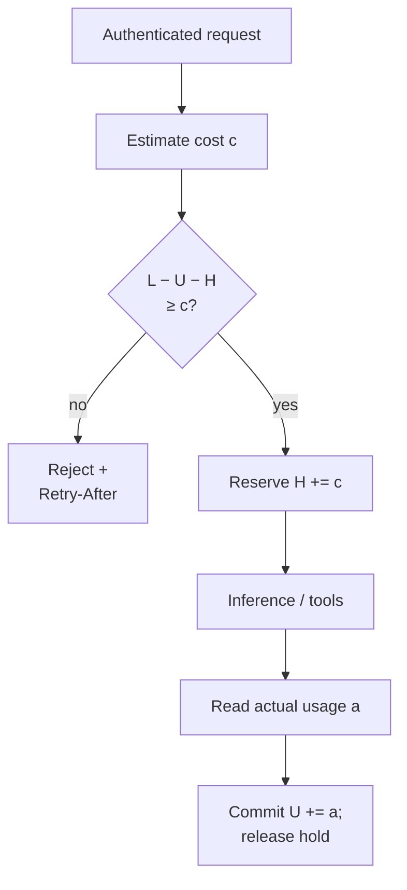

A **quota** is a hard or soft allowance of a scarce resource that an identity (user, seat, workspace, project, or organization) may consume inside a policy window before further work is rejected, delayed, degraded, or billed as overage. The unit can be tokens, requests, dollars of spend, GPU-seconds, vector writes, premium-model calls, or any other scarce product dimension.

Quotas answer *how much remains in this plan or accounting window*. They sit next to shorter [rate limits](glossary://rate-limit) (how fast you may call *right now*), [metered billing](glossary://metered-billing) (who pays for each unit), and [fair use limits](glossary://fair-use-limit) (whether fixed-price "unlimited" use is still ordinary). Provider APIs often ship both layers under mixed names: OpenAI separates short-window rate limits (RPM, TPM, and day-scale RPD/TPD) from monthly **usage limits** in dollars by tier; Anthropic separates **spend limits** (monthly cost caps) from rate limits (RPM, ITPM, OTPM). Azure OpenAI calls assignable TPM/RPM pools **quotas** (per subscription, region, and model); that product name is capacity assignment for short windows, not a monthly plan allowance, so treat the label carefully.

## Intuition

Rate limits protect short-term burst capacity on the gateway and fleet. Quotas protect longer-term fairness, cost, and packaging: tokens per day, dollars per month, premium calls per seat, embeddings per tenant. A well-behaved tenant can hit a quota after legitimate heavy work; a bad actor can stay under a rate limit while still burning the monthly allowance.

The product promise is the **allowance plus the behavior at exhaustion**. Silent quality drop, opaque `429`s, or sudden hard stops without reset time turn a capacity control into a support incident.

## How it differs from nearby controls

| Control | Question it answers | Typical unit | Time scale |
| --- | --- | --- | --- |
| [Rate limit](glossary://rate-limit) | How fast may this identity call *right now*? | RPM, TPM, concurrency | seconds to minutes |
| **Quota** | How much allowance remains in this plan window? | tokens/day, $/month, premium calls | hours to months |
| [Rolling quota](glossary://rolling-quota) | Same as quota, but over a moving window | tokens in last 24h | sliding window |
| [Fair use limit](glossary://fair-use-limit) | Is this still "ordinary" use of a fixed-price plan? | premium burn, concurrent streams | plan-relative |
| [Metered billing](glossary://metered-billing) | Who pays for each unit after the free tier? | tokens, tools, GPU-s | continuous ledger |

In practice stacks layer them: edge rate limits stop storms; quotas enforce plan economics; fair-use policies protect shared premium capacity; meters produce the invoice.

## Dimensions

A usable quota record names at least:

| Dimension | Why it matters |
| --- | --- |
| Identity + tenant | Seat vs workspace vs org; wrong key starves the wrong party |
| Resource unit | Input tokens ≠ output tokens ≠ dollars ≠ requests |
| Window shape | Fixed calendar (month UTC) vs [rolling](glossary://rolling-quota) (last 24h) |
| Limit $L$ and remaining $R$ | request gating decision is $R \ge \text{cost}$ |
| Reset / replenish time | Clients need `Retry-After` or reset timestamps |
| Route / model class | Premium and standard often share or split pools |
| Reservation vs commit | Pre-request gating hold for unknown output length |
| Exhaustion policy | Block, queue, fallback, or paid overage |

Providers often share a pool across model families (shared TPM) or keep input and output separate (ITPM vs OTPM). Your product quotas should mirror the cost axis you care about, not a vanity request count alone.

## Formula

For a single quota bucket with limit $L$, committed usage $U$, and reserved (in-flight) holds $H$:

$$
R = L - U - H
$$

A request with estimated cost $c$ is allowed only if $R \ge c$ (or under a soft policy that allows limited overdraft). On allow, $H \leftarrow H + c$. After completion with actual cost $c_{\mathrm{actual}}$:

$$
\begin{aligned}
H &\leftarrow H - c \\
U &\leftarrow U + c_{\mathrm{actual}}
\end{aligned}
$$

Here $c$ is the amount reserved for this request, not the final bill. If you reserved too high, release the unused hold so concurrent workers do not starve. If you reserved too low, either top up the hold mid-stream or accept a small post-commit overshoot and tighten estimates next time.

For a fixed calendar window that resets at $t_{\mathrm{reset}}$:

$$
U(t) = \sum_{e \in W(t)} c_e,\quad W(t) = \{e : t_{\mathrm{start}} \le t_e < t_{\mathrm{reset}}\}
$$

For a rolling window of length $W$ (for example 24 hours), drop events older than $t - W$ instead of zeroing at midnight. See [rolling quota](glossary://rolling-quota).

## Example

A B2B support-copilot plan for one workspace:

| Bucket | Limit | Window |
| --- | --- | --- |
| Standard model input | $2{,}000{,}000$ tokens | rolling 24h |
| Standard model output | $200{,}000$ tokens | rolling 24h |
| Premium model requests | $50$ calls | rolling 24h |
| Monthly spend safety | \$500 COGS | calendar month UTC |

At 14:00, counters show $1{,}850{,}000$ input used, $180{,}000$ output used, $48$ premium calls, and \$412 monthly spend. Three concurrent **standard-model** agent turns each reserve $\hat{c}_{\mathrm{in}}=40{,}000$ and $\hat{c}_{\mathrm{out}}=6{,}000$. Their total output hold is 18,000, within the remaining 20,000; assume their spend reservations also fit the monthly bucket:

$$
H_{\mathrm{in}} = 3 \times 40{,}000 = 120{,}000,\quad
R_{\mathrm{in}} = 2{,}000{,}000 - 1{,}850{,}000 - 120{,}000 = 30{,}000
$$

A fourth large turn that estimates $50{,}000$ input tokens is denied even though committed usage alone still has $150{,}000$ free. That is correct: without reservation, concurrent completions would overspend.

When the standard input budget is exhausted, the API returns a clear exhaustion body (which resource, remaining $0$, reset time) and may offer a cheaper [fallback lane](glossary://fallback-lane) or next-window reset. Communicate any model downgrade to the user. Premium request $51$ fails on the request counter even if token budgets remain.

Operational sketch:

```python title="quota-reserve.py"
def allow(
    *,
    limit: int,
    used: int,
    held: int,
    estimate: int,
) -> tuple[bool, int]:
    if min(limit, used, held, estimate) < 0:
        raise ValueError("quota quantities must be nonnegative")
    remaining = limit - used - held
    if remaining < estimate:
        return False, remaining
    return True, remaining - estimate


def reconcile(
    *,
    used: int,
    held: int,
    reserved: int,
    actual: int,
) -> tuple[int, int]:
    if min(used, held, reserved, actual) < 0 or reserved > held:
        raise ValueError("invalid reservation reconciliation")
    # Release the hold, then commit actual spend.
    held = held - reserved
    used = used + actual
    return used, held
```

## Diagram



## Reservation problem

LLM calls often need quota **before** exact usage is known. Output length is open-ended; tool loops add tokens; provider tokenizers may disagree with local estimates. Pattern:

1. **Estimate** input (tokenizer or char heuristic) and a conservative output ceiling.
2. **Reserve atomically** across all relevant buckets so concurrent admissions cannot both spend the same remainder. Give holds a TTL with renewal for legitimate long-running work; releasing a still-active hold can enable overspend.
3. **Execute** the call.
4. **Reconcile** with actual `prompt_tokens` / `completion_tokens` (or dollar cost) from the provider.
5. **Release** unused reserve and commit actual usage once, keyed by reservation/request id. If actual exceeded reserve, record the overshoot and tighten the estimator. Enforce output/tool-loop ceilings or require a successful top-up before further consumption to maintain a strict hard cap.

Without reservation, concurrent requests race on a shared counter and overspend. Without TTL on holds, a process crash permanently freezes capacity until manual repair.

## Exhaustion schema

Good quota responses tell the caller:

- **Which resource** ran out (input tokens, premium requests, monthly dollars)
- **Whether retry helps** (rate limit: maybe soon; monthly spend cap: usually not until next period or upgrade)
- **When capacity returns** (`Retry-After`, reset timestamp, or rolling window age-out)
- **What degraded path remains** (standard model, batch, queued job, paid overage)

HTTP status is often `429 Too Many Requests` (RFC 6585), which may include `Retry-After`, even when the binding limit is a long-window quota rather than a per-minute rate. Provider specifications differ: Claude's documented tier spend-cap response is429 without `retry-after`, while a user-configured spend limit ordinarily returns400. Prefer an application error code that distinguishes *plan quota exhausted* from *fleet overloaded* ([load shedding](glossary://load-shedding)) so clients do not retry-storm a hard monthly cap.

Response headers in the wild expose the same ideas: OpenAI `x-ratelimit-remaining-tokens` / reset fields for short windows; Anthropic `anthropic-ratelimit-*-remaining` plus monthly spend caps separate from RPM/ITPM/OTPM. Your product API should show remaining allowance and reset timing in the UI and headers, then return a clear exhaustion response when a request crosses the limit.

## What fails in production

- **Wrong identity key:** API key vs seat vs workspace; one noisy agent burns the whole org bucket, or seats never share when the plan is workspace-scoped.
- **Unit mismatch:** counting requests while cost is tokens (or dollars); one long-context call equals hundreds of short chats.
- **No reservation:** concurrent streams overspend; finance and the customer disagree about "the limit."
- **Leaked holds:** reserves never released on cancel, timeout, or crash; remaining drops to zero with low real usage.
- **Clock / window bugs:** fixed midnight reset vs rolling window; multi-region servers with different clocks; double-count on retry without idempotency.
- **Silent degradation:** route to a weaker model without telling the user; looks like a quality regression, not a quota event.
- **Retry on hard monthly caps:** clients treat every `429` as brief TPM; they spin and amplify load while spend is already capped.
- **Provider vs product counters:** local tokenizer estimates for request gating, provider bills actual tokens; without reconcile, product quota and COGS diverge.

## Debug path

For a disputed denial, log at decision time:

`tenant_id`, `identity`, `plan`, `bucket`, `unit`, `window_start`, `window_end`, `L`, `U`, `H`, `estimate`, `actual`, `decision`, `reset_at`, `request_id`.

Most quota bugs are perimeter math, duplicate commits, missing reconcile, wrong bucket for the route, or two services reading different stores for the same plan.

## Why it matters here

Quota design is where model cost, multi-tenant fairness, reliability, and product packaging meet. Curriculum on serving, routing, agent loops, and plan selection all assume someone defined the unit, the window, the reservation rule, and the exhaustion path before traffic arrived. Without deliberate quotas, one workspace's overnight agent can empty a shared provider tier, trip monthly usage limits, or make "unlimited" plans untrustworthy. With clear quotas, rate limits, meters, and fallbacks form a coherent control stack instead of a pile of ad hoc `429`s.

## Related terms

- [Rate limit](glossary://rate-limit)
- [Rolling quota](glossary://rolling-quota)
- [Metered billing](glossary://metered-billing)
- [Fair use limit](glossary://fair-use-limit)
- [Token budget](glossary://token-budget)
