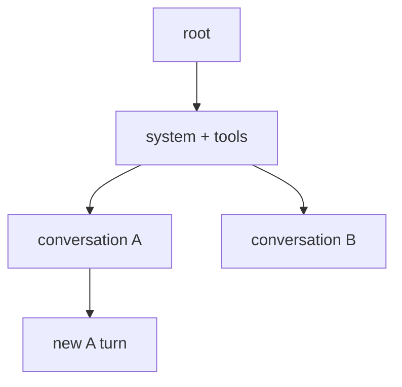

**Radix tree** is compressed prefix tree. Each edge can store sequence of key elements instead of one element, collapsing chains with only one child. Lookup walks shared prefixes, branches at first mismatch, and may split edge when new key shares only part of existing edge.

Trie over token IDs might store one token per edge. Radix tree can store `[system, prompt, tool, schema]` on one edge until two conversations diverge. Compression reduces node count and makes shared-prefix structure explicit. It doesn't make approximate matches: keys still match exactly.

## Core operations

- **Longest-prefix match:** return deepest path shared with query.
- **Insert:** add unmatched suffix, splitting partially matched edge when needed.
- **Delete or evict:** remove leaf and merge single-child chains when representation allows.
- **Prefix walk:** enumerate keys below shared prefix.

For token sequences $x$ and $y$, longest common prefix length is

$$
p=\max\{j:x_{1:j}=y_{1:j}\}.
$$

Tree can reuse value attached to first $p$ tokens and process only suffix after $p$.



## Example

Suppose two tokenized prompts are:

```text
[system, tools, user-A, question-1]
[system, tools, user-B, question-2]
```

Tree stores `[system, tools]` once as shared edge, then branches into user-specific suffixes. Third request beginning `[system, tools, user-A]` finds longer match on A branch and processes only its new suffix.

## Why it matters here

[RadixAttention](glossary://radixattention) uses radix tree over exact token sequences to index reusable [KV-cache](glossary://kv-cache) state. Shared system prompts, tool schemas, and conversation histories become common paths. New request attaches cached KV for longest matching prefix and [prefills](glossary://prefill) only unmatched suffix.

Prefix caches use different indexing strategies. vLLM automatic [prefix cache](glossary://prefix-cache) commonly hashes chains of full KV blocks, while SGLang RadixAttention uses a radix-tree index. Both exploit causal-model prefix reuse, with different lookup granularity and eviction behavior.

Radix tree also appears outside serving in IP routing and string indexes. Don't confuse data structure with radix sort or with attention algorithm itself.

## Operational checks

- Exact token IDs, tokenizer, chat template, model weights, and adapter identity must agree.
- Per-request noise near prompt start shortens match.
- Cache policy still decides which tree paths remain resident.
- Multi-tenant deployments need isolation because shared-cache timing can reveal prefix reuse.

Primary reference for LLM use: [SGLang paper](https://arxiv.org/abs/2312.07104).

## Related terms

- [RadixAttention](glossary://radixattention)
- [Prefix cache](glossary://prefix-cache)
- [KV cache](glossary://kv-cache)
