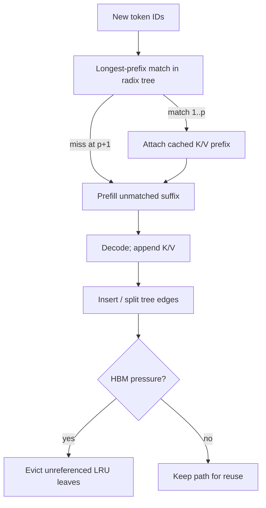

**RadixAttention** is a serving technique that keeps finished requests' [KV cache](glossary://kv-cache) alive in a [radix tree](glossary://radix-tree) keyed by token sequences, so later requests with the same exact prefix can skip recomputing that prefix. It was introduced in SGLang (Zheng et al., 2024; arXiv:2312.07104) as automatic, systematic [prefix cache](glossary://prefix-cache) reuse across multi-call LM programs, multi-turn chat, few-shot prompts, and agent trees.

RadixAttention keeps the standard causal-attention equation and changes the **index and lifetime** of cached $K$/$V$. The runtime inserts tensors into a tree when a request finishes, matches new prompts against that tree, and [prefills](glossary://prefill) the unmatched suffix.

## Intuition

Causal self-attention makes compatible prefix reuse possible. With the same weights/adapters, positional configuration, non-text inputs, and inference behavior, $k_j$ and $v_j$ for position $j$ depend on the prefix through that position. Matching token IDs alone is insufficient if those other inputs differ. Reuse preserves the mathematical computation, subject to numerical/kernel differences; KV storage alone does not retain every prefix logit. Engines may still evaluate a final prompt token to obtain next-token logits even on a full prefix hit.

Many production prompts waste that fact. System policy, tool schemas, few-shot blocks, chat history, and agent templates repeat across calls while only the last user turn or tool result changes. Without a shared structure, each request pays full prefill again. With a radix tree, the shared path is stored once near the root and every branch reuses it.

A [radix tree](glossary://radix-tree) (Patricia trie) is a compressed prefix tree whose edges can hold a *sequence* of characters or tokens. That keeps the tree shallow and makes longest-prefix match cheap. Keys are **token IDs**, so semantic similarity between text embeddings does not affect a match. One different token ID ends the match.

SGLang also retains **generation outputs** alongside prompt tokens. Multi-turn chat and self-consistency sampling can therefore share prior assistant turns when the next request continues that conversation.

## How it works

### Tree as a cache map

- **Keys:** sequences of token IDs (edges may compress multi-token spans).
- **Values:** the corresponding $K$/$V$ tensors for that span, stored in GPU memory (in SGLang's design, paged layout with page size one token; the tree *structure* lives on the CPU).
- **Operations:** longest-prefix match on admit, insert after prefill/decode, node split when two children share a shorter common prefix, leaf-first LRU eviction under memory pressure.

Typical admit path:

1. Tokenize the full prompt (and multimodal placeholders if any).
2. Walk the radix tree from the root, matching token IDs edge by edge.
3. Stop at the first mismatch; let $p$ be the matched length.
4. Attach cached $K$/$V$ for positions $1..p$ (increment reference counts so eviction cannot steal them mid-request).
5. Prefill only tokens $p+1..N$; append new nodes (and split edges as needed) for the new path.
6. During decode, append generated tokens' $K$/$V$ onto the same path so later turns can reuse them.

When a second chat session shares only the system prompt, the engine **splits** a node so the shared edge becomes a parent and each session's private history becomes a child. Shared ancestors stay until every dependent leaf is gone.

### Eviction and reference counts

GPU HBM is finite. RadixAttention does **not** reserve a fixed separate cache pool in the original design: cached tokens and live sequences share one memory pool. Under pressure, an **LRU leaf-first** policy removes the least recently used **leaf**. Evicting a leaf leaves common ancestors intact until those ancestors become leaves too. That bias keeps hot shared roots (system prompts, few-shot banks) longer than cold private branches.

Each node has a **reference counter** for how many currently running requests use it. Only nodes with refcount zero are evictable. Continuous batching therefore cannot drop a prefix still needed by an in-flight batch. When many waiting requests need memory for a larger batch, the system can drop idle cached leaves in favor of live work.

### Cache-aware scheduling

**Admission order** also affects hit rate. Alternating unrelated tenants through a full tree yields low hits even when long shared prefixes exist. The original SGLang design uses longest-shared-prefix-first scheduling; its offline cache-hit optimality argument assumes a cache at least as large as the longest request and a DFS traversal of the request tree. Those assumptions concern cache hits; evaluate latency and fairness separately. Current SGLang exposes multiple scheduling policies, so check the deployment's configured policy. Naive cache-first policies can starve unique prompts, requiring fairness or priority controls.

### Boundary with PagedAttention

[PagedAttention](glossary://pagedattention) (vLLM) combines **paged KV storage and attention kernels** that read noncontiguous blocks: variable-length sequences avoid one contiguous max-sequence slab. RadixAttention is a **prefix index and lifetime policy**: which sequences stay after completion and how longest common prefixes are found. They compose: pages store tensors; the radix tree decides which pages remain shared and searchable. vLLM-style automatic prefix caching often hashes **full blocks**; RadixAttention can match at token granularity along the tree (implementation details vary by version and page size).

## Diagram



```text
                    root
                     |
          [system + tools]          <-- shared edge (hot root)
               /          \
        [user A hist]   [user B hist]
             |               |
        [A turn 3]      [B turn 2]

New request: system + tools + user A hist + "new question"
Match stops after user A hist; prefill only the new question.
```

## Example

An agent API always starts with the same system prompt and tool schema: $N_{\mathrm{sys}} = 1{,}200$ tokens. A multi-turn session then has $N_{\mathrm{hist}} = 3{,}000$ tokens of prior turns already in the tree. The new user message is $N_{\mathrm{new}} = 80$ tokens.

- **Cold miss** (empty tree): prefill cost scales with $1{,}200 + 3{,}000 + 80 = 4{,}280$ tokens.
- **Warm session hit** (history still resident): match length $p = 4{,}200$; prefill only $80$ tokens.
- **Shared system only** (history already evicted): match length $p = 1{,}200$; prefill $3{,}080$ tokens.

If prefill time is roughly linear in uncached tokens at $c = 0.04\,\mathrm{ms/token}$ (order-of-magnitude model; batching and kernels matter):

| Case | Uncached tokens | Prefill time |
|---|---:|---:|
| Cold | $4{,}280$ | $\approx 171\,\mathrm{ms}$ |
| System only | $3{,}080$ | $\approx 123\,\mathrm{ms}$ |
| Full history hit | $80$ | $\approx 3\,\mathrm{ms}$ |

[TTFT](glossary://ttft) drops with the hit depth; decode cost barely changes, because each new token still attends over the full context. Throughput also rises when shared roots free HBM: more concurrent sequences fit for the same model size.

Few-shot and self-consistency look similar on the tree: a shared example bank sits under one edge; each question or sampled answer branches as a child. Tree-of-thought and `fork`-style programs create exactly the shape RadixAttention indexes well.

## Formula

SGLang defines the token-level prefix [cache hit rate](glossary://cache-hit-rate) as:

$$
HR_{\mathrm{tok}}
=
\frac{\sum N_{\mathrm{cached}}}{\sum N_{\mathrm{prompt}}}
$$

where $N_{\mathrm{cached}}$ is the matched prefix length $p$ on each request and $N_{\mathrm{prompt}}$ is the full prompt length. Prefill work on a hit is:

$$
T_{\mathrm{prefill}}
\approx
c \cdot (N_{\mathrm{prompt}} - N_{\mathrm{cached}})
=
c \cdot (N_{\mathrm{prompt}} - p)
$$

for a rough constant $c$ (ms per uncached token). Decode still scales with full context length, while RadixAttention reduces repeated **prefix** computation and shares **prefix** memory.

## Trade-offs

| Strength | Cost / risk |
|---|---|
| Automatic longest-prefix reuse without manual cache keys | Exact token match only; chat-template or tokenizer drift forces misses |
| Leaf-first LRU keeps hot shared roots | Private long branches still fill HBM until evicted |
| Works with continuous batching and tensor-parallel shards | Cache-aware reordering can starve short unique prompts if unbounded |
| Negligible overhead on full miss (tree on CPU) | Hit rate collapses under mixed tenants with little shared text |
| Generation outputs stay in the tree for multi-turn | Stale conversation nodes compete with new traffic until LRU clears them |

**What fails in production.** Front-load stable text and put per-request noise last: timestamps, request IDs, or shuffled tool JSON at the start of the prompt destroy $p$. A tokenizer or chat-template upgrade that retokenizes the same system string can invalidate prefix matches. Aggressive multi-tenant mix without isolation can thrash leaves and even roots. Measure $HR_{\mathrm{tok}}$, TTFT p50/p95, eviction rate, and HBM occupancy on a realistic mix, not a synthetic all-same-system bench alone. Multimodal cache keys must distinguish media content as well as the causal prefix. A matching image hash does not make its downstream KV reusable when preceding text differs.

## Why it matters here

RadixAttention is the concrete mechanism behind "the server already knew that system prompt." For LLM engineers it sits at the junction of data structures and serving: exact-prefix KV reuse, tree-shaped agent workloads, and why TTFT depends on prompt *structure* as much as model FLOPs. Understanding it clarifies what [prefix cache](glossary://prefix-cache) products and [SGLang](glossary://sglang) report when they advertise hit rates and multi-turn speedups.

## Related terms

- [Prefix cache](glossary://prefix-cache)
- [Radix tree](glossary://radix-tree)
- [KV cache](glossary://kv-cache)
- [Prefill](glossary://prefill)
- [Cache hit rate](glossary://cache-hit-rate)
- [SGLang](glossary://sglang)
