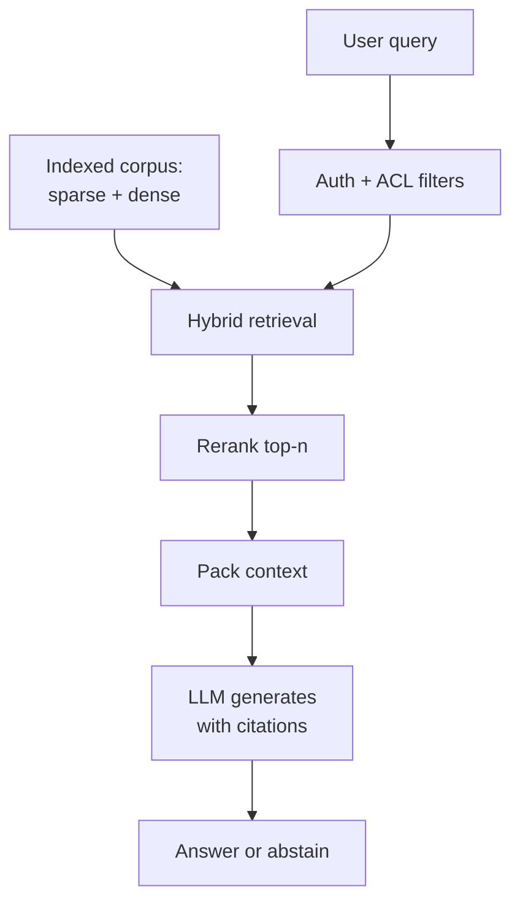

**Retrieval-augmented generation (RAG)** is a generation pattern that pulls external text (or other evidence) into the model context at inference time, then conditions the answer on that evidence plus the user query. Lewis et al. (2020, NeurIPS; arXiv:2005.11401) named and formalized it as a hybrid of **parametric memory** (weights of a pre-trained generator) and **non-parametric memory** (a searchable document index). The retriever proposes latent documents $z$ given input $x$; the generator produces $y$ conditioned on $x$ and $z$.

Production systems usually realize the same idea as an explicit **pipeline**: ingest and chunk a corpus, retrieve top candidates, optionally rewrite the query and rerank, pack a context packet under a token budget, then generate with instructions to use and cite the packet. The product goal is grounded answers over private, fresh, or long-tail knowledge without re-pretraining the model every time a policy or runbook changes.

## Intuition

An LLM alone stores facts only as weights. That memory is hard to update, hard to audit, and easy to invent when the right fact is missing. RAG splits the job:

1. **Find evidence** in a corpus you control (docs, tickets, code, policies, product data).
2. **Write the answer** only after that evidence is in the prompt.

Updating knowledge means re-indexing documents (or hot-swapping an index), not full model retraining. Provenance becomes possible because the system can point at the chunks it retrieved. A fluent answer without evidence is still a guess; RAG's job is to make that guess unnecessary when the corpus already holds the answer.

## How it works

A typical production path has offline and online halves.

### Offline (index)

1. **Ingest.** Parse PDFs, HTML, tickets, code. Strip boilerplate; keep structure (headings, tables, ACLs).
2. **Chunk.** Split into retrieval units with stable ids and metadata (source, section, tenant, version). The chunk is what gets embedded, ranked, and cited.
3. **Index.** Build sparse (BM25 / learned sparse), dense (embedding + ANN), or both. Same chunk ids on every index.
4. **Version.** Record embedder id, chunker version, and content checksum so "why did this answer change?" is answerable.

### Online (serve)

1. **Accept query** under auth. Apply tenant and [ACL](glossary://acl) filters *before* ranking when access control matters.
2. **Optional rewrite.** Expand, decompose, or HyDE-style rewrite for better retrieval ([query rewriting](glossary://query-rewriting)).
3. **Candidate generation.** Hybrid sparse + dense top-$k$ (often $k \in [20, 100]$).
4. **Rerank.** Cross-encoder or late-interaction model reorders a shortlist to $n$ (often $n \in [3, 12]$) for packing.
5. **Pack.** Label evidence blocks, enforce token budget, order for attention (strong hits near start/end when windows are long).
6. **Generate.** Instruct the model to answer from evidence, cite chunk ids, and abstain when support is missing.
7. **Trace.** Log rewritten query, candidates, scores, packed ids, citations, and final text so failures are diagnosable.

Original Lewis RAG jointly fine-tuned the retriever's query encoder and generator with documents as latents, while keeping the document encoder and document index fixed. Most product stacks keep retrieval and generation as separate stages with frozen or independently trained components, then evaluate the full path as one system.

## Formula

Lewis et al. treat the retrieved document $z$ as a latent and approximate $p(y \mid x)$ by top-$k$ documents from the retriever $p_\eta(z \mid x)$ and generator $p_\theta$.

**RAG-Sequence** (one document for the whole answer):

$$
p_{\text{RAG-Sequence}}(y \mid x) \approx \sum_{z \in \mathrm{top}\text{-}k(p(\cdot \mid x))} p_\eta(z \mid x)\, p_\theta(y \mid x, z)
= \sum_{z \in \mathrm{top}\text{-}k} p_\eta(z \mid x) \prod_{i=1}^{N} p_\theta(y_i \mid x, z, y_{1:i-1})
$$

**RAG-Token** (document choice can change per output token):

$$
p_{\text{RAG-Token}}(y \mid x) \approx \prod_{i=1}^{N} \sum_{z \in \mathrm{top}\text{-}k(p(\cdot \mid x))} p_\eta(z \mid x)\, p_\theta(y_i \mid x, z, y_{1:i-1})
$$

Their dense retriever (DPR-style bi-encoder) scores passages by inner product:

$$
p_\eta(z \mid x) \propto \exp\bigl(\mathbf{d}(z)^\top \mathbf{q}(x)\bigr)
$$

with $\mathbf{d}(z)$ and $\mathbf{q}(x)$ from separate document and query encoders; top-$k$ is approximate MIPS over the index.

**Production packing form** (what most code does) applies a deterministic packer $C$ and then runs one conditioned generation:

$$
\hat{y} = \arg\max_y \; p_\theta\bigl(y \mid \mathrm{prompt}(x, C(x))\bigr)
\quad\text{where}\quad
C(x) = \mathrm{pack}\bigl(\mathrm{rerank}(\mathrm{retrieve}(x))\bigr)
$$

Quality follows a cascade. If gold evidence is absent from $\mathrm{retrieve}$, retrieval has failed. If retrieved evidence is dropped by $\mathrm{pack}$, packing failed. If packed evidence is ignored, classify the failure as generation faithfulness.

The $\arg\max$ describes an idealized decoding objective. Practical systems use greedy/beam decoding or sampling, so their outputs may fall below the globally most probable complete sequence.

## Diagram



## Example

Developer assistant. Query: *"Which checks block production for release r17?"* Deployment corpus versioned as `deploy-policy-v3`.

| Stage | What happens |
| --- | --- |
| Chunk | Heading-aware split keeps "Production release gates" as one unit with `acl: engineering`, `source_id: deploy-policy-v3`, `heading_path: Releases > Production` |
| Retrieve | Hybrid search returns $k=40$ candidates; gold chunk rank 6 dense / rank 2 BM25 |
| Fuse + rerank | RRF then cross-encoder puts the current approval and rollback clause at rank 1; an obsolete staging-only clause falls to rank 8 |
| Pack | Top 5 chunks, ~1.8k tokens, labeled `[doc_3]`, `[doc_7]`, ... with heading paths; strongest policy hit first |
| Generate | Answer: production requires the private safety suite, signed approval, and a rollback artifact; cites `[doc_3]`; notes staging uses a lighter gate |

Without retrieval, a base model may invent a generic "tests must pass" rule. With retrieval of only the staging clause, it can omit production approval and rollback requirements. The failure is missing the right chunk in $C(x)$.

Sketch of the serve path:

```python
def answer(query: str, user: User) -> Answer:
    q = rewrite(query)  # optional
    cands = hybrid_search(q, k=40, acl=user.acl)
    top = cross_encoder_rerank(q, cands, n=8)
    packet = pack_context(top, budget_tokens=2000)
    return llm.generate(
        system="Answer only from evidence. Cite [doc_id]. If unsupported, say so.",
        user=query,
        evidence=packet,
    )
```

## Debug path

When an answer is wrong, walk the cascade in order. Do not start with temperature or system-prompt rewrites.

| Step | Question | Metric / signal |
| --- | --- | --- |
| 1 | Was the right text ingested and chunked intact? | Span containment; parser version; content checksum |
| 2 | Did candidates include gold? | [Recall@k](glossary://recall-at-k) on labeled queries |
| 3 | Did fusion/rerank keep it high enough to pack? | Rank before/after rerank; packing cut line |
| 4 | Did packing preserve the supporting span? | Token budget, truncation, dedup of near-duplicates |
| 5 | Did the model use the evidence? | Citation match; faithfulness / groundedness judge |
| 6 | Was access correct? | ACL filter applied pre-retrieve; no cross-tenant hits |

A useful trace names: original query, rewritten query, retriever versions, candidate ids + scores, reranker scores, packed packet, citations, ACL decision, and final answer. That separates "never retrieved" from "retrieved but demoted" from "packed but unused" from "cited the wrong source."

**What fails in production (common):**

- **Bad chunks.** Answer and qualifier split across boundaries; tables/code bisected.
- **Wrong retriever mix.** Pure dense misses IDs and error codes; pure BM25 misses paraphrase.
- **Stale index.** Policy updated in CMS; vectors still encode last week's text.
- **Lost in the middle.** Liu et al. (TACL 2024; arXiv:2307.03172) show long multi-document contexts often use beginning and end better than the middle. Dumping 20 middling chunks can hurt more than packing 5 sharp ones.
- **Faithfulness gaps.** Gold chunk is present; model still invents a number or softens a restriction.
- **Citation theater.** Model emits `[3]` that was never in the packet, or cites a chunk that does not support the claim.
- **Prompt injection via docs.** Untrusted retrieved text tries to override system policy; treat evidence as data, not instructions ([prompt injection](glossary://prompt-injection)).
- **ACL after rank.** High-scoring private chunks leak, or filters applied only on one hybrid path.

## Trade-offs

| Choice | Gain | Cost / risk |
| --- | --- | --- |
| Larger $k$ then rerank | Higher chance gold enters the shortlist | Latency, noise, lost-in-the-middle if you pack everything |
| Bigger chunks | More self-contained context | Weaker embedding locality; burns token budget |
| Smaller chunks | Sharper retrieval | Missing qualifiers; need parent/child expansion |
| Hybrid + rerank | Best recall across query types | Two indexes, more moving parts, versioning burden |
| Long-context "stuff all docs" | Simpler stack for small corpora | Cost, attention dilution, still needs retrieval at scale |
| End-to-end fine-tuned RAG | Can learn task-specific retrieval | Harder ops; index/encoder coupling; rare outside research |
| Index hot-swap | Update world knowledge without retrain | Must keep embedder and chunker versions consistent |

Choose retrieval to match the question. Local chunk retrieval can support multi-hop questions with decomposition and repeated searches; corpus-wide summaries may benefit from a [GraphRAG](glossary://graphrag) variant, which is itself retrieval-augmented generation. Retrieval may add little when the task is pure style transformation with no external facts, or when all required evidence already fits curated context and the latency budget cannot afford another round trip.

## Why it matters here

RAG is the default architecture for grounded assistants, internal document QA, support automation, codebase search, policy reasoning, and enterprise products that need source-backed answers. Curriculum work on [chunking](glossary://chunking), [dense retrieval](glossary://dense-retrieval), [hybrid search](glossary://hybrid-search), [rerankers](glossary://reranker), [context engineering](glossary://context-engineering), evaluation, and access control all hang on this pattern: evidence first, then generation, with a trace that proves which stage failed.

## Related terms

- [Dense retrieval](glossary://dense-retrieval)
- [Hybrid search](glossary://hybrid-search)
- [Chunking](glossary://chunking)
- [Reranker](glossary://reranker)
- [Recall@k](glossary://recall-at-k)
