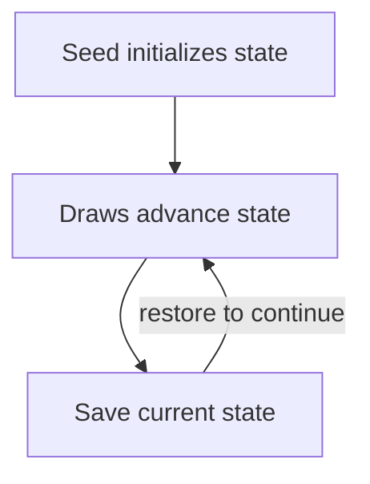

A random-number generator (RNG) supplies values used for sampling, shuffling, initialization, and operations such as dropout. Most training software uses a pseudorandom generator: a deterministic algorithm whose internal state produces a sequence that behaves statistically like random draws. A seed initializes that state; each draw advances it.

## Seeds initialize; checkpoints resume

Restarting with the original seed restarts the draw sequence. Resuming midway requires restoring the generator's current state or a correctly managed key/counter. Python, NumPy, framework CPU code, and accelerator devices can maintain separate generators. Distributed workers may also need distinct streams so they don't accidentally sample identical data.

[Python's random documentation](https://docs.python.org/3/library/random.html) distinguishes seeding from saving and restoring state. Reproducibility still depends on which operations consume draws and in what order. A fixed seed can't repair nondeterministic kernels or changed data ordering.

## Example

Two generators start from seed 17 and initially produce matching draws. One worker consumes an extra draw for augmentation before sampling an action. Their subsequent actions can now differ even though both logs still say "seed 17." Saving state immediately before action sampling lets a replay begin at the correct point.

## Why it matters here

RNG state belongs in training resume and reproducibility records. Log seeds for experiment identity, but checkpoint states and data cursors for continuation. Compare multiple independent seeds when estimating training variability. Ordinary pseudorandom generators aren't suitable for secrets or authentication tokens; use the platform's cryptographic facilities for those purposes.

## Related terms

- [PRNG key](glossary://prng-key)
- [Dropout](glossary://dropout)
- [Model checkpoint](glossary://model-checkpoint)
- [Reproducible environment](glossary://reproducible-environment)
- [Temperature](glossary://temperature)
