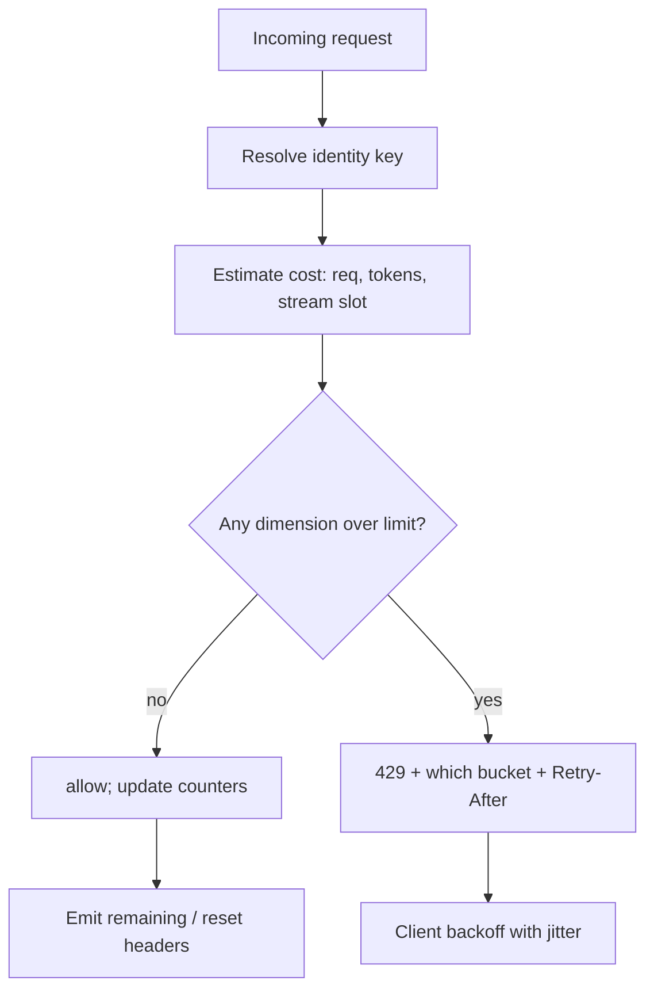

A **rate limit** is a policy that caps how fast an identity may consume a protected resource. After the cap is hit inside a time window (or a continuously refilled bucket), the system rejects, delays, or de-prioritizes further work until capacity returns.

Rate limits answer *how fast right now*, while longer-horizon [quotas](glossary://quota) answer *how much this month*. They sit beside local capacity signals ([backpressure](glossary://backpressure), [load shedding](glossary://load-shedding)) and dependency health ([circuit breaker](glossary://circuit-breaker)). In LLM stacks the scarce units are often requests **and** tokens, concurrent streams, GPU seconds, or expensive model routes, because one chat turn can be cheap or enormous.

HTTP clients usually see enforcement as status **429 Too Many Requests** (RFC 6585): the response should explain the condition and may include `Retry-After`. OpenAI and Anthropic also expose remaining budget and reset timing in response headers so callers can pace themselves before they fail.

## Intuition

A quota caps total allowance over a plan window. A rate limit caps how quickly that allowance may be consumed. A caller can remain under quota and still exceed the permitted requests, tokens, or concurrent work per second.

| Control | Question | Typical action when hit |
|---|---|---|
| **Rate limit** | How fast may this identity hit this resource? | `429`, queue, or slow allow |
| **[Quota](glossary://quota)** | How much allowance remains in the plan window? | Exhaustion until reset or overage |
| **[Backpressure](glossary://backpressure)** | Is *this path* full right now? | Bound queues; await or reject |
| **[Load shedding](glossary://load-shedding)** | Must we drop work to protect goodput? | Drop low priority under overload |
| **[Circuit breaker](glossary://circuit-breaker)** | Is the *dependency* unhealthy? | Fail fast / fallback |

Providers often enforce **several** rate dimensions at once. The first one you exhaust wins. OpenAI documents RPM (requests per minute), RPD, TPM (tokens per minute), TPD, and model-specific measures. Anthropic's Messages API uses RPM, **ITPM** (input tokens per minute), and **OTPM** (output tokens per minute), and states that capacity is replenished with a [token bucket](glossary://token-bucket) rather than a hard fixed-window reset.

## Pick the unit first

Request count alone is a weak unit for generative models. Prefer the resource that actually burns capacity or money:

- Requests per minute / second (RPM, RPS)
- Tokens per minute (combined TPM, or split ITPM / OTPM)
- Concurrent streams or in-flight generations
- Tool calls, vector writes, image or audio minutes
- Premium-model routes or dollar-weighted cost

One agent turn can issue many model calls. Late steps often carry larger contexts, so token rate limits bind even when request counts look fine.

## How common algorithms work

Three shapes cover most production gates. All need an **identity key** (API key, org, project, workspace, user, IP) and a **cost** (usually 1 per request, or estimated tokens).

### Fixed window

Count usage in buckets such as "this calendar minute." Allow if count $+$ cost $\le L$. Cheap and easy to explain. **perimeter burst:** a client can spend a full limit at $12{:}00{:}59$ and again at $12{:}01{:}00$, briefly $2L$ in two seconds.

### Sliding window / rolling window

Count usage over the last $W$ seconds (or approximate with fine sub-buckets). Capacity returns as old events age out. Smoother UX than fixed windows; more state and clock care. Closely related to a [rolling quota](glossary://rolling-quota) when the window is long.

### Token bucket (continuous refill)

Maintain balance $b$ up to capacity $B$, refilled at rate $r$ units per second. On an arrival of cost $c$ after elapsed time $\Delta t$:

$$
b \leftarrow \min\!\bigl(B,\; b + r\,\Delta t\bigr),\qquad
\text{allow if } b \ge c,\ \text{then } b \leftarrow b - c.
$$

Burst size is $B$; long-run average is $r$. Anthropic documents this for Claude API rate limits. Here, bucket "tokens" count rate credits; tokenizer tokens are a separate unit.

```python title="token-bucket-check.py"
def allow(bucket, cost: float, now: float) -> bool:
    # Caller serializes this entire operation and supplies a monotonic clock.
    if cost < 0 or now < bucket.last:
        raise ValueError("cost must be nonnegative and time must not go backward")
    elapsed = now - bucket.last
    bucket.tokens = min(
        bucket.capacity,
        bucket.tokens + elapsed * bucket.refill_per_s,
    )
    bucket.last = now
    if bucket.tokens < cost:
        return False
    bucket.tokens -= cost
    return True
```

## Diagram



## Example

A workspace plan advertises:

| Dimension | Limit | Notes |
|---|---|---|
| Chat turns | 60 RPM | Per workspace |
| Combined tokens | 120,000 TPM | Input + output estimate |
| Concurrent streams | 5 | Decode slots held open |
| Premium model | 10 RPM | Separate route |

At 14:03 a support bot fires 40 short turns (~800 tokens each) in one minute: fine on RPM, but $40 \times 800 = 32{,}000$ TPM still under the token cap. Then an agent loop starts: 8 parallel long-context jobs, each ~20k input tokens and max output 2k.

- **TPM:** if all 32,000 earlier tokens are still counted and no capacity has replenished, only 88,000 remain. Four long jobs can reserve $4\times22{,}000=88{,}000$; a fifth fails the token gate even though one stream slot remains.
- **Concurrent streams:** in a separate fresh-bucket case, five long jobs reserve 110,000 tokens and fill all five slots. Further parallel jobs fail the stream gate; a sixth would also bring reserved tokens to 132,000, beyond the token capacity, even if a slot freed before tokens replenished. request gating must atomically honor every dimension.
- **caller interfaces:** response body names the exceeded bucket (`concurrent_streams` or `tpm`), and `Retry-After: 12` (or provider reset headers) tells the client when retry is useful.

OpenAI-style headers on success look like `x-ratelimit-limit-requests`, `x-ratelimit-remaining-tokens`, `x-ratelimit-reset-tokens`. Anthropic returns `retry-after` on limit hits plus `anthropic-ratelimit-*-remaining` / `*-reset` fields for requests, input tokens, and output tokens. Honor `Retry-After` when present; otherwise use [retry backoff](glossary://retry-backoff) with jitter. Failed retries still consume request budget, so tight loops make the hole deeper.

## Worked numbers (token bucket)

Capacity $B = 10$ request-credits, refill $r = 2$/s. At $t=0$ the bucket is full.

1. Burst of 10 cost-1 calls: all allowed; $b = 0$.
2. Next call at $t=0.1$s: refill adds $0.2$; still insufficient → reject.
3. At $t=1.0$s: the rejected call retained its 0.2 credits, and another 0.9 seconds adds 1.8, giving $b=2$; two more cost-1 calls succeed.

Long-run sustained rate is 2 req/s, but short spikes up to 10 are legal. That matches interactive chat better than a pure leaky-bucket "exactly 2/s forever" shape.

## caller interfaces and production failures

Good limit responses name **which** dimension failed, whether retry helps, and **when** capacity returns. Vague 500s turn rate policy into mystery outages.

What usually breaks in production:

- **Wrong identity key** (shared API key, missing project scope, IP behind NAT) so one tenant burns another's budget or everyone shares one bucket.
- **Request limits only** while agents blow TPM / OTPM mid-trajectory.
- **No reservation / reconcile** for unknown output length: concurrent allows overspend the account, or `max_tokens` is counted too aggressively (provider-specific and volatile). OpenAI/Azure-style pre-request gating TPM often uses a **provider-estimated** token cost for the request (commonly sensitive to `max_tokens` and the prompt estimate; re-verify current docs rather than hard-coding a "max of" rule). Anthropic states OTPM counts generated tokens and `max_tokens` doesn't pre-charge OTPM.
- **Distributed counters** with stale reads: under-block abuse or over-block good traffic; need atomic increments, Redis-style scripts, or accept bounded inconsistency intentionally.
- **Thundering herd:** all clients retry at the same reset second without jitter.
- **Clock skew** across gateways: fixed windows disagree on partitions; prefer monotonic elapsed time for token buckets.

## Debug path

For an unexpected rejection, log identity, route, model, unit, window or bucket parameters, counter value, threshold, estimated vs actual cost, and the counter store (local vs shared). Compare client-visible headers to server-side metrics. Check keys, request-versus-token units, and perimeter calculations before investigating model availability.

## Why it matters here

Rate limits are where product promises meet finite model-serving capacity. LLM apps fail here early: agent fan-out multiplies RPM, growing context multiplies TPM, and streaming holds concurrency. Designing units, algorithms, headers, and client backoff is part of shipping reliable AI systems.

## Related terms

- [Quota](glossary://quota)
- [Token bucket](glossary://token-bucket)
- [Retry backoff](glossary://retry-backoff)
- [Rolling quota](glossary://rolling-quota)
- [Backpressure](glossary://backpressure)
