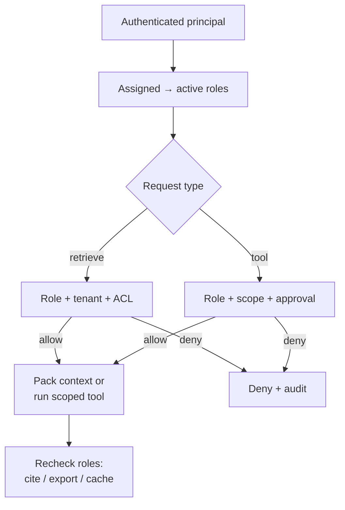

**Role-based access control (RBAC)** grants permissions through *roles* assigned to principals (users, service accounts, agent runtimes), not through one-off rules on every object. A role names a job function; permissions (operations on objects) attach to roles; principals acquire authority only by role membership. The trusted control plane evaluates role membership before retrieval, prompt assembly, tool execution, export, or cache write. The model never decides access from free text.

NIST formalized the idea in the early 1990s (Ferraiolo and Kuhn, 1992) and published a unified model (Sandhu, Ferraiolo, and Kuhn, 2000) later adopted as ANSI/INCITS 359. That model packages features as **Core RBAC**, **Hierarchical RBAC**, **static separation of duty (SSD)**, and **dynamic separation of duty (DSD)**. A practical design can start from Core RBAC and add hierarchy or constraints when job relationships or separation-of-duty rules require them.

## How it works

### Core sets and relations

Core RBAC (NIST / INCITS 359 style) is built from:

| Set | Meaning in an LLM product |
| --- | --- |
| $\mathrm{USERS}$ | Humans *and* machine principals: service accounts, agent sessions, workload identities |
| $\mathrm{ROLES}$ | Job functions: `support_agent`, `analyst`, `workspace_admin`, `svc_search` |
| $\mathrm{OPS}$ | Operations: `read`, `export`, `call_tool`, `manage_tools`, `promote_model` |
| $\mathrm{OBS}$ | Objects: documents, tenants, tools, indexes, export jobs, deploy targets |
| $\mathrm{PRMS}$ | Permissions: approvals to perform operations on objects |
| $\mathrm{SESSIONS}$ | A principal's active context with a chosen subset of assigned roles |

Assignments are many-to-many:

$$
\mathrm{UA} \subseteq \mathrm{USERS} \times \mathrm{ROLES}, \qquad
\mathrm{PA} \subseteq \mathrm{PRMS} \times \mathrm{ROLES}
$$

For the atomic permission encoding used in this entry's authorization code, permissions are operation–object pairs:

$$
\mathrm{PRMS} \subseteq \mathrm{OPS} \times \mathrm{OBS}
$$

For a session $s$ with activated roles $\mathrm{session\_roles}(s)$, available permissions are the union of those assigned to active roles:

$$
\mathrm{avail\_session\_perms}(s) =
\bigcup_{r \in \mathrm{session\_roles}(s)}
\mathrm{assigned\_permissions}(r)
$$

Authorization for principal $u$ performing operation $op$ on object $o$ in session $s$ is then membership of $(op, o)$ in that set, after trusted identity resolution. Formal models may group operation–object pairs into permission objects using a power-set representation; with that encoding, check the contents of the granted permission objects rather than testing a pair against a set of sets. Default is deny: missing role, unknown object, or policy-service timeout means no grant.

### Hierarchical and constrained RBAC

**Role hierarchy** $\mathrm{RH} \subseteq \mathrm{ROLES} \times \mathrm{ROLES}$ is a partial order: a senior role inherits permissions of juniors. Formally (NIST), $r_1 \succeq r_2$ only if

$$
\mathrm{authorized\_permissions}(r_2) \subseteq \mathrm{authorized\_permissions}(r_1)
$$

and user membership flows the other way (users of the senior are authorized for the junior). Use hierarchy sparingly in agent products: a broad `agent` senior that inherits every tool role reintroduces the blast radius RBAC was meant to shrink.

**SSD** blocks conflicting *assignments* (for example, no user may hold both `refund_issuer` and `refund_auditor`). **DSD** blocks conflicting *activations in one session* (hold both roles over a career, but not in the same login). Both implement separation of duty without hard-coding every principal.

### Enforcement path in LLM systems

Roles are data in a source of truth (IdP groups, IAM bindings, app DB). They are not system-prompt sentences.

1. Authenticate the caller; bind tenant / workspace identity in middleware.
2. Resolve $\mathrm{UA}$: roles for that principal from the directory or policy store, never from model output.
3. Optionally activate a least-privilege subset of roles for this session or task (DSD / JIT).
4. Before retrieval: filter candidates by roles plus [ACL](glossary://acl) / tenant metadata so denied chunks never enter ranking or the prompt.
5. Before tool execution: check role $\rightarrow$ [action allowlist](glossary://action-allowlist) $\rightarrow$ resource scope $\rightarrow$ approval if required.
6. Before cache write / export / log retention: re-check the same role-derived rights; key semantic caches with tenant + permission fingerprint.
7. On uncertainty: [fail closed](glossary://fail-closed). Emit [audit](glossary://audit-trail) events with principal, role set, action, object id, allow/deny, policy version.

RBAC is the *mechanism* for grouping permissions. [Least privilege](glossary://least-privilege) is the *sizing rule* for which roles and permissions you attach. [ACL](glossary://acl) is object-centric: the same role often appears as a principal *inside* a document ACL (`role:support_agent` may read ticket `T-19`).

## Diagram



The retrieval gate allows only authorized context. The tool gate allows only the scoped tool effect. Later citation, export and cache paths recheck active roles.

## Example

Multi-tenant support assistant with three roles:

| Role | Read tickets | Aggregate analytics | Export raw customer text | Manage tools |
| --- | --- | --- | --- | --- |
| `support_agent` | own queue only | no | no | no |
| `analyst` | no (aggregates only) | yes | no | no |
| `workspace_admin` | yes | yes | yes (audited) | yes |

The bot runtime is principal `svc:support-bot`. It holds only `support_agent` plus a narrow permission to call `search_docs` and `lookup_order`. It is *not* assigned `export_customer_csv` or any admin role.

User `alice` (roles: `support_agent`) asks: "Export all raw customer messages for this account." The model may propose `export_customer_csv`, but trusted code decides:

```python
ROLE_PERMS = {
    "support_agent": {
        ("read", "ticket:own_queue"),
        ("call_tool", "search_docs"),
        ("call_tool", "lookup_order"),
    },
    "analyst": {
        ("read", "analytics:aggregate"),
        ("call_tool", "run_sql_readonly"),
    },
    "workspace_admin": {
        ("read", "ticket:*"),
        ("export", "customer_text"),
        ("manage", "tools"),
        ("call_tool", "*"),
    },
}


def avail_perms(roles: set[str]) -> set[tuple[str, str]]:
    out: set[tuple[str, str]] = set()
    for r in roles:
        out |= ROLE_PERMS.get(r, set())
    return out


def authorize(roles: set[str], op: str, obj: str) -> bool:
    perms = avail_perms(roles)
    if (op, obj) in perms:
        return True
    # simple wildcard objects, e.g. ticket:*
    for p_op, p_obj in perms:
        if p_op != op:
            continue
        if p_obj.endswith(":*") and obj.startswith(p_obj[:-1]):
            return True
        if p_obj == "*":
            return True
    return False


def run_tool(principal_roles: set[str], name: str, args: dict) -> dict:
    if not authorize(principal_roles, "call_tool", name):
        # model proposed it; credentials never allow it
        raise PermissionError(f"role cannot call tool: {name}")
    if name == "export_customer_csv":
        if not authorize(principal_roles, "export", "customer_text"):
            raise PermissionError("export denied")
    return execute_tool(name, args)  # scoped credentials only
```

With `principal_roles = {"support_agent"}`, `export_customer_csv` fails even if prompt injection or a hallucinated plan demands it. If the API key or DB role behind the tool *could* export, a successful injection can still do it: RBAC in the app layer must match [least privilege](glossary://least-privilege) credentials at the data plane. A single broad `agent` role that can read every tenant and call every tool is the failure mode this table exists to prevent; system-prompt wording does not shrink credentials.

The sketch checks tool-name permissions only. Trusted execution must also validate arguments and the concrete tenant/resource scope: `ticket:own_queue` is a policy label, not a wildcard grant to arbitrary tickets. When acting for a user, authorize the user's access within the service's delegated authority rather than substituting the service account's broader roles.

## Trade-offs

| Approach | Strength | Weakness in AI products |
| --- | --- | --- |
| **RBAC** | Admin scales with jobs, not users; clear reviews ("who is support?") | Role explosion if every customer/doc becomes a role; coarse without resource scope |
| **ACL** | Fine per-document grants | Hard to manage at user scale alone; combine with roles as principals |
| **ABAC** (attributes / policies) | Rich conditions (clearance, region, time) | Harder to audit and reason about; NIST SP 800-162 treats ACLs and RBAC as special cases of attribute evaluation |

Practical pattern for RAG and agents: **RBAC for job function and tool catalogs**, **ACL/metadata filters for document and tenant scope**, short-lived elevated sessions for rare admin acts, and complete mediation in code (OWASP LLM06: enforce authorization in downstream systems, not by asking the model whether an action is allowed).

## Why it matters here

LLM products turn natural language into retrieval and side effects. Injection, tool misuse, and over-broad service accounts need permission controls alongside prompt defenses. OWASP **LLM06 (Excessive Agency)** separates excessive functionality (too many tools), excessive permissions (tools that run with too much power), and excessive autonomy (high-impact actions without independent checks). RBAC maps job functions onto the first two: few roles, narrow $\mathrm{PA}$, and session activation that limits which tools remain live.

In LeetLLM curriculum terms, RBAC shows up whenever enterprise RAG filters by group, agents propose tools, multi-tenant isolation must hold under paraphrase, or a support bot must not become workspace admin because the user asked nicely. Name principal, role set, resource, action, policy owner, denial behavior, and audit event. Test allowed *and* denied paths with fixtures. If the credential can do it, assume a buggy plan or injected instruction eventually will.

## Related terms

- [ACL](glossary://acl)
- [Least privilege](glossary://least-privilege)
- [Permission boundary](glossary://permission-boundary)
- [Tenant isolation](glossary://tenant-isolation)
- [Audit trail](glossary://audit-trail)
