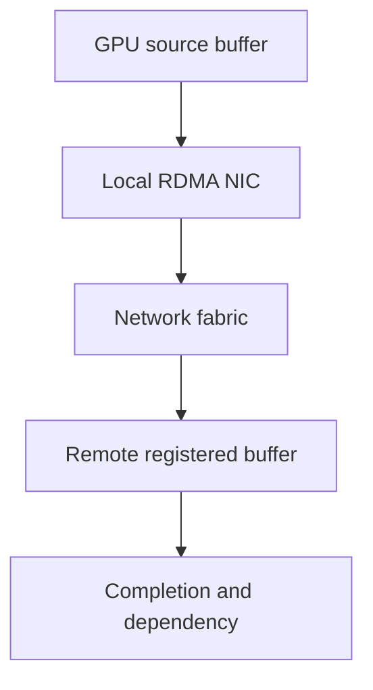

Remote direct memory access (RDMA) transfers bytes between machines without requiring the remote CPU to copy each payload through an application-owned receive loop. A network interface reads or writes a registered memory region directly. GPU-aware variants can target device memory, which makes RDMA relevant when expert activations, parameter shards, or cached attention state must cross servers. RDMA provides a transport capability; overall workload speed still depends on network and application bottlenecks.

## Registration, queues, and completion

Applications establish queue-pair communication and register the memory the network interface may access. A one-sided RDMA read/write names a remote address and access key with the required permissions; a two-sided send instead matches a receive buffer posted by the peer. Registrations and buffers must remain valid for the operation's lifetime. A completion notification records an API-specific synchronization perimeter. A local completion does not automatically establish application-level notification or visibility to every remote consumer, particularly a GPU kernel; follow the transport and GPU synchronization schema.

InfiniBand and RDMA over Converged Ethernet provide different networking environments for similar direct-access operations. Queue-pair limits, congestion, network-interface placement, and cross-node topology still constrain throughput. A healthy local [NVLink](glossary://nvlink) path says nothing about whether the remote network rail works.

## Example

An expert-parallel worker dispatches 2,048 hidden-state rows with 7,168 BF16 values each. The raw payload is `2048 * 7168 * 2 = 29,360,128` bytes before routing metadata, padding, and duplicated top-k assignments. RDMA can move those rows directly between worker-visible GPU buffers, but the receiving expert kernel must wait for the communication completion before reading them. A sender-side Python return is not that proof.

## Why it matters here

DeepEP, multi-node collective communication, and disaggregated inference all depend on distinguishing inter-node transport from intra-node GPU links. Misconfigured network rails, exhausted queue pairs, or missing event dependencies can look like slow model computation or numerical corruption. Recording logical payload bytes, physical network traffic, routing skew, and synchronization evidence isolates the real perimeter.

## Related terms

- [NCCL](glossary://nccl)
- [NVLink](glossary://nvlink)
- [Expert parallelism](glossary://expert-parallelism)
- [All-to-all](glossary://all-to-all)
