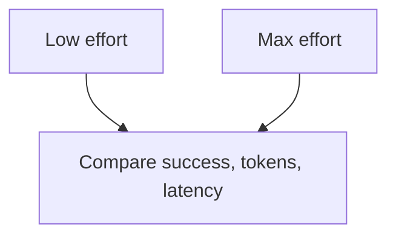

Reasoning effort is a model-specific inference control that influences how much computation a reasoning model spends before or while producing an answer. Labels such as `low` and `max` map to model- and API-specific behavior rather than fixed token counts. Evaluate correctness on the target task; reasoning effort is an inference setting rather than a training hyperparameter.

## Effort is separate from length and sampling

A maximum-output setting caps generation length. Temperature changes sampling probabilities. Reasoning effort controls another part of the model's inference behavior. Tune these settings independently; visible answer length alone says little about reasoning quality.

For [GLM-5.3](https://docs.z.ai/guides/llm/glm-5.3), supported efforts are `low`, `high`, and `max`, with `max` as the default. Reasoning remains enabled at `low`; requests that disable it are rejected by the hosted API. Other models can expose different values or controls.

## Example

Evaluate the same 50 incident snapshots at low and max effort with identical tools, output caps, and judges. Suppose max solves four additional incidents but doubles median latency. That result supports a measured routing decision, such as reserving max for difficult cases under those evaluation conditions.

## Why it matters here

Effort belongs in the evaluation manifest and rollout configuration. Changing it during a model comparison can mix a checkpoint improvement with an inference-budget change. Record reasoning tokens when exposed, total latency, tool calls, and task success together. For training replay, retain the actual token sequence rather than regenerating history under a different effort setting.

## Related terms

- [Test-time compute](glossary://test-time-compute)
- [Chain of thought](glossary://chain-of-thought)
- [Temperature](glossary://temperature)
- [Token budget](glossary://token-budget)
- [GLM-5.3](glossary://glm-53)
