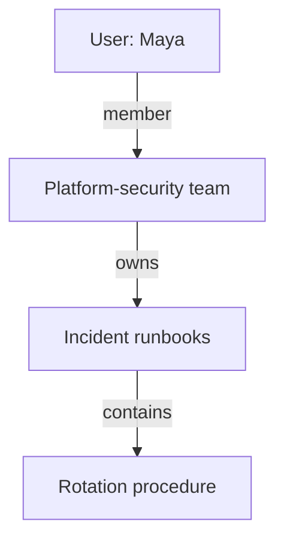

**Relationship-based access control (ReBAC)** authorizes an operation by checking whether a valid relationship connects the caller to the requested resource. Membership, ownership, delegated administration, parent folders, and team hierarchy become explicit edges in an authorization graph. Google's [Zanzibar authorization-system paper](https://research.google/pubs/zanzibar-googles-consistent-global-authorization-system/) describes this kind of relationship-aware authorization at large scale. Policy grants access through authorized relationships from trusted sources; a model-supplied identifier alone carries no authority.

A decision might ask whether `user:maya` belongs to `team:platform-security`, whether that team owns `folder:incident-runbooks`, and whether `document:rotation-17` inherits permission from that folder. Each edge needs a trustworthy source, clear direction, and explicit rules for inheritance and expiration.

## Follow the authorized relationship

Relationship traversal is bounded. A policy must define allowed edge types, maximum traversal depth, tenant boundaries, and deny behavior when the graph is stale. Otherwise a convenient transitive edge can become an accidental cross-team or cross-customer grant.

## Example

Maya can read `rotation-17` while her membership in `platform-security` is active. Revoking membership removes the authorization path even though the document embedding, cached summary, and vector similarity remain unchanged. An ingestion-time copy of an old membership edge isn't sufficient proof that access is still allowed.

## Why it matters here

Enterprise retrieval combines documents from systems with nested folders, shared groups, and inherited permissions. ReBAC preserves those source relationships more faithfully than a single flat role, but GraphRAG community reports and cached answers must still respect the same current relationship decision before their contents reach the model.

## Related terms

- [RBAC](glossary://rbac)
- [Access control list](glossary://acl)
- [GraphRAG](glossary://graphrag)
- [Permission boundary](glossary://permission-boundary)
