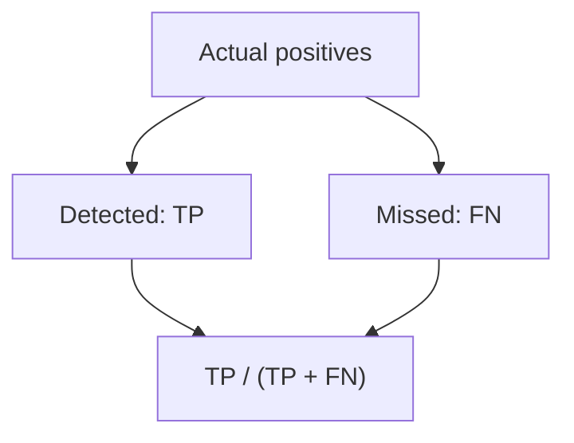

Recall is the fraction of actual positive cases that a system successfully identifies. It answers the coverage question: among requests that truly need review, relevant documents in a corpus, or incidents that should trigger alerts, how many did the system recover? Precision measures how many selected cases were true positives.

## Denominator and missed cases

For binary classification, $\operatorname{recall}=\mathrm{TP}/(\mathrm{TP}+\mathrm{FN})$. True positives are caught; false negatives are missed. Lowering a score threshold can recover additional positives while increasing reviewer workload. A recall estimate only describes the labeled population: if unreviewed cases never receive labels, selective observation can make measured recall substantially more optimistic than reality.

## Example

Twelve access requests truly require human review. A classifier correctly flags nine and automatically processes three. Recall is $9/(9+3)=0.75$. If its review queue also contains six safe requests, precision is separately $9/(9+6)=0.60$. Whether that tradeoff is acceptable depends on the cost of three missed policy violations and the capacity needed for fifteen reviews.

## Why it matters here

The curriculum evaluates retrieval candidates, safety classifiers, anomaly detectors, and review-routing policies against known relevant cases. Recall explains why a polished answer cannot recover evidence that retrieval omitted and why a high aggregate accuracy can hide costly misses on rare positives.

## Related terms

- [Precision](glossary://precision)
- [False negative](glossary://false-negative)
- [Recall at k](glossary://recall-at-k)
