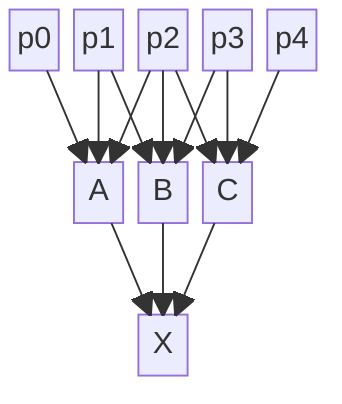

The **receptive field** of a unit is the region of the network input that can affect that unit's activation. In a fully connected layer every unit sees the whole input. In a convolutional stack, each unit depends only on a local patch; stacking kernels, strides, and pooling grows that patch with depth. The size of the region is the **theoretical receptive field (TRF)**; how much each input location actually moves the output is the **effective receptive field (ERF)**.

## Intuition

A $3 \times 3$ convolution only mixes a $3 \times 3$ neighborhood. The next $3 \times 3$ layer mixes neighborhoods of those responses, so one deeper cell depends on a $5 \times 5$ patch of the original input (stride 1, no dilation). Each extra $3 \times 3$ stride-1 layer increases the field by two pixels of diameter (one pixel on each side). Pooling or stride greater than 1 multiplies growth: once the feature map is coarser, the same kernel covers a larger region in input coordinates.

That geometry is the design lever. Detection and segmentation need enough field to cover objects of interest; overshooting with aggressive downsampling can erase small-object signal before the head ever runs. Naming the field shows which structures a representation can use: a unit with a $15 \times 15$-pixel field covers nearby image structure, while a feature 50 pixels away lies outside its accessible region.

## Formula

For a single-path stack of $L$ layers with kernel sizes $k_l$ and strides $s_l$, Araujo, Norris, and Sim (Distill, 2019) give the closed-form theoretical receptive field size at the input:

$$
r_0 = \sum_{l=1}^{L}\left((k_l - 1)\prod_{i=1}^{l-1} s_i\right) + 1
$$

(with the empty product equal to $1$). Padding shifts *where* the field sits relative to the image border while leaving $r_0$ unchanged. The same formula applies independently per spatial axis for 2D maps.

Here size means the bounding span. Strided or dilated connectivity can leave holes inside it, and a border unit's span may include padding rather than actual image pixels. A span larger than the image doesn't by itself prove that every real pixel influences every output unit.

Equivalently, walk backward from the output ($r_L = 1$):

$$
r_{l-1} = s_l \cdot r_l + (k_l - s_l)
$$

**Dilation.** A dilation factor $\alpha$ (PyTorch `dilation`) spaces kernel taps. Replace $k$ with the effective span $\alpha(k-1)+1$ before applying the formulas above. A $3 \times 3$ kernel with $\alpha=2$ has span $5$.

**Jump (cumulative stride).** When implementing the forward recurrence used in many codebases, keep a running jump $j$ (product of strides so far). Starting from $r=1$, $j=1$:

$$
r \leftarrow r + (k - 1) \cdot j,\qquad j \leftarrow j \cdot s
$$

after each layer (dilation folded into $k$).

**Track region and size.** Size $r_0$ alone cannot provide pixel-accurate alignment. Distill also maps an output coordinate $u_L$ to left/right input indices $u_0, v_0$ using paddings and strides, with $r_0 = v_0 - u_0 + 1$. Track field size *and* center when projecting detections, heatmaps, or encoder tokens back to image coordinates.

## Worked numbers

Three $3 \times 3$ convolutions, all stride $1$:

$$
r_0 = (3-1) + (3-1) + (3-1) + 1 = 7
$$

Same kernels, but insert stride $2$ after the first layer ($k = [3,3,3]$, $s = [2,1,1]$):

$$
r_0 = (3-1)\cdot 1 + (3-1)\cdot 2 + (3-1)\cdot 2 + 1 = 2 + 4 + 4 + 1 = 11
$$

One $3 \times 3$ then $2 \times 2$ max pool with stride $2$ ($k = [3,2]$, $s = [1,2]$):

$$
r_0 = (3-1)\cdot 1 + (2-1)\cdot 1 + 1 = 4
$$

Dilated stack used in multi-scale context (effective kernels $k' = \alpha(k-1)+1$ for $k=3$, $\alpha \in \{1,2,4\}$): spans $3$, $5$, $9$. With unit strides:

$$
r_0 = (3-1)+(5-1)+(9-1)+1 = 15
$$

## Example

Tiny 1D image of length $9$, two layers of conv with $k=3$, $s=1$, no padding. Layer-1 unit at position $i$ sees input indices $\{i, i+1, i+2\}$. Layer-2 unit at position $j$ sees three layer-1 units, which expand to five input samples. That matches $r_0 = (3-1)+(3-1)+1 = 5$.

```python
def theoretical_rf(kernels, strides, dilations=None):
    """Single-path TRF size (Araujo et al. closed form, dilation folded in)."""
    if dilations is None:
        dilations = [1] * len(kernels)
    if not (len(kernels) == len(strides) == len(dilations)):
        raise ValueError("one stride and dilation are required per kernel")
    if any(value <= 0 for values in (kernels, strides, dilations) for value in values):
        raise ValueError("kernel sizes, strides and dilations must be positive")
    r, jump = 1, 1
    for k, s, d in zip(kernels, strides, dilations):
        k_eff = d * (k - 1) + 1
        r = r + (k_eff - 1) * jump
        jump = jump * s
    return r

assert theoretical_rf([3, 3, 3], [1, 1, 1]) == 7
assert theoretical_rf([3, 3, 3], [2, 1, 1]) == 11
assert theoretical_rf([3, 3, 3], [1, 1, 1], dilations=[1, 2, 4]) == 15
```

On a $224 \times 224$ image, a VGG-style stack reaches TRF around $200$ (Distill reports $212$ for VGG-16), while deep ResNets exceed the full image (ResNet-101 TRF $1027$ in the same table). The closed form above is **single-path**; residual and multi-branch nets take the max theoretical field over paths (Distill multi-path procedure), so don't sum every residual branch as if it were a sequential stack. Covering the image is necessary but not sufficient: the ERF can still be much smaller.

## Diagram



Reading the geometry: unit X in layer 2 depends on A, B, and C in layer 1. With stride 1 those windows overlap, so together they touch five input positions ($p0$–$p4$). Stack depth, not a single huge kernel, built that field.

## Effective vs theoretical field

The TRF is the set of input locations with a nonzero *possible* influence given the connectivity graph. Luo, Li, Urtasun, and Zemel (NIPS 2016) define the ERF via the gradient magnitude $\partial y / \partial x_{i,j}$ of a central output unit $y$ with respect to each input pixel. Central pixels sit on many forward paths; border pixels of the TRF sit on few. Under mild assumptions the impact distribution is asymptotically Gaussian and decays from the center, so the region with non-negligible impact is only a fraction of the TRF.

Practical consequences:

- A network whose TRF covers the whole image may still behave as if it only "looks" at a smaller central blob.
- Random initialization often starts with a small ERF that grows during training.
- Dilated convolutions, larger kernels, and careful downsampling can enlarge the ERF; skip connections change path structure and thus the gradient profile.
- Measuring ERF (gradient heatmap of a center output w.r.t. the input, averaged over samples) is more informative than quoting TRF alone when debugging "model ignores context" failures.

## Beyond CNNs

**Local attention / windowed Transformers.** A window of size $w$ is a hard receptive field of $w$ tokens (or patches). Stacking shifted windows (as in Swin) grows the field with depth, analogous to stacking convolutions.

**Full self-attention.** With unmasked dense attention, every token can attend to every other token from the first layer, so the theoretical field is the full sequence (or full set of image patches). A causal mask restricts each token to its prefix; padding and other masks further restrict allowed connections. Dense attention computes $O(n^2)$ token-pair interactions in sequence length $n$; efficient kernels can avoid materializing the entire score matrix without removing those interactions.

**Vision-language and hybrid stacks.** Many VLM image towers still begin with a CNN or hierarchical encoder whose early layers have local fields; later stages or a Transformer projector expand to global context. When an OCR or document model "misses" a large table spanning the page, check whether the encoder stage that feeds the LLM still has a field smaller than the structure, or whether aggressive pooling deleted the fine text before the field could grow.

**Sequence models with fixed kernel.** Temporal convolutions, WaveNet-style dilated stacks, and some state-space front-ends use the same size arithmetic along time instead of space.

## Why it matters here

Receptive-field thinking connects architecture knobs (kernel, stride, dilation, depth, pooling, attention window) to what context a representation can actually use. Curriculum pieces on vision encoders, feature maps, and detection assume you can compute TRF, map features back to input coordinates, and distinguish "the connectivity allows it" from "the gradients actually use it." In production, small-object miss rates, misaligned heatmaps, and context-blind segmenters often trace to an undersized or poorly centered field rather than a mysterious head bug.

## Related terms

- [Convolution kernel](glossary://convolution-kernel)
- [Stride](glossary://stride)
- [Max pooling](glossary://max-pooling)
- [Feature map](glossary://feature-map)
- [Self-attention](glossary://self-attention)
