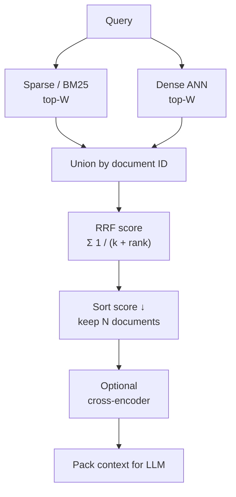

**Reciprocal Rank Fusion (RRF)** combines several ranked result lists into one ordered list using each document's rank positions; the input score values do not enter the calculation. Cormack, Clarke, and Buettcher introduced RRF at SIGIR 2009 as a simple unsupervised fusion method: sum a damped reciprocal of rank across lists, then sort. It is the default glue for [hybrid search](glossary://hybrid-search) in many RAG stacks because BM25, dense ANN, and sparse neural retrievers emit incompatible score units.

## Intuition

Each retriever is a specialist that votes with **rank order**; the fusion ignores its private score scale:

- [BM25](glossary://bm25) / sparse: strong on exact tokens (IDs, error codes, product names).
- [Dense retrieval](glossary://dense-retrieval): strong on paraphrases and intent.
- Optional extra lists: query rewrites, multi-vector fields, ColBERT-style late interaction shortlists.

RRF treats "rank 1 on list A" and "rank 1 on list B" as comparable evidence. A document that sits near the top of **any** list gets credit. One that sits near the top of **several** lists gets more. Documents that never appear in a list contribute nothing from that list. These rank contributions support first-stage [candidate generation](glossary://candidate-generation) without a trained fusion model or calibrated score ranges.

Cormack et al. chose the reciprocal form so top ranks matter more, but lower ranks do not vanish the way an exponential decay would. The constant $k$ softens outlier systems that put a weak document at rank 1.

## Formula

Given a document set $D$ and a set of rankings $R$ (each ranking is a permutation of some subset of $D$), Cormack, Clarke, and Buettcher define:

$$
\mathrm{RRF}(d)=\sum_{r\in R}\frac{1}{k+\mathrm{rank}_r(d)}
$$

where:

- $\mathrm{rank}_r(d)$ is the **1-based** position of $d$ in ranking $r$ (rank $1$ is best)
- documents missing from ranking $r$ contribute $0$ from that term (equivalently, skip them)
- $k$ is a fixed damping constant

They set $k=60$ in a pilot over TREC collections, found it near-optimal, and left it fixed for validation. Their pilot MAP varied only mildly for $k$ from about $20$ to $100$; validate sensitivity on the target corpus. **Rank conventions and missing-list handling matter.** Elasticsearch defaults `rank_constant` to $60$, and Azure AI Search describes a constant around $60$. Defaults differ elsewhere: current Qdrant uses $k=2$ with **0-based** ranks, so the original paper's 1-based $k=60$ corresponds to Qdrant's $k=61$. Compare the actual denominators alongside parameter names.

**Effect of $k$:**

| $k$ | Behavior |
|-----|----------|
| Small (e.g. $1$ to $10$) | Sharp: rank $1$ far above rank $20$; one strong list can dominate |
| Default ($60$) | Mild: rank $1$ is $\approx 2.6\times$ rank $100$ on a single list ($1/61$ vs $1/160$) |
| Large (e.g. $500$) | Flat: consensus across lists matters more than top-of-list spikes |

Larger $k$ flattens rank differences; smaller $k$ rewards top ranks more sharply. Do not confuse RRF's $k$ with vector-search top-$k$ (how many neighbors to retrieve).

Some engines expose **weighted RRF** (multiply each list's $1/(k+\mathrm{rank})$ by a per-retriever weight). Classic RRF is unweighted: every list counts equally when a document appears.

## Worked numbers

Two shortlists, $k=60$. Query is about rotating leaked API credentials.

| Doc | BM25 rank | Dense rank | Contribution | RRF score |
|-----|-----------|------------|--------------|-----------|
| A (exact runbook title) | 1 | 10 | $1/61 + 1/70$ | $\approx 0.0307$ |
| B (paraphrase guide) | 5 | 2 | $1/65 + 1/62$ | $\approx 0.0315$ |
| C (project ID only) | 2 | missing | $1/62$ | $\approx 0.0161$ |

B wins fusion even though A won BM25, because dense ranked B higher and both lists supported B. C's strong BM25 rank alone yields a lower fused score. Pass the fused order (or fused top-$N$) to a [reranker](glossary://reranker); use judged relevance to evaluate the final ranking.

With a smaller constant the story flips. For $k=1$:

| Doc | Score |
|-----|-------|
| A | $1/2 + 1/11 \approx 0.591$ |
| B | $1/6 + 1/3 \approx 0.500$ |

A would win under sharp damping. That is why production defaults stay near $60$ unless offline eval says otherwise.

```python
def rrf(rankings: list[list[str]], k: int = 60) -> list[tuple[str, float]]:
    if k < 0:
        raise ValueError("damping constant must be nonnegative")
    scores: dict[str, float] = {}
    for ranking in rankings:
        if len(set(ranking)) != len(ranking):
            raise ValueError("each ranking must contain unique document IDs")
        for rank, doc_id in enumerate(ranking, start=1):  # 1-based
            scores[doc_id] = scores.get(doc_id, 0.0) + 1.0 / (k + rank)
    return sorted(scores.items(), key=lambda item: (-item[1], item[0]))
```

## Example

Support RAG. Query: *"how do I rotate leaked API credentials for project X9?"*

| Chunk | BM25 top-40 | Dense top-40 | Role |
|-------|-------------|--------------|------|
| `runbook: API_KEY_ROTATION` | 1 | 18 | Exact token + procedure title |
| `guide: reset compromised keys` | 27 | 2 | Paraphrase of "rotate credentials" |
| `changelog: X9 auth middleware` | 9 | missing | Project id match, weak semantics |
| `blog: password tips` | missing | 7 | Semantic noise |

RRF ($k=60$) boosts chunks that either lane ranked highly and especially those both ranked well. The paraphrase guide rises relative to pure BM25 order; the project-only changelog stays in the union; the password blog enters only from dense and usually sits below dual-supported docs. You then take fused top-$N$ (often $20$ to $50$), optionally cross-encode rerank, dedupe near-duplicates, and pack context.

This pattern is what managed hybrid APIs implement server-side: Elasticsearch `rrf` retriever (`rank_constant`, `rank_window_size`), OpenSearch hybrid rank fusion, Azure AI Search hybrid `@search.score` via RRF, Weaviate `rankedFusion`, Qdrant prefetch + `rrf`. Client-side fusion is the same loop over id lists when the store only returns separate sparse and dense hits.

## Diagram



The two illustrated retrievers can be joined by more ranked lists. Each missing document contributes zero from that list. `W` is the per-list window (Elasticsearch `rank_window_size`). If $W$ is too small, complementary hits never enter the union. If $W$ is huge, noise floods the merge and latency grows.

## How it works

1. **Run retrievers in parallel** on the same logical query (and the same ACL / tenant filters when access control matters).
2. **Take top-$W$ per list** with stable 1-based ranks. Ties should use a deterministic secondary key so fusion is reproducible.
3. **Accumulate** $1/(k+\mathrm{rank})$ into a map keyed by document (or chunk) id.
4. **Sort** by fused score descending; break residual ties deterministically.
5. **Truncate** to the fused top-$N$ for the next stage (rerank, MMR diversity, or direct context packing).

RRF needs no cross-list score normalization and no training data. Cormack et al. also noted it can be computed one ranking at a time (streaming sum), which matches multi-shard fan-out.

## Trade-offs

**Strengths**

- Score-scale agnostic: safe when BM25 and cosine live on different units.
- No training loop; good default for hybrid and multi-query fusion (including RAG-Fusion over query variants).
- Empirically strong as unsupervised fusion versus Condorcet-style majority and CombMNZ-style score sums in the original TREC/LETOR studies.

**Limits and production failure modes**

- **Window starvation:** if dense returns the right chunk at rank $35$ but you only fuse top-$20$, RRF never sees it.
- **Window flood:** huge $W$ on a noisy list fills the union with weak candidates that still get small reciprocal credit.
- **ACL timing:** apply permission filters **before** fusion (or ensure forbidden docs never enter any list). A forbidden high-ranked hit can crowd the window and change which allowed docs survive even if you strip it later.
- **Uncalibrated scores:** RRF values encode shortlist order. Calibrate separately before interpreting a value such as $0.03$ as a probability or cross-query threshold.
- **Equal list weight:** if one retriever is much better on your corpus, unweighted RRF can over-promote weak-lane noise; use offline [NDCG](glossary://ndcg) / [recall@k](glossary://recall-at-k) to justify weights or drop a lane.
- **Rank bugs:** mixing 0-based and 1-based conventions, sorting by ascending score, or counting one ID twice in a list corrupts fusion. An absent document contributes zero; treating its rank as infinity is mathematically equivalent if implemented correctly.
- **Text-aware reranking:** RRF combines ranks without reading query-document text. A cross-encoder can add value on the fused shortlist when top-rank precision matters.

Tune $k$, $W$, and fused $N$ on **your** eval set. Default $k=60$ is a proven starting point; the best value depends on your candidate lists and evaluation target.

## Why it matters here

LLM apps rarely have one perfect retriever. Hybrid RAG lives or dies on whether complementary candidates make it into the prompt. RRF provides a standard, training-free way to merge lists from incompatible score systems. Understanding ranks, windows, and the method's scope keeps retrieval debugging honest: log per-lane top hits, fused order, and post-rerank order so you can see where a known-good chunk disappeared.

## Related terms

- [Hybrid search](glossary://hybrid-search)
- [BM25](glossary://bm25)
- [Dense retrieval](glossary://dense-retrieval)
- [Reranker](glossary://reranker)
- [Candidate generation](glossary://candidate-generation)
