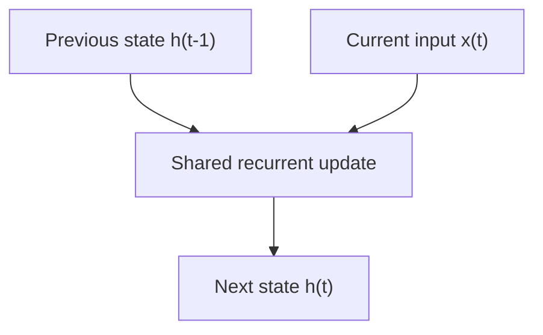

A recurrent neural network (RNN) processes an ordered sequence by carrying a hidden state from one step into the next. At position $t$, it combines the current input $x_t$ with the previous state $h_{t-1}$, typically as $h_t=\tanh(W_xx_t+W_hh_{t-1}+b)$.

## One state summarizes earlier events

The matrices $W_x$ and $W_h$ are reused at every position. That weight sharing lets the same update rule operate on sequences of different lengths. The hidden state compresses earlier observations into a fixed-size representation, so information can be lost.

Training unrolls the recurrence across time and applies [backpropagation](glossary://backpropagation) through that chain. Repeated Jacobian products can shrink or grow, producing vanishing or exploding gradients. [Gradient clipping](glossary://gradient-clipping) limits exploding updates; gated architectures such as LSTM and GRU change how state is retained and overwritten.

## Diagram

## Example

Take scalar recurrence $h_t=0.5h_{t-1}+x_t$ with initial state zero and inputs $[1,2,3]$. The successive states are $1$, $2.5$, and $4.25$. The first input still influences the final state, but its contribution has fallen to $0.25$. Reversing the sequence changes the final state because the update preserves order rather than treating inputs as an unordered set.

## Why it matters here

Sequence modeling introduces explicit historical state before transformers replace the single recurrent bottleneck with attention over visible token positions. Knowing what an RNN stores makes the difference between recurrence, attention, and KV-cache state easier to explain.

## Related terms

- [LSTM](glossary://lstm)
- [GRU](glossary://gru)
- [Tanh](glossary://tanh)
- [Self-attention](glossary://self-attention)
