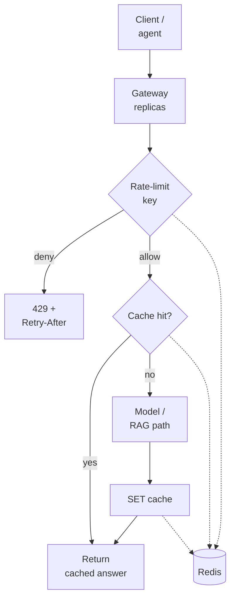

**Redis** (Remote Dictionary Server) is an in-memory data structure store. Clients talk to a server that keeps keys and values in RAM; common commands may take less than a microsecond of server processing while end-to-end latency is dominated by network RTT, virtualization, scheduling, TLS, and load. Measure latency from the deployed client path instead of assuming a same-zone number. The open-source project started with Salvatore Sanfilippo in 2009. Official docs describe Redis as a data structure server; caching is one common use.

For AI/ML/LLM engineers, Redis is usually the **shared memory on the request path**: exact and [semantic caches](glossary://semantic-cache), [rate-limit](glossary://rate-limit) counters, short-lived session and agent state, feature flags and [kill switches](glossary://kill-switch), and lightweight job queues. Model calls are expensive in time and dollars, so high-traffic AI gateways often put Redis (or an equivalent fast shared store) in front of those calls.

Use Redis as a performance and coordination layer. Keep durable records in a system such as [PostgreSQL](glossary://postgresql) unless Redis persistence, replication, and recovery are deliberately configured for the data you store there.

## Intuition

Picture every replica of your API gateway as a separate brain. Without a shared store, each replica has its own counters, its own cache, and its own idea of "how many tokens did tenant X spend this minute?" Load balancers then make limits and caches wrong: the same client can bypass a per-process cap by hitting different pods.

Redis gives those replicas a shared keyspace, with latency set by your deployment path. Atomic primary-side operations can coordinate fixed-window counters (`INCR` + `EXPIRE`), token buckets, and response caches across a fleet. Ordinary replication is asynchronous: replica reads can be stale, and failover can lose acknowledged writes. Strong consistency and strict quota preservation depend on explicit write, replication, and failure semantics.

| Role | Typical store | What you put there |
| --- | --- | --- |
| Durable truth | Postgres / object storage | Users, documents, permissions, billing ledger |
| Hot shared state | **Redis** | Counters, caches, sessions, locks, queues |
| Heavy retrieval | Vector DB / Postgres+pgvector | Embeddings, ANN indexes at large scale |

## How it works

### Keys, values, and data types

Everything lives in a **keyspace**: each key is a string (often namespaced like `rl:tenant:42:rpm`) and points to a value of a Redis type. Core types used in AI stacks:

| Type | Common commands | AI use |
| --- | --- | --- |
| **String** | `GET`, `SET`, `INCR`, `SET` with `NX`/`EX` | Cache blobs, counters, simple locks |
| **Hash** | `HGET`, `HSET`, `HINCRBY` | Structured session fields, multi-field rate state |
| **List** | `LPUSH`, `BRPOP` | Simple FIFO job queues |
| **Set / Sorted set** | `SADD`, `ZADD`, `ZRANGEBYSCORE` | Membership, sliding-window timestamps, priority |
| **Stream** | `XADD`, `XREADGROUP` | Consumer-group work queues with IDs |
| **JSON / vector indexes** (integrated in Redis 8; modules / Redis Stack in earlier deployments) | Search + vector ops | Semantic cache and RAG indexes |

Strings can hold JSON, msgpack, or raw embedding bytes. Keep values bounded: a 50 MB cached chat transcript per key will thrash memory and replication.

### Single-threaded command execution

Redis processes commands on a single main thread (I/O and some background work can use extra threads in modern versions). That design makes individual commands atomic: two clients cannot interleave half of an `INCR`. Complex multi-key logic that must be atomic uses [Lua scripts](https://redis.io/docs/latest/develop/programmability/eval-intro/) (`EVAL`) or Redis functions so the whole read-decide-write cycle runs without races. Rate limiters almost always need that atomicity; naive `GET` then `SET` from the app will double-spend under concurrency.

### TTL and expiry

Keys can carry a **time to live** ([TTL](glossary://ttl-deadline)). After expiry, Redis removes the key. That is how you implement fixed rate-limit windows, short-lived session tokens, and cache freshness without a custom sweeper. Prefer setting TTL at write time (`SET key value EX 300` or `EXPIRE`) so keys cannot live forever after a code path forgets cleanup.

### Persistence (optional)

Redis keeps the working set in **RAM**. Disk persistence is optional and has its own durability tradeoffs; compare the configured RDB/AOF policy with Postgres WAL and fsync-on-commit:

- **RDB:** point-in-time snapshots (default sample `redis.conf` enables periodic `save` rules; compact and good for backups; you can still lose the last minutes of writes on a hard crash).
- **AOF:** append-only log of write commands (stronger durability depending on `appendfsync`: `always`, `everysec` (the usual AOF default), or `no`).
- **RDB + AOF:** common production combo when you care about recovery; on restart Redis prefers AOF when both exist.
- **No persistence:** valid for pure caches that can rebuild from origin (`save ""` and AOF off).

Official docs: AOF with `fsync everysec` can still lose about one second of writes on a hard crash. That recovery point often works for rate limits and caches. Store authoritative paid-credit balances under a durability policy that meets the accounting requirement.

### Eviction under memory pressure

When `maxmemory` is set and the instance is full, Redis applies a **`maxmemory-policy`**. Policies that matter in practice:

- `noeviction`: writes fail with an error; reads still work. Use for data you must not drop.
- `allkeys-lru` / `allkeys-lfu`: evict any key by approximate [LRU](glossary://lru-cache) or LFU. Default mental model for pure caches.
- `volatile-lru` / `volatile-ttl`: only keys with a TTL are eligible. Useful when one instance mixes durable keys and cache keys (two instances is cleaner).

Redis samples eviction candidates to approximate LRU/LFU with lower metadata cost than maintaining exact recency order. For hit-rate math see [cache hit rate](glossary://cache-hit-rate):

$$
HR = \frac{\text{keyspace\_hits}}{\text{keyspace\_hits} + \text{keyspace\_misses}}
$$

Track `INFO stats` fields `keyspace_hits`, `keyspace_misses`, `evicted_keys`, and `expired_keys` separately so you know whether misses are expiry, eviction, or key-schema bugs.

### Clustering and slots

Redis Cluster shards keys across hash slots ($16{,}384$ slots). Multi-key operations must land in the same slot (use hash tags like `{tenant:42}:cache` and `{tenant:42}:rl` so both keys share `{tenant:42}`). Cross-slot bugs show up as runtime errors only under cluster, not on a single-node dev box.

## Example

An AI gateway serves chat completions. On every request it (1) checks a fixed-window request quota per API key, (2) looks up an exact response cache for identical prompts under the same model and tenant, then (3) calls the model only on miss.

```python
import hashlib
import json
import time

import redis

r = redis.Redis(host="localhost", port=6379, decode_responses=True)

LIMIT = 60          # requests per window
WINDOW_SEC = 60
CACHE_TTL = 300     # seconds

def rate_allow(api_key: str) -> bool:
    # Fixed window: one counter per key per wall-clock minute bucket.
    # INCR is atomic; EXPIRE-on-first is the usual pattern (prefer Lua if you
    # need incr+expire as one script under crash-sensitive cleanup).
    bucket = int(time.time()) // WINDOW_SEC
    key = f"rl:{api_key}:{bucket}"
    n = r.incr(key)
    if n == 1:
        r.expire(key, WINDOW_SEC + 1)  # auto-clean after the window
    return n <= LIMIT

def cache_key(tenant: str, model: str, messages: list, response_scope: dict) -> str:
    raw = json.dumps(
        {"t": tenant, "m": model, "msg": messages, "scope": response_scope},
        sort_keys=True,
    )
    digest = hashlib.sha256(raw.encode()).hexdigest()
    return f"resp:{tenant}:{model}:{digest}"

def complete(tenant: str, api_key: str, model: str, messages: list, response_scope: dict) -> dict:
    if not rate_allow(api_key):
        return {"error": "rate_limited", "retry_after_s": WINDOW_SEC}

    ck = cache_key(tenant, model, messages, response_scope)
    hit = r.get(ck)
    if hit is not None:
        return json.loads(hit)  # cache hit: skip model call

    answer = call_model(model, messages)  # expensive path
    r.set(ck, json.dumps(answer), ex=CACHE_TTL)
    return answer
```

`response_scope` comes from trusted gateway configuration and must identify the permission scope, policy/prompt versions, generation parameters, tool schemas, and any retrieval snapshot that can affect the response. Bind it to the actual configuration used by `call_model` and ignore caller-provided labels. Recheck current access on hits because a revoked-permission fingerprint no longer grants access. Store a nonsecret key identifier for `api_key` instead of raw API credentials in Redis key names. The separate `INCR`/`EXPIRE` calls retain a crash window; use one atomic script when cleanup must survive a client crash.

```text
# Same pattern from redis-cli
INCR rl:key_abc:28401942
EXPIRE rl:key_abc:28401942 61
GET resp:acme:gpt-x:9f3c…
SET resp:acme:gpt-x:9f3c… '{"text":"..."}' EX 300
```

**Fixed-window limits and response-cache scope.** The fixed window is simple and race-safe for the counter thanks to atomic `INCR`. It can still burst up to $2 \times LIMIT$ around a window boundary (end of one minute + start of the next). For smoother limits use a [token bucket](glossary://token-bucket) or sliding window, typically with a Lua script so refill and spend are atomic. The response cache matches **exact** keys; paraphrase matches need a [semantic cache](glossary://semantic-cache) (embeddings + similarity threshold), often built with RedisVL or Redis vector indexes. Partition semantic lookups by tenant, model, and policy version so similarity stays within authorization boundaries.

## Diagram



## Worked numbers

Suppose uncached completion costs \$0.02, mean total latency is $T_{\text{miss}}=800\,\mathrm{ms}$, mean total hit-path latency is $T_{\text{hit}}=1\,\mathrm{ms}$, and hit rate on the exact cache is $HR = 0.40$ for a hot FAQ bot. These hypothetical path means include their gateway/counter/cache overhead. Use complete hit- and miss-path means in the calculation; a single Redis RTT or model median omits other stages.

Expected cost and latency per request:

$$
\mathbb{E}[\text{cost}] \approx HR \cdot C_{\text{hit}} + (1-HR) \cdot C_{\text{miss}}
= 0.40 \cdot 0 + 0.60 \cdot 0.02 = 0.012\,\mathrm{USD}
$$

$$
\mathbb{E}[T] \approx 0.40 \cdot 1\,\mathrm{ms} + 0.60 \cdot 800\,\mathrm{ms} \approx 480\,\mathrm{ms}
$$

At $1$ M requests/day that is about \$8{,}000/day saved versus no cache (\$20{,}000 uncached). If a deploy changes the cache key schema and $HR$ drops to $0$, you pay full cost and load until the new keys warm. That "miss storm" is a classic post-deploy incident.

**Memory sizing (rough).** One cached answer of $2\,\mathrm{KB}$ average, $500{,}000$ live keys, with Redis overhead often in the $1.5$-$2\times$ range depending on key names and encoding:

$$
\text{RAM} \gtrsim 500{,}000 \times 2\,\mathrm{KB} \times 2 \approx 2\,\mathrm{GB}
$$

Add headroom for fragmentation, AOF/replication buffers, and peak write bursts. Set `maxmemory` below host RAM and pick an eviction policy that matches whether those keys are disposable.

## AI usage patterns

| Pattern | Redis shape | Notes |
| --- | --- | --- |
| Exact response / embedding cache | String + TTL | Key must include tenant, model, prompt hash, tool policy |
| Semantic cache | Vector index + metadata filter | Similarity ranks candidates; authorization requires tenant-aware partitioning |
| Rate limits / quotas | `INCR`/`EXPIRE`, token bucket Lua | Unit can be requests, tokens, or dollars |
| Session / multi-turn state | Hash or String JSON | Prefer short TTL; do not store secrets long-term |
| Agent tool intermediate state | Hash + TTL | Crash mid-tool: design for restart or lose ephemeral state |
| Feature flags / kill switch | String or Hash | Short TTL or pub/sub invalidate so flags flip fast |
| Job queues | List, Stream, or Sorted set | Modest durability; use a real queue/broker when work must never drop |
| Distributed lock | `SET key token NX EX` | Single-instance coordination; Redlock multi-node is debated for hard safety |

## What fails in production

- **Treating Redis as durable.** Flush, OOM eviction, replica promotion lag, or AOF disabled means caches **and** counters vanish. Rate limits that live only in Redis can **fail open** (everyone unlimited) or [**fail closed**](glossary://fail-closed) (everyone blocked) depending on how the gateway handles connection errors. Choose deliberately per surface: public free tier might fail closed; internal health checks might fail open.
- **Key schema churn.** Renaming `resp:v1:…` to `resp:v2:…` without dual-read warms empty keys and spikes model spend.
- **Missing tenant in the key.** Cache or semantic hits that omit `tenant_id` (or auth scope) leak answers across customers.
- **Giant values.** Storing full RAG corpora or multi-MB agent transcripts per key blows `maxmemory` and causes eviction storms of *other* hot keys.
- **Non-atomic multi-step limits.** App-level read-modify-write under concurrency undercounts spend.
- **Cluster slot surprises.** Multi-key Lua without hash tags works in dev and fails in Cluster.
- **Hot keys.** One global counter or one celebrity tenant key can bottleneck a single shard; shard by tenant or use hierarchical limits.

## Debug path

When "the model got slower" or "limits look wrong":

1. **Key:** full name (or hash), TTL (`TTL key`), type (`TYPE key`), and whether it exists (`EXISTS`).
2. **Serialization:** compare raw `GET` bytes to what the app expects (JSON field order, float formatting, embedding dtype).
3. **Clock / window:** which time source builds the rate-limit bucket; wall-clock jumps vs monotonic for client-side token buckets.
4. **Memory:** `INFO memory`, `maxmemory`, `maxmemory-policy`, `evicted_keys` rising.
5. **Hit stats:** `keyspace_hits` / `keyspace_misses` sliced by key prefix if you emit app metrics (Redis global counters mix all workloads).
6. **Topology:** single node vs Cluster slot; which replica you read from if using replicas (stale reads on limits are dangerous).
7. **Writers:** multiple services writing the same key without a shared schema or lock.

Many incidents are not Redis bugs. They are key design bugs that Redis made visible at scale.

## Trade-offs

| Choice | Gain | Cost |
| --- | --- | --- |
| Put state in Redis | Shared, fast coordination | Operational dependency on the critical path |
| Pure cache, no AOF | Max simplicity, easy rebuild | Total loss on restart is expected |
| AOF `everysec` | Good durability/speed balance | ~1 s of writes can be lost on crash |
| `allkeys-lru` | Automatic pressure relief | Silent data loss of cold keys |
| `noeviction` | Predictable retention | Write errors under pressure |
| Semantic cache in Redis | Lower LLM cost | Wrong-hit risk if partitions are weak |
| Lists for jobs | Easy to start | Weaker delivery guarantees than a dedicated broker |

## Why it matters here

LLM products fail in production as often from **coordination and cost control** as from model quality. Redis is the common place those controls live: stop a runaway agent with a kill-switch key, cap token spend per tenant, cache embeddings and repeated answers, and keep multi-replica gateways honest. Systems design for AI products needs cache keys, TTLs, eviction, and fail-open vs fail-closed behavior alongside prompts and evals.

## Related terms

- [Cache hit rate](glossary://cache-hit-rate)
- [Semantic cache](glossary://semantic-cache)
- [Rate limit](glossary://rate-limit)
- [Token bucket](glossary://token-bucket)
- [TTL deadline](glossary://ttl-deadline)
