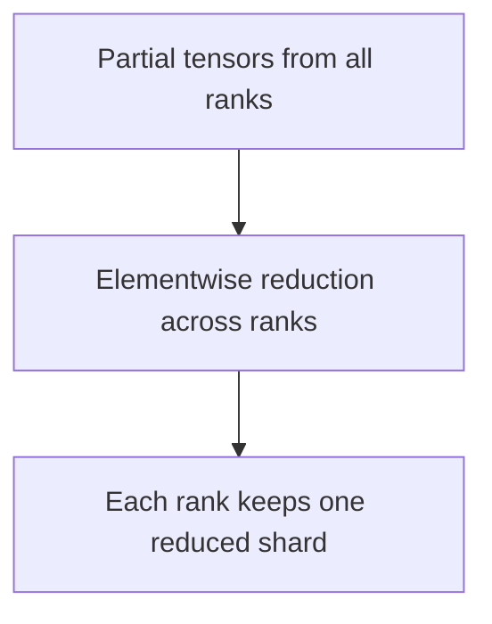

**Reduce-scatter** combines tensors across ranks and leaves only one shard of the reduced result on each rank. It is equivalent in meaning to a reduce followed by a scatter, but collective libraries can execute it directly and efficiently.

Compared with all-reduce, reduce-scatter avoids materializing the full reduced tensor everywhere. That makes it useful when the next stage already wants sharded gradients, activations, or optimizer state.

## Pairing with all-gather

Many distributed paths form a pair: reduce-scatter turns replicated or partial values into reduced shards; all-gather reconstructs full values later. Megatron sequence parallelism and distributed optimizer paths use this pattern to keep less data resident between collective boundaries.

## Diagram

## Example

If four ranks each produce a 4,096-element gradient vector, reduce-scatter can sum the vectors and return one 1,024-element reduced shard to each rank. A sharded optimizer updates only its local shard before parameters are gathered again.

## Why it matters here

Understanding reduce-scatter helps separate computation from communication in Megatron profiles. A long optimizer or SP phase may reflect communication of sharded state; inspect its collective boundaries alongside model GEMMs.

## Related terms

- [All-gather](glossary://all-gather)
- [All-reduce](glossary://all-reduce)
- [Distributed optimizer](glossary://distributed-optimizer)
- [Sequence parallelism](glossary://sequence-parallelism)
- [NCCL](glossary://nccl)
