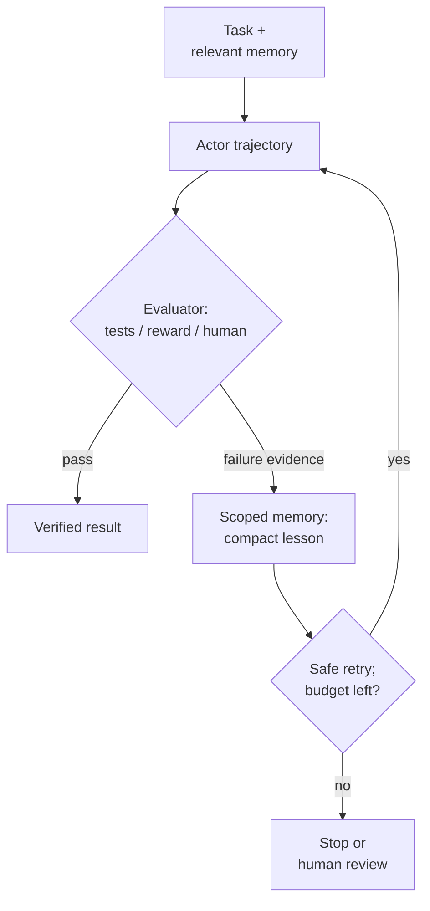

**Reflexion** is a language-agent pattern that turns feedback from a completed attempt into a short verbal lesson, stores that lesson in episodic memory, and supplies it to a later attempt. Shinn et al. introduced the [framework at NeurIPS 2023](https://papers.neurips.cc/paper_files/paper/2023/hash/1b44b878bb782e6954cd888628510e90-Abstract-Conference.html) as **verbal reinforcement learning**: behavior changes through text in context, not through gradient updates to model weights.

The distinction from a retry is information. A blind retry samples again from nearly the same state. Reflexion adds a critique that says what failed and how the next attempt should differ:

$$
\tau_t \xrightarrow{\text{evaluate}} f_t
\xrightarrow{\text{reflect}} r_t,
\qquad
\tau_{t+1} \sim \pi(\cdot \mid x, M_t \cup \{r_t\})
$$

Here $\tau_t$ is a trajectory, $f_t$ is external or simulated feedback, $r_t$ is a compact reflection, and $M_t$ is the memory of prior lessons. Parameters of policy $\pi$ stay fixed.

## Actor, evaluator, and memory

Reflexion needs three roles, even if one model performs more than one:

| Role | Contract |
| --- | --- |
| **Actor** | Attempts task using current state and relevant reflections |
| **Evaluator** | Produces a grounded success signal or concrete failure evidence |
| **Reflector** | Converts evidence into a short, actionable lesson for another attempt |

The evaluator is the critical dependency. A compiler error, failed unit test, environment reward, or human correction can anchor useful reflection. Self-critique without external evidence can amplify the model's original misconception. "Be more careful" gives no observable correction; "the test uses UTC, but the implementation compares local dates" identifies a verifiable cause.

Memory also needs policy. Store reflections by task or failure class, cap their count and size, expire stale lessons, and keep raw trajectories outside the prompt. A reflection written for one repository, API version, or tenant can be harmful when replayed elsewhere.

## Diagram



## Example

**Critique before safe retry.**

```python
MAX_ATTEMPTS = 3

def repair_with_reflexion(task, actor, sandbox, reflector, truncate, validate_and_bound):
    memory: list[str] = []

    for attempt in range(MAX_ATTEMPTS):
        proposal = actor.run(task, lessons=memory[-2:])
        result = sandbox.run_tests(proposal.patch)

        if result.passed:
            return proposal.patch

        evidence = {
            "failed_tests": result.failed_tests,
            "stderr": truncate(result.stderr, 4_000),
        }
        lesson = reflector.write_lesson(
            task=task,
            proposal=proposal.summary,
            evidence=evidence,
            instruction="Name one causal mistake and one concrete next change.",
        )
        memory.append(validate_and_bound(lesson, max_chars=800))

    raise RuntimeError(f"human_review_required: {memory!r}")
```

The injected sandbox, actor, reflector and validation helpers are application-specific. Tests must check the task's acceptance criteria, and passing them does not automatically authorize publishing or deploying the patch.

Attempt 1 changes a timeout but fails because the implementation uses wall-clock time for a deadline. The evaluator returns the failing monotonic-clock test. A useful reflection says: "Elapsed deadlines must use `time.monotonic`; preserve wall time only for display." Attempt 2 now has new information. Repeating the original prompt with a higher temperature does not.

## Not online weight learning

Reflexion borrows reinforcement-learning language, but it doesn't update policy parameters or estimate gradients. Its memory changes the policy's **input context**. That makes it cheap and reversible, but also fragile:

- removing memory removes the learned behavior;
- long or contradictory reflections compete for attention;
- an incorrect evaluator writes incorrect lessons;
- lessons don't automatically generalize beyond their scope;
- extra attempts spend latency and tokens.

The original paper's benchmark gains apply to its evaluated setup. Validate self-reflection on the model and task you plan to use.

## Decision rule

Use Reflexion when failures are **observable**, retries are **safe**, and feedback can name a correctable cause. Prefer direct deterministic repair when an error already maps to one known action. Stop instead of reflecting when:

- a side effect may already have committed;
- success can't be verified independently;
- the same failure repeats without new evidence;
- policy or spend limits forbid another attempt;
- memory could cross a tenant or confidentiality boundary.

For write tools, reconcile external state before retrying. A reflection such as "retry the deployment" must never substitute for an idempotency key and a transaction lookup.

## What to measure

Compare against a same-budget retry baseline. Track first-attempt success, eventual success, attempts per task, repeated-failure rate, tokens and latency, reflection length, stale-memory hits, and regressions caused by prior lessons. Review whether each reflection cites evaluator evidence and changes the next trajectory in the intended way.

## Why it matters here

Agent systems need a middle ground between blind retries and model retraining. Reflexion supplies one: turn a failed [trajectory](glossary://trajectory-evaluation) into bounded context for a later attempt. It works best as one transition inside an explicit state machine, surrounded by sandboxing, checkpoints, retry budgets, and human escalation.

## Related terms

- [ReAct](glossary://react)
- [Trajectory evaluation](glossary://trajectory-evaluation)
- [Workflow checkpoint](glossary://workflow-checkpoint)
- [Retry and backoff](glossary://retry-backoff)
- [State machine](glossary://state-machine)
- [LLM-as-judge](glossary://llm-as-judge)
- [Human in the loop](glossary://human-in-the-loop)
