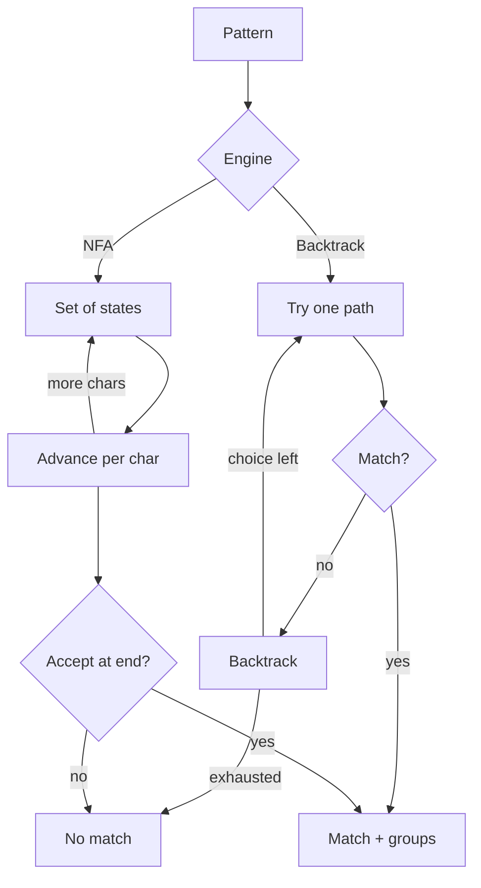

A **regular expression** (regex, RE) is a compact pattern that describes a set of strings. Python's standard-library [`re`](https://docs.python.org/3/library/re.html) module implements a Perl-like regex engine for matching, searching, splitting, substituting, and capturing substrings. Compile once with `re.compile`, then call methods on the pattern object; module-level helpers (`re.search`, `re.match`, …) do the same work with a short-lived cache.

In theory, classical regular languages are recognized by finite automata. In practice, Python's engine (like Perl, PCRE, Ruby, and Java's default) is a **backtracking** matcher that also supports features outside pure regular languages, especially **backreferences** such as `\1`. That power is useful. It also means some patterns can take time exponential in the input length on near-miss strings ([CWE-1333](https://cwe.mitre.org/data/definitions/1333.html), ReDoS).

## Intuition

Think of a regex as a tiny program that walks a string and either reports a match (plus captured groups) or fails. It is the right tool when the shape is **local and flat**: fixed delimiters, digit runs, ISO timestamps, log levels, fence markers, simple IDs. It is the wrong tool when the grammar is **nested or stateful**: balanced brackets, escaped JSON, HTML with optional attributes, multi-turn tool transcripts. For those, write a small [parser](glossary://parsing) or [state machine](glossary://state-machine), or force the model into [structured output](glossary://structured-output) so you never regex free-form prose.

In AI pipelines, regex usually sits **before** the model (ingest, chunking, PII redaction, log triage) or **after** it (pulling fenced code, citation keys, JSON-looking blobs from completions). Either way, later stages treat the extracted span as truth. A greedy group that eats the next field, a pattern that silently drops half the lines, or a ReDoS hang on uploaded text all fail as data bugs, not as "model quality."

## How it works

**Pattern language (essentials).** Literals match themselves. Metacharacters change meaning:

| Construct | Role |
|-----------|------|
| `.` | Any character except newline (unless `re.DOTALL`) |
| `^` / `$` | Start / end of string (or of each line with `re.MULTILINE`) |
| `*`, `+`, `?`, `{m,n}` | Greedy quantifiers (as much as possible while still matching) |
| `*?`, `+?`, `??` | Non-greedy (minimal) quantifiers |
| `*+`, `++`, `?+`, `{m,n}+` | Possessive quantifiers (Python 3.11+): greedy and no backtrack |
| `[...]` / `[^...]` | Character class / complement |
| `A\|B` | Alternation (try left first; a backtracking engine can abandon a successful left branch if the rest of the pattern fails) |
| `(...)` | Capturing group |
| `(?:...)` | Non-capturing group |
| `(?P<name>...)` | Named capturing group |
| `(?>...)` | Atomic group (Python 3.11+): commit and discard backtrack points |
| `(?=...)` / `(?!...)` | Lookahead (does not consume) |
| `\d`, `\w`, `\s` | Digit / word / whitespace classes (Unicode for `str` unless `re.ASCII`) |

Use **raw strings** (`r"..."`) for patterns so backslashes are not eaten by Python string syntax.

**API surface.**

| Call | Behavior |
|------|----------|
| `re.compile(pat, flags=0)` | Build a reusable `Pattern` (preferred in hot loops) |
| `pattern.match(s)` | Match only at the **start** of `s` |
| `pattern.search(s)` | First match **anywhere** in `s` |
| `pattern.fullmatch(s)` | Entire string must match |
| `pattern.findall` / `finditer` | All non-overlapping matches |
| `pattern.split` / `sub` | Split or replace |

A successful `match`, `search`, or `fullmatch` call returns a `Match` object (always truthy); failure returns `None`. Read fields with `m.group("name")`, `m.groupdict()`, or `m.span()`. Other APIs return their own types: `findall` returns a list, `finditer` an iterator, and `sub` a replacement string.

**Engine model.** Two families of engines matter for production reasoning:

1. **Thompson-style NFA / DFA simulation** (classical Unix `grep`/`egrep`, RE2, many automata libraries): process each input character against a set of states. For a pattern of length $m$ and text of length $n$, time is $O(mn)$ in the Thompson NFA simulation, and worst-case behavior stays polynomial for true regular patterns (Russ Cox, *Regular Expression Matching Can Be Simple And Fast*, 2007; Ken Thompson, CACM 1968).
2. **Recursive backtracking** (Python `re`, Perl, PCRE, …): try a path; on failure, rewind and try another. Easy to implement rich features (backreferences, many assertions). On pathological patterns, the number of paths can grow as $O(2^n)$.

Python chooses (2). Features such as backreferences are not regular in the formal sense and do not admit the simple linear automata algorithms, so backtracking remains the default design for full Perl-compatible power.

**Greedy vs non-greedy vs possessive.** On `'<a> b <c>'`, the pattern `<.*>` matches the whole string because `.*` is greedy. `<.*?>` matches only `'<a>'`. Possessive forms (`.*+`, atomic groups) refuse to give characters back: useful to kill some backtracking explosions, but they can turn a near-match into a hard fail if the rest of the pattern needed a shorter first span.

## Example

Extract structured fields from a log line that an eval harness or incident bot will later embed and rank:

```python title="regex-log-line.py"
import re

line_re = re.compile(
    r"^(?P<ts>\d{4}-\d{2}-\d{2}T[\d:.]+Z) "
    r"(?P<level>INFO|WARN|ERROR) "
    r"(?P<message>.*)$"
)

line = "2026-03-01T12:00:00Z ERROR payment retry failed"
match = line_re.match(line)

if match:
    fields = match.groupdict()
    # {'ts': '2026-03-01T12:00:00Z', 'level': 'ERROR', 'message': 'payment retry failed'}
    print(fields["level"], fields["message"])
```

A second, LLM-specific pattern: pull fenced code from a model completion without swallowing the closing fence into the body (non-greedy body, explicit fence):

```python title="regex-code-fence.py"
import re

fence_re = re.compile(
    r"```(?P<lang>[a-zA-Z0-9_+-]*)\n(?P<code>.*?)\n```",
    re.DOTALL,
)

text = "Sure.\n```python\nprint(1)\n```\nDone."
m = fence_re.search(text)
assert m is not None
assert m.group("lang") == "python"
assert m.group("code") == "print(1)"
```

`re.DOTALL` lets `.` cross newlines inside the fence. Without non-greedy `.*?`, a greedy `.*` would run to the **last** closing fence in the document.

These are deliberately narrow extraction patterns. The timestamp pattern checks shape, not valid dates or times; parse it with a date/time library before trusting it. The fence pattern handles the shown triple-backtick/LF form, not full Markdown rules (longer fences, tildes, indentation, CRLF, or embedded backticks); use a Markdown parser when those cases are allowed.

## Diagram

Backtracking engines explore alternatives; automata engines advance a state set once per character:



Catastrophic cases are almost always on the left branch: nested or overlapping quantifiers plus a near-miss input force the engine to revisit the same prefixes many times.

## Worked numbers

Cox's classic demonstration pattern is essentially:

$$
\underbrace{a?\,a?\,\cdots\,a?}_{n\ \text{times}}\underbrace{a\,a\,\cdots\,a}_{n\ \text{times}}
\quad\text{matched against}\quad
a^n
$$

A naive backtracking search tries each optional `a?` as "consume" then "skip," producing on the order of $2^n$ paths before the final $a^n$ succeeds. Thompson NFA simulation keeps at most $O(n)$ active states and finishes in $O(n^2)$ for that family of growing patterns (or $O(mn)$ with pattern length $m$ and text length $n$ held distinct).

A shorter ReDoS sketch that shows up in validation code:

```python title="regex-redos-sketch.py"
import re
import time

# Nested quantifiers with overlapping character classes: dangerous on near-misses.
bad = re.compile(r"^(a+)+$")
s = "a" * 28 + "!"

t0 = time.perf_counter()
bad.match(s)  # fails only after exploring many partitions of the a-run
print(f"{time.perf_counter() - t0:.3f}s")
```

On a long run of `a` followed by a single failing character, the engine re-partitions the run under the outer `+` again and again. CWE-1333 names this **inefficient regular expression complexity**; OWASP and industry write-ups call the availability impact **ReDoS**. Mitigations that actually work in Python services:

- Prefer simple, non-nested quantifiers; avoid `(a+)+`, `(a|aa)+`, and "match anything, then match anything again" stacks.
- Use possessive quantifiers or atomic groups where they preserve correctness (Python 3.11+).
- Cap input length **before** matching untrusted text (prompts, uploads, headers, log lines).
- Bound execution with a separately terminable process or an engine that supports match deadlines. A `Future.result(timeout=...)` only stops the caller's wait; it doesn't stop a running match. Thread cancellation doesn't kill the worker, and a long stock `re` match can hold the GIL. Stock `re` has no per-match deadline.
- For untrusted **patterns** (user-supplied search), consider an automata engine such as [RE2](https://github.com/google/re2) (linear-time guarantee, smaller feature set) instead of `re`.

## Trade-offs

| Approach | Strengths | Weaknesses |
|----------|-----------|------------|
| `re` on fixed patterns | Fast to write; named groups; fine for flat extraction | ReDoS risk; opaque for nested structure; hard to unit-test every branch of a 200-char pattern |
| Hand parser / state machine | Explicit recovery, line continuations, nesting | More code; you own edge cases |
| Schema / constrained decode | Model output is already typed | Needs model support; still validate semantics |
| Automata regex (RE2, etc.) | Predictable $O(mn)$-class matching | No backreferences; not drop-in for every Perl feature |

Rule of thumb for LLM systems: **regex for evidence spans and shallow checks; schemas for tool arguments; parsers for documents.**

## Debug path

When extraction "works in the notebook" but fails in production:

1. Print `repr(text[:200])` and confirm newlines, BOM, and Unicode look like the fixture (`\r\n` vs `\n`, NFKC vs raw). Pair with [unicode normalization](glossary://unicode-normalization) and [splitlines](glossary://splitlines) when line boundaries matter.
2. Decide `match` vs `search` vs `fullmatch`. Many bugs are "pattern is fine, anchor is wrong."
3. Check **named groups** and their values. A match with `message=""` still counts as a match.
4. Add a near-miss fixture: valid prefix + one bad character, repeated character runs, empty string, maximum-length input.
5. Time the near-miss. If it scales worse than linear in length, rewrite the pattern or isolate the call behind a timeout.
6. If you are parsing model output, prefer asking for [structured output](glossary://structured-output) or tool JSON so regex is a last-resort recovery path, not the contract.

## Why it matters here

Regex is the default glue between raw text and every later ML stage: chunk boundaries, citation scrape, log-derived labels, guardrail denylist checks, and "pull the JSON out of the assistant message." Get the pattern wrong and retrieval, eval, and tools never see the real evidence. Get the complexity wrong and a single adversarial prompt or log line pins a worker CPU core (CWE-1333). Treat `re` as a sharp production dependency: compile deliberate patterns, test matches **and** non-matches, bound untrusted input, and graduate to a real parser when the grammar outgrows a line-oriented pattern.

## Related terms

- [Parsing](glossary://parsing)
- [Structured output](glossary://structured-output)
- [State machine](glossary://state-machine)
- [splitlines](glossary://splitlines)
- [Unicode normalization](glossary://unicode-normalization)
