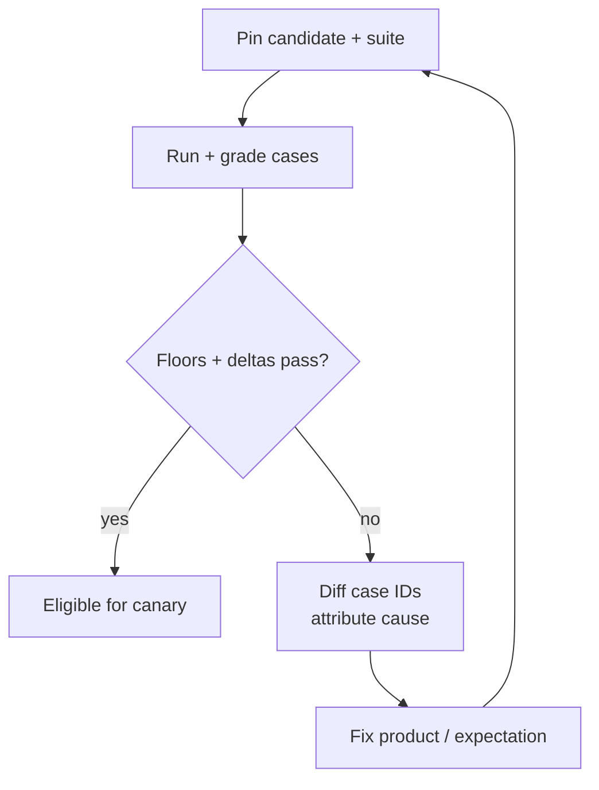

A **regression suite** is a fixed, versioned collection of tests or eval cases that you re-run after a change to detect **unintended behavior loss**: features that used to work, policies that used to hold, or quality floors that used to pass. In classical software, IEEE-style regression testing is selective retesting of a system so modifications do not introduce (or reintroduce) faults. In AI and LLM products the "system" is broader than code: model weights or provider route, prompt templates, retrieval indexes, tool schemas, decoding settings, and agent scaffolds all count as changes that can silently break prior behavior.

A [golden dataset](glossary://golden-dataset) supplies **reviewed reference data** (inputs + expected behavior). A regression suite defines the **operational schema**: which test cases run, which graders score them, which slice floors block release, and how often the pack executes in CI. An [eval harness](glossary://eval-harness) executes the suite, and an [eval gate](glossary://eval-gate) usually enforces it.

A regression is a failure on something that previously passed (or that the product claims still works). New capability gaps belong in exploratory eval; re-breaking last month's incident belongs in the suite.

## Intuition

Think in three layers that people often collapse into one folder named `evals/`:

| Layer | Question it answers |
| --- | --- |
| **test case / case** | One frozen input + expected behavior + tags |
| **Golden dataset** | Which reviewed cases define quality for a surface |
| **Regression suite** | Which cases + graders + thresholds re-run on every relevant change |

Unit tests protect deterministic code paths. [Smoke tests](glossary://smoke-test) ask whether the main path is alive. A regression suite asks whether **known-good product behavior still holds** under the candidate stack. Google's production-ML guidance frames the same idea for models: check new versions for sudden quality drops versus the previous version **and** for slow multi-version rot against fixed thresholds on a validation set.

Classical test engineering also warns that suites grow with every fixed defect. Without selection, prioritization, ownership, and retirement, the pack becomes slow, flaky, and ignored. AI suites inherit that failure mode and add sampling noise, judge variance, and token cost.

## How it works

A production regression suite is a pipeline, not a static spreadsheet of prompts:

1. **Curate cases from reality.** Prefer production incidents, near-misses, policy edges, high-value journeys, and red-team finds over easy demos that always pass.
2. **Freeze test cases.** Pin inputs, expected outcomes or rubrics, side context (retrieved docs, tool stubs, clock), and slice tags. Version the dataset so a score delta is attributable.
3. **Attach graders.** Exact match or schema checks where fair; rubrics or [model judges](glossary://model-judge) where answers paraphrase; zero-tolerance checks for safety, tenant isolation, and schema validity.
4. **Define gate metrics.** Absolute floors (for example refusal pass $\ge 0.98$) and allowed regressions versus a pinned baseline (for example citation accuracy drop $\le 0.02$). Report each [evaluation slice](glossary://evaluation-slice) alongside the pool mean.
5. **Run on every behavior-changing change.** Model or provider config, prompts, retrieval/chunking/rerank, tools, safety policy. Infrastructure-only edits can stay on unit and smoke paths so the expensive suite is not burned out.
6. **Triage failures with version pins.** Diff fail↔pass rows against model id, prompt version, index, tools, temperature, harness SHA. Many "model regressions" are packing, template, or index drifts.
7. **Maintain suite health.** Track flake rate, runtime, ownership, last triage date, and coverage of real incident classes. Add the case that burned users; retire obsolete product paths under a new suite version.

### Classical strategies (still useful for AI)

Software regression literature (Rothermel et al. on prioritization; surveys on selection and minimization) names tactics that map cleanly to LLM ops:

| Strategy | Software meaning | AI/LLM analogue |
| --- | --- | --- |
| **Retest all** | Run every case | Full golden suite on main / release |
| **Selection** | Run a subset affected by the change | Prompt-only PRs run reply suite; index PRs run retrieval slices |
| **Prioritization** | Order cases for early fault detection | Safety and tenant isolation first; long fuzzy judge rows later |
| **Hybrid** | Select + prioritize | Fast PR gate + nightly full suite |

## Diagram



## Example

A support RAG product is about to promote a new system prompt and a cross-encoder reranker. The regression suite `support-reg@v12` is not "200 random tickets." It is a structured pack with pass criteria:

| Slice | Count | Pass criteria | Role in the suite |
| --- | --- | --- | --- |
| `citation_core` | $200$ | Must cite approved policy ids; answer span match | Head quality |
| `must_refuse` | $50$ | Refuse unsafe / out-of-policy asks | Zero-tolerance policy |
| `tool_schema` | $30$ | Valid tool name + args against JSON schema | Agent schema |
| `tenant_isolation` | $20$ | Zero cross-tenant chunks | Hard privacy fail |
| `incident_replay` | $25$ | Cases that already failed in prod once | Anti-rebreak |
| `latency_smoke` | $20$ | p95 end-to-end under budget on harness hardware | Non-functional regression |

Total $N = 345$ test cases. Graders are deterministic first (citation ids, schema, isolation); a judge scores only paraphrase quality after schema and citation checks pass. Baseline production run:

- Citation accuracy $0.94$, refusal pass $1.00$ (50/50), isolation failures $0$, p95 $1.8\,\mathrm{s}$.

Candidate after prompt + reranker:

- Citation overall $0.93$ (drop $0.01$ from baseline, so it clears a $0.02$ max-regression budget and a $0.90$ absolute floor).
- Tagged sub-slice `long_pdf_table` inside `citation_core`: $29/40=0.725$ against a $0.80$ slice floor (support $n_s = 40$).
- Refusal $1.00$ (50/50), isolation $0$, p95 $2.1\,\mathrm{s}$.

**Suite decision: fail.** The pool mean almost looked shippable; the slice floor did not. Engineers open the 11 failing `long_pdf_table` rows, find the reranker over-weights table-free chunks, fix packing, re-run the **same** `support-reg@v12`. Passing all 50 refusal test cases still leaves uncertainty about failures on unseen requests. A green suite makes the change eligible for canary; measure live business impact during rollout.

Minimal structure of one suite case (case-level schema):

```json title="support-reg-v12-incident.json"
{
  "suite_version": "support-reg@v12",
  "case_id": "inc_2026_02_prod_gate",
  "slice": "incident_replay",
  "input": {
    "question": "Can release r17 enter production without the private safety suite?",
    "corpus_version": "deploy-corpus@2026-03-01"
  },
  "expected": {
    "status": "grounded",
    "must_cite": ["deploy-policy-v4"],
    "must_not_claim": ["staging checks are sufficient"]
  },
  "lineage": {
    "source": "incident-4821",
    "added_after": "prod_failure_2026-02-11"
  }
}
```

## What belongs in an AI regression suite

Include cases that protect **behavior the product already claims**:

- **Golden answers** where exact or structured match is fair (ids, enums, tool args).
- **Rubric or judge scores** where style varies, calibrated on human gold first.
- **Safety and policy edges** (jailbreaks, PII, refusals) with hard floors.
- **Tool and schema specifications** for agents.
- **Multilingual, long-context, and document-shape slices** that hide under averages.
- **Incident replays** that once failed for real users.
- **Non-functional checks** where regressions hurt: latency, cost, timeout rate.

Do **not** fill the suite only with easy demos that always pass. Prefer stable labels and clear pass criteria. Prefer cases with ownership and a known failure class over anonymous bulk synthetic rows.

Hold the suite out of training and few-shot demos so it does not become self-[contamination](glossary://benchmark-contamination). When product policy legitimately changes, bump the suite version and treat metric history as discontinuous rather than silently editing expectations mid-comparison.

## Suite health

A suite only protects you if people still run and trust it. Track at least:

| Signal | Why it matters |
| --- | --- |
| **Flake rate** | High flake → force-merge culture |
| **Runtime / cost** | Hours-long gates get skipped or under-sampled |
| **Ownership** | Orphan suites rot; someone must triage and update thresholds |
| **Last failure triage** | Untriaged reds teach the team to ignore red |
| **Incident coverage** | If last month's SEV never became a test case, it can rebreak |
| **Slice support $n_s$** | Tiny slices are triage lenses, not solid gates |

Common operating split: a **fast PR gate** (critical slices, deterministic graders) plus a **nightly or pre-release full suite** (judge-heavy and long-tail rows). That is selection and prioritization under another name.

## Debug path

When a regression fires, do not start by "trying a better model." Diff pins first:

1. Model id / provider snapshot and decoding (`temperature`, seed, max tokens).
2. Prompt template and chat formatting (system message, few-shots, tool instructions).
3. Retriever index, chunker, filters, reranker version.
4. Tool schema and allowlist.
5. Harness git SHA, grader version, dataset version.
6. Sampling noise: compare repeated runs with the same decoding settings and check judge variance on the same outputs. Temperature $0$ or a fixed seed can reduce some variation. Hosted inference can still be nondeterministic, so estimate its variance with repeated runs under the same settings; changing decoding creates a different experimental condition.

Many "model regressions" are packing, template, index, or grader changes. If the suite itself moved (edited labels, new judge prompt) without a version bump, you do not have a product regression; you have a measurement change.

## What fails in production

| Failure | What it looks like | Fix |
| --- | --- | --- |
| **Trophy suite** | Only happy-path FAQs; always green | Add incidents, refusals, hard slices |
| **Mean-only gate** | Overall $0.91$, safety slice collapses | Slice floors; zero-tolerance hard fails |
| **Silent test case edits** | Scores jump with no product change | Immutable versions + changelog |
| **Flaky / slow suite** | Team force-merges or skips CI | Prioritize, stabilize graders, split fast/full |
| **Unpinned stack** | Failures not reproducible | Pin model, prompt, index, harness, data |
| **Judge-only grading** | Measurement drift looks like product drift | Deterministic checks first; calibrate judges on gold |
| **No incident feed** | Same SEV class reappears quarterly | Auto-add high-severity failures as test cases |

## Why it matters here

LLM systems change under your feet: providers update models, teammates edit prompts, indexes reindex, tools gain fields. Unit tests stay green while citation quality, refusals, or tenant isolation rot. A regression suite is how AI teams turn past failures and product specifications into a re-runnable safety net for [offline evaluation](glossary://offline-evaluation) and release gates. Without one, quality erodes as prompts, indexes, and models drift. With one, a red build points at concrete case IDs and version pins instead of a vague "it felt worse."

## Related terms

- [Golden dataset](glossary://golden-dataset)
- [Eval harness](glossary://eval-harness)
- [Eval gate](glossary://eval-gate)
- [Offline evaluation](glossary://offline-evaluation)
- [Evaluation slice](glossary://evaluation-slice)
