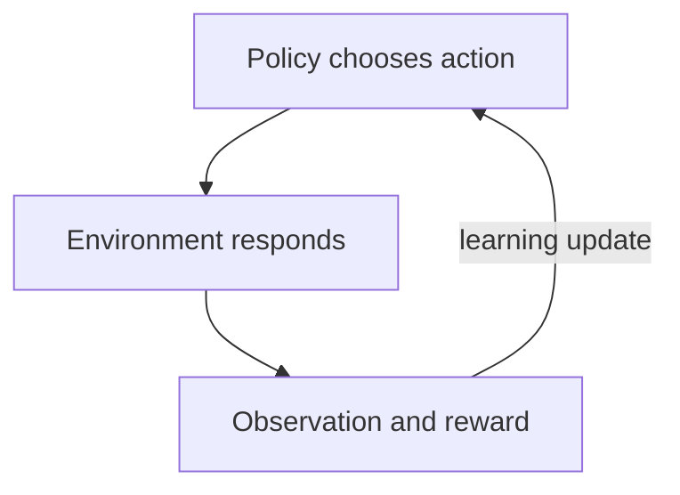

Reinforcement learning (RL) trains a decision-making policy through interaction and reward. The policy chooses an action from its observations, the environment responds, and a reward signal measures some aspect of the outcome. Training changes the policy to increase expected accumulated reward, rather than simply copying a supplied correct action for every input.

## Reward can arrive after the useful action

A decision can change which observations become available later. An agent that queries the right trace may identify an incident's cause several tool calls afterward. Credit assignment asks which earlier decisions helped earn the eventual reward. Exploration asks which uncertain actions are worth trying to improve future decisions.

The learned policy optimizes the specified reward. Test whether that reward tracks product usefulness, since a policy can exploit an incomplete evaluator. Enforce tool permissions and safety constraints outside the learned policy.

## Example

An investigator chooses between inspecting traces, checking CPU metrics, and submitting a diagnosis. A grounded correct diagnosis earns 1; an unsupported diagnosis earns 0. Several attempts on the same incident reveal that inspecting traces often precedes success. An RL update can increase that action's probability without having a human label every intermediate step.

## Why it matters here

RL supplies the foundation for PPO, GRPO, RLHF, and RLVR. These methods differ in where rewards come from and how updates are estimated. Policy learning requires an update using collected experience. Stored experience can also support learning when the chosen algorithm accepts its data distribution.

## Related terms

- [Policy gradient](glossary://policy-gradient)
- [Reward function](glossary://reward-function)
- [RL rollout](glossary://rl-rollout)
- [On-policy learning](glossary://on-policy)
- [Off-policy learning](glossary://off-policy)
- [GRPO](glossary://grpo)
