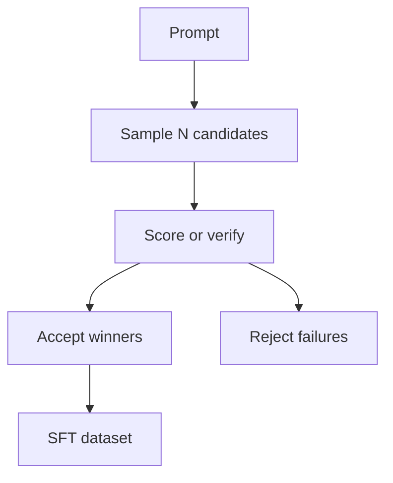

**Rejection sampling** generates several candidates, scores them against an acceptance rule, keeps selected candidates, and discards the rest. In LLM post-training, accepted outputs often become a new [supervised fine-tuning](glossary://supervised-fine-tuning) dataset.

This practical LLM use is broader than exact statistical accept-reject sampling. Acceptance may come from unit tests, formal verifiers, reward thresholds, human labels, a [reward model](glossary://reward-model), or top-ranked candidate. “Best-of-N” returns winner at inference time. Rejection sampling fine-tuning trains policy on retained winners.

In exact statistical rejection sampling, draw from a proposal density $q$ and accept $x$ with probability $p(x)/(M q(x))$, where $p(x) \leq M q(x)$ everywhere and the proposal covers the target's support. Accepted samples then follow target density $p$. That guarantee applies when these conditions hold; selecting an LLM answer by its highest score follows a different procedure.

## Example

A code model samples eight patches. Tests accept two. Pipeline keeps those complete trajectories, including valid tool calls, and runs SFT. This can bootstrap competence cheaply, but discarded failures provide no direct negative gradient.

## Why it matters here

Rejection sampling offers bridge between supervised learning and online RL. It can turn verified successful rollouts into stable demonstrations before more expensive policy optimization.

## Failure modes

- **Scorer hacking:** candidates exploit verifier or judge.
- **Selection bias:** retained outputs cover narrow modes.
- **Mode collapse:** repeated training on similar winners reduces diversity.
- **Trajectory truncation:** saving only final answer loses tool behavior that produced it.
- **Distribution lag:** winners came from older policy and environment.

## Related terms

- [Supervised fine-tuning](glossary://supervised-fine-tuning)
- [Reward model](glossary://reward-model)
- [RL rollout](glossary://rl-rollout)
- [Pass@k](glossary://pass-at-k)
- [Test-time compute](glossary://test-time-compute)
