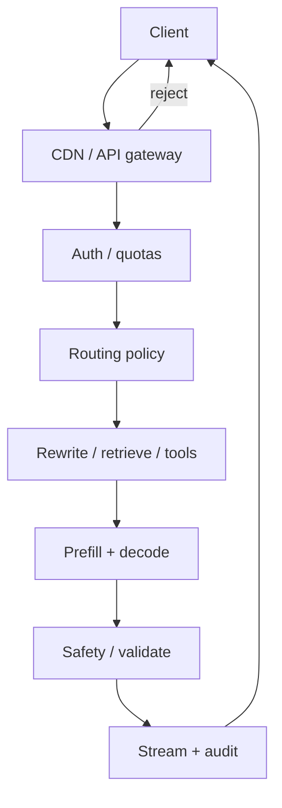

The **request path** is the ordered sequence of components a single user request travels through from the product edge to a completed response (or a deliberate reject). In classical distributed systems that path is gateway, service, database, and back. In AI products it is usually longer: identity and request gating, routing, retrieval or tools, prompt assembly, model prefill and decode, safety, streaming, and audit. OpenTelemetry describes a [trace](glossary://tracing) the same way: *the path of a request through your application*, with each hop as a timed span under one `trace_id`.

Treat the request path as a **design artifact**: attach latency budgets, security perimeters, cost attribution, and ownership to named hops before production. If a hop is missing from the diagram, it is also missing from metrics, timeouts, and on-call ownership until it fails in production.

## Intuition

Picture one chat turn as a baton pass across stages. The client hands a [payload](glossary://payload) to the edge. The edge may reject it cheaply (bad key, over quota, body too large) or stamp a request ID and forward it. Downstream stages transform the baton: rewrite the query, fetch evidence, pack context, call a model, run tools, check policy, stream tokens. Users experience the **sum** of sequential hops and the **max** of true parallel fan-outs; model latency covers only part of that path.

"The model failed" is almost never a path diagnosis. The same wrong answer can come from a missing ACL on retrieval, a stale index, a wrong [provider route](glossary://provider-route), a truncated context pack, a safety filter rewrite, or a client that buffered the stream. Naming the path first turns arguments into span comparisons.

## How it works

A production LLM request path is usually a **pipeline of stages** with a shared correlation ID:

1. **Edge and request gating.** CDN / TLS, [API gateway](glossary://api-gateway), auth and RBAC, body size and schema checks, rate limits and quotas. Cheap rejects never touch GPUs.
2. **Route and policy.** [Routing policy](glossary://routing-policy) chooses model, region, tool set, and fallbacks from tenant plan, task type, latency target, and provider health.
3. **Application stages.** Query rewrite, embed, hybrid retrieval, rerank, context packing, tool planning, and prompt/template assembly. These often dominate wall time before prefill starts.
4. **Inference.** Queue wait, [prefill](glossary://prefill), first token, then [decode](glossary://decode-phase) under continuous batching. Streaming responses return tokens as they are produced; the path is not done until the stream ends or is cancelled.
5. **Exit gates and side effects.** Safety classifiers, structured-output validation, usage metering, audit logs, and client delivery. Failures here can replace or block an otherwise finished generation.

### Sequential vs parallel time

For stages that run one after another with durations $t_1,\ldots,t_k$:

$$
T_{\mathrm{seq}} = \sum_{i=1}^{k} t_i.
$$

For a true parallel fan-out (for example dense and sparse retrieval at the same time) that joins before the next stage:

$$
T_{\mathrm{par}} = \max_j t_j.
$$

End-to-end latency is the critical-path combination of those blocks (sum across sequential groups, max inside each parallel group), plus queue and network residual. A [latency budget](glossary://latency-budget) assigns a share $b_i$ of the product SLO $B$ to each stage so that $\sum b_i + m \le B$ with margin $m$.

Inside the model server the path splits further. Prefill processes the full prompt and drives time-to-first-token; decode generates tokens autoregressively and drives stream cadence. Continuous batching (iteration-level scheduling in systems such as vLLM) can interleave other requests' prefills and decodes on the same GPU, so **your** request's queue wait is part of *your* path even when the kernel is busy with someone else's work.

### What every hop must carry

| Field | Why it exists |
|---|---|
| `request_id` / `trace_id` | Join logs, spans, and support tickets for one turn |
| Auth principal and tenant | Authorization must not trust client-asserted fields alone |
| Route and model IDs | Replay which policy and provider handled the call |
| Deadlines / remaining budget | Nested timeouts so retries cannot exceed the product SLO |
| Version stamps | App build, prompt, index, feature flags, safety policy |

If a hop drops the correlation ID or rewrites identity, the path becomes un-debuggable at that perimeter.

## Diagram



Rejects at the edge never enter App or Infer. Streamed tokens flow Infer → Gate → Client without waiting for the full completion when the product is interactive.

## Example

Support chat for a SaaS help center. Product SLO: p95 time-to-first-token under $900\,\mathrm{ms}$ for short answers. One request:

```text
CDN -> API gateway (auth, 60 rpm, body cap)
  -> route: support-fast
  -> query rewrite + embed
  -> hybrid retrieval + ACL filter + rerank
  -> context pack (token budget)
  -> provider / vLLM (prefill then decode stream)
  -> safety classifier on output chunks
  -> SSE to client + audit log
```

Hypothetical wall times from one trace (same request ID on every span). A single trace contains durations, not p95 estimates:

| Hop | Span duration | Notes |
|---|---:|---|
| Edge + auth | $12\,\mathrm{ms}$ | healthy |
| Rewrite + embed | $45\,\mathrm{ms}$ | healthy |
| Retrieve + rerank | $310\,\mathrm{ms}$ | over a $180\,\mathrm{ms}$ budget line |
| Pack + policy | $25\,\mathrm{ms}$ | healthy |
| Queue wait | $40\,\mathrm{ms}$ | mild load |
| Prefill + first token | $380\,\mathrm{ms}$ | long packed prompt |
| **TTFT total** | **$\approx 812\,\mathrm{ms}$** | still under $900\,\mathrm{ms}$, thin margin |

Suppose the user later reports a citation from a **forbidden** private draft. Trace which hop introduced that text, including retrieval, caches, tools, and prompt assembly. If retrieval returned the unauthorized chunk, fix its ACL and tenant filtering; decoding settings do not control that authorization perimeter. Confirm from retrieval and prompt-assembly traces whether the model received the document, since models can fabricate citations. The path diagram owns the security question: *which hops may see which documents*.

Illustrative application-side stage timer; use server-side spans to cover the full request:

```python title="path-stages-sketch.py"
import time
from dataclasses import dataclass, field

@dataclass
class PathTrace:
    request_id: str
    stages: list = field(default_factory=list)

    def span(self, name: str):
        return _Stage(self, name)

class _Stage:
    def __init__(self, trace: PathTrace, name: str):
        self.trace, self.name = trace, name
    def __enter__(self):
        self.t0 = time.perf_counter()
        return self
    def __exit__(self, *exc):
        ms = (time.perf_counter() - self.t0) * 1000
        self.trace.stages.append((self.name, ms))

def handle_turn(req, deps, trace: PathTrace):
    with trace.span("allow"):
        deps.gateway.allow(req)  # may raise 401/429/413
    with trace.span("route"):
        route = deps.router.choose(req)
    with trace.span("retrieve"):
        docs = deps.retriever.search(req.query, tenant=req.tenant)
    with trace.span("pack"):
        prompt = deps.packer.build(req, docs, route.token_budget)
    with trace.span("generate"):
        # Consume the stream inside the span so the span measures generation.
        yield from deps.model.stream(prompt, route=route, request_id=trace.request_id)
```

This generator runs when consumed. Its `generate` span covers stream consumption, including time the consumer spends between chunks; measure provider work and client backpressure separately when needed. `req.tenant` must come from trusted request gating, and the retriever must enforce document permissions. In production these stages become OpenTelemetry spans rather than only local timers.

## Debug path

When an incident says "chat is broken" or "slow":

1. **Name the path for that route.** Interactive FAQ, deep research agent, and batch summary jobs do not share one hop list.
2. **Pull one failing or slow `request_id`.** Expand the full span tree: edge → app → retrieve → generate → tools → gate.
3. **Compare each span to its budget and owner.** The first stage over budget (or the first that returned empty/wrong evidence) is the primary owner.
4. **Check versions on that hop.** App build, feature flags, prompt/template version, index build ID, model and route, safety policy version, cache namespace. A "model regression" is often an index or prompt deploy that shared the same release train.
5. **Verify identity and ACL at the hop that loads data.** Wrong-tenant chunks and forbidden docs point to the retrieval authorization path; fix those controls before adjusting generation style.
6. **Confirm timeouts and retries nest inside the remaining budget.** Three sequential $3\,\mathrm{s}$ provider retries behind a $2\,\mathrm{s}$ client timeout will look like random client failures while the server still burns work.

A path map directs fixes to the hop that moved the metric or evidence.

## Trade-offs

| Choice | Gain | Cost |
|---|---|---|
| More hops (rewrite, hybrid, rerank, tools) | Higher quality, better evidence | Longer critical path, more failure modes |
| Flatten path (direct model call) | Low latency, simple ops | Weak grounding, harder policy isolation |
| Strict edge rejects | Protect GPUs and cost | Need clear client errors and support playbooks |
| Deep in-process path (one service) | Fewer network hops | Harder independent scaling of retrieve vs decode |
| Disaggregated prefill/decode or separate RAG workers | Scale stages independently | KV transfer, more trace complexity |

Draw the path **before** optimizing a single component. Optimizing decode kernels does nothing if retrieval owns half of TTFT and the bug is an ACL miss on that hop.

## Why it matters here

LeetLLM system design, serving, and RAG material all assume you can name the hops between user action and tokens on screen. Request-path thinking turns "a model with some glue" into a debuggable pipeline with owners, budgets, and security perimeters. Latency budgets allocate time across the path; traces record the path; routing policy chooses which path variant runs. Learners who can draw the path can diagnose production failures without guessing at the model first.

## Related terms

- [Latency budget](glossary://latency-budget)
- [API gateway](glossary://api-gateway)
- [Provider route](glossary://provider-route)
- [Tracing](glossary://tracing)
- [OpenTelemetry](glossary://opentelemetry)
