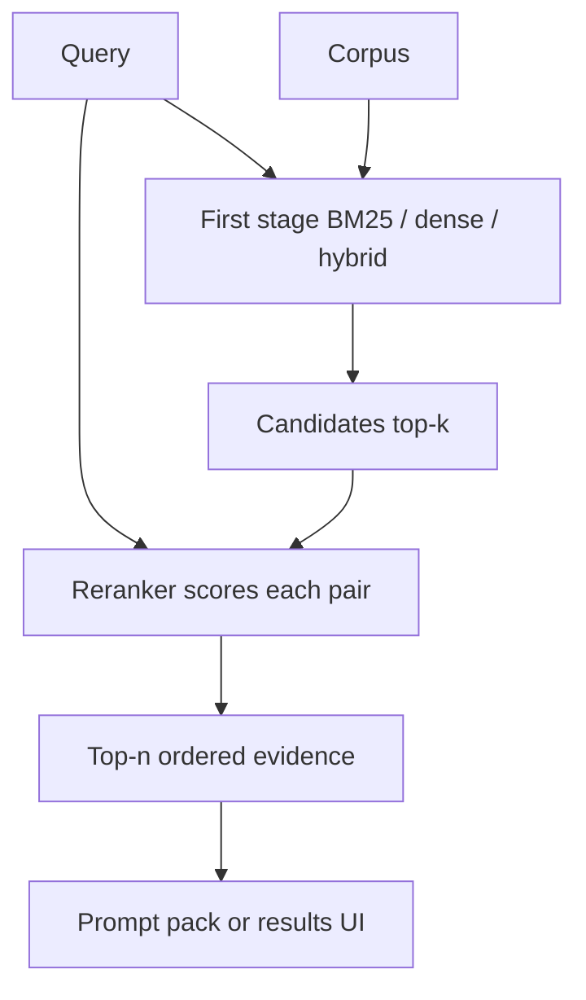

A **reranker** is a second-stage relevance model. It takes a shortlist of candidates from first-stage retrieval (BM25, dense ANN, hybrid fusion, or a rules filter) and reorders that shortlist with a stronger, usually more expensive scorer. The first stage optimizes for **recall** over a huge corpus; the reranker optimizes for **precision of order** on a few tens or hundreds of items before UI display or prompt packing.

Reranking cannot invent documents the retriever never returned. If the gold passage is outside the candidate set of size $k$, the best possible post-rerank rank is "absent." Production stacks therefore treat candidate [recall@k](glossary://recall-at-k) and post-rerank metrics ([MRR](glossary://mrr), [NDCG](glossary://ndcg), answer faithfulness) as separate dials.

## Intuition

First-stage search avoids expensive joint scoring across the whole corpus. Simple sparse or single-vector representations can miss fine constraints: negation, version pins, entity swaps, and multi-clause queries. First stages can also use positional indexes or multi-vector late interaction. A reranker spends more compute **per remaining candidate**, often by reading the query and document together so tokens can interact directly.

The candidate set is a hard boundary: a reranker can change the order of returned IDs, but it cannot score or recover an ID that first-stage retrieval omitted.

## How it works

The classic **retrieve-then-rerank** pipeline (Sentence Transformers docs; Nogueira and Cho 2019 monoBERT):

1. **Candidate generation.** Lexical, dense, or hybrid search returns top-$k$ hits (often $k \in [50, 200]$ for RAG).
2. **Pair scoring.** For each candidate $d_i$, compute a relevance score $s(q, d_i)$. Cross-encoder rerankers encode the concatenated pair in one forward pass; API rerankers (for example Cohere Rerank) expose the same contract: query + document list in, relevance scores out.
3. **Reorder and truncate.** Sort by $s$ descending, keep top-$n$ for the prompt or result page ($n$ often $3$–$10$ for generation).
4. **Optional extras.** Drop below a score threshold, apply diversity (MMR), enforce ACL already checked earlier, or fall back to first-stage order on timeout.

**Pointwise cross-encoders** produce one score per pair, independent of other candidates in the batch. Listwise models (including some LLM-as-reranker prompts that see many passages at once) compare candidates jointly and need input-order sensitivity and length checks.

## Formula

**Cross-encoder pointwise score** (monoBERT-style). Concatenate query and passage, run a pretrained encoder, map the pooled state to a scalar:

$$
s(q, d) = w^\top h_{\mathrm{CLS}}(q, d) + b
$$

with input sequence

$$
[\mathrm{CLS}]\; q \;[\mathrm{SEP}]\; d \;[\mathrm{SEP}]
$$

On MS MARCO, Nogueira and Cho fine-tuned BERT this way and reported a large MRR@10 jump over prior SOTA on that leaderboard (exact relative % depends on which baseline you pick). Training is usually binary cross-entropy on relevant vs non-relevant pairs, or a pairwise/listwise ranking loss when graded labels exist.

**Final order** for a candidate set $C = \{d_1,\ldots,d_k\}$:

$$
\mathrm{rank}(q) = \mathrm{argsort}_{d \in C}\; s(q, d)\quad \text{(descending)}
$$

**Latency budget.** Measure total reranking time versus candidate count, document length, batch size, hardware, and concurrent load. In a hypothetical linear approximation, $k=100$ at effective $0.5$–$2$ ms/pair is $50$–$200$ ms. Real batching and queueing can change that cost curve, and ANN latency isn't universally a few milliseconds.

Raw scores are model-specific. Some heads look like probabilities in $[0,1]$; many open MS MARCO MiniLM checkpoints emit unbounded logits. Rank within a query; calibrate thresholds on your own traffic before using absolute cutoffs.

## Diagram



## Example

Hypothetical support RAG over runbooks. Query: `"auth-cache unit test failure"`.

| Stage | What happens | Outcome |
| --- | --- | --- |
| Hybrid retrieve | BM25 + bi-encoder ANN return $k=100$ chunks in ~$15$–$30$ ms | Gold runbook is in the set at first-stage rank $17$ |
| Cross-encoder rerank | Score all $100$ pairs; sort | Gold moves to rank $1$; a topical but wrong "API key rotation" page drops from rank $2$ to rank $40$ |
| Pack | Keep top $5$ for the generator | Answer cites the unit-test cache section |

Concrete score sketch using illustrative MiniLM-style logits. Calibrate decision thresholds on a held-out target query set:

| Doc | First-stage rank | Rerank score $s$ | Final rank |
| --- | --- | --- | --- |
| `auth-cache-unit-test` (gold) | $17$ | $8.4$ | $1$ |
| `api-key-rotation` | $2$ | $-1.2$ | $40$ |
| `unit-test-failure-guide` | $3$ | $3.1$ | $5$ |
| `gpu-driver-notes` | $4$ | $-3.8$ | $91$ |

If first-stage $k$ had been $10$, gold at rank $17$ would never enter this table, so retrieval depth caused the miss. Fix depth, chunking, hybrid fusion, or filters before adjusting the reranker.

Operational sketch with Sentence Transformers-style API:

```python
from sentence_transformers import CrossEncoder

reranker = CrossEncoder("cross-encoder/ms-marco-MiniLM-L6-v2")
query = "auth-cache unit test failure"
candidates = [...]  # texts from first-stage top-k

ranks = reranker.rank(query, candidates, top_k=5, return_documents=True)
# ranks[i]["score"], ranks[i]["text"] ordered by relevance
```

Managed APIs expose the same shape: `rerank(query, documents, top_n=...)` returns indices and relevance scores (Cohere Rerank docs).

## Trade-offs

| Concern | First-stage only | + Reranker |
| --- | --- | --- |
| Corpus scale | Millions via index | Only shortlist size $k$ |
| Token interaction | Sparse terms or pooled vectors | Full joint attention (cross-encoder) or stronger scorer |
| Latency | Depends on index, filters, and load | Depends on $k$, sequence lengths, attention cost, batches, and load |
| Failure mode | Missed paraphrases / weak order | Missed recall if $k$ too small; p95 spikes if $k$ too large |
| Ops | Embed + ANN / inverted index | GPU/CPU batching, timeouts, model versioning |

**Other reranker families** (same role, different cost curve):

- **Cross-encoder:** default second stage; one forward per pair.
- **Late interaction (ColBERT-style):** token-level MaxSim; can sit as a strong mid-stage with a different index cost.
- **LLM listwise rerank:** model reads several candidates and emits an order; flexible but expensive and sensitive to position bias and context length.
- **Lightweight linear / LTR features:** older learning-to-rank stacks over BM25 features still count as rerankers when they reorder a shortlist.

## Debug path

When answers still cite the wrong snippet after adding a reranker:

1. **Was gold in the candidate pool?** Log first-stage ranks and recall@k. Absent gold is a retrieval bug.
2. **Did rerank demote gold?** Log pre-rank, score, post-rank. Domain shift, truncation, or bad negatives often show up here.
3. **Did the generator ignore the top hit?** Check prompt packing, citation format, and context overflow before adjusting ranking.
4. **Latency.** Measure p50/p95 for rerank alone vs end-to-end. Shrink $k$, batch, truncate docs, distill, or timeout-fallback to first-stage order.
5. **Score misuse.** Do not mix first-stage cosine with rerank logits in one arithmetic fusion without normalization; use ranks or calibrated scores.

Log query id, model version, candidate ids, pre/post ranks, scores, $k$, $n$, timeout flag, and whether the cited span came from a top-ranked chunk.

## Why it matters here

Rerankers are the standard quality lever between "we retrieved something topical" and "the prompt holds the right evidence" in [RAG](glossary://rag), hybrid search, code search, and long-context packing. Curriculum work on bi-encoders, cross-encoders, and eval metrics all meet here: measure recall into the shortlist, measure ranking quality out of it, and size $k$ against your latency budget instead of treating the second stage as magic.

## Related terms

- [Cross-encoder](glossary://cross-encoder)
- [Candidate generation](glossary://candidate-generation)
- [Bi-encoder](glossary://bi-encoder)
- [Recall@k](glossary://recall-at-k)
- [RAG](glossary://rag)
