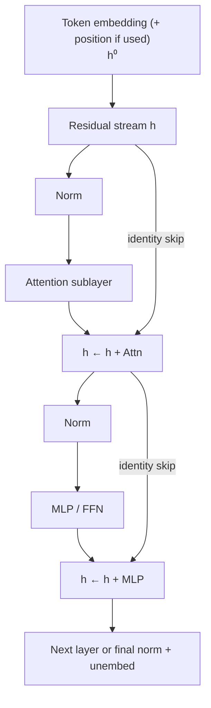

The **residual stream** is the per-token hidden vector passed through a Transformer's residual connections. In a standard pre-norm decoder, attention and MLP sublayers read its normalized state, compute updates, and add them back. Elhage et al. (2021) analyze this additive stream as the embedding plus previous sublayer outputs. It is the main communication channel between these sublayers; cross-attention and other architecture-specific inputs can add separate information paths.

The name comes from residual (skip) connections (He et al., 2016; Vaswani et al., 2017). Each block keeps an identity path so earlier features and gradients can travel forward and backward without being forced through every nonlinear map. In circuit language, "residual stream" is that identity highway viewed as the main object of computation, not as a side path around the "real" layer.

## Intuition

Picture one token's feature vector as a whiteboard of width $d_{\mathrm{model}}$. The embedding writes the first marks. Layer 0 attention reads the board, decides what to copy from other positions, and scribbles an additive update. Layer 0 MLP reads the updated board and scribbles again. Layer 1 does the same. Nothing erases the board between layers: new marks stack on old ones. Later layers can still use early syntax or copied names when those directions retain enough magnitude; later opposing writes can cancel them.

That additive structure has three practical consequences:

1. **Residual accumulation.** A small direction written early can still matter many layers later; later opposing writes can cancel it.
2. **Communication by subspace.** Attention heads and MLPs tend to read and write preferred directions in $\mathbb{R}^{d}$. Composition happens when one component writes a direction another later reads (Elhage et al., 2021).
3. **Scale is part of the design.** Pre-norm models leave the stream unnormalized on the skip path, so magnitude can grow with depth. A final LayerNorm or RMSNorm controls scale before logits; RMSNorm does not subtract the coordinate mean.

## Diagram



## Formula

**One residual step.** For residual state $h^{(\ell)} \in \mathbb{R}^{d}$ and sublayer $f^{(\ell)}$ (attention or MLP, including its input projections):

$$
h^{(\ell+1)} = h^{(\ell)} + f^{(\ell)}\!\big(\mathrm{Norm}(h^{(\ell)})\big)
$$

This is the **pre-norm** (Pre-LN) form used by most modern decoder LLMs: normalize the *input* to $f$, keep a pure identity add. The original Transformer used **post-norm**:

$$
h^{(\ell+1)} = \mathrm{Norm}\!\big(h^{(\ell)} + f^{(\ell)}(h^{(\ell)})\big)
$$

so the skip path itself crossed a normalization at every block (Vaswani et al., 2017; Xiong et al., 2020 analyze the training difference).

**Unrolled stream.** Ignoring the distinction between attention and MLP slots for a moment, after $L$ additive updates:

$$
h^{(L)} = h^{(0)} + \sum_{\ell=0}^{L-1} \Delta^{(\ell)}
$$

where $\Delta^{(\ell)}$ is the write of sublayer $\ell$ (after that sublayer's internal norms and projections). In a full block there are usually two writes per layer: attention then MLP. The final logits are a linear (or bias-affine) map of a last normalized stream:

$$
z = W_U\,\mathrm{Norm}(h^{(L)}) \quad (+\,b)
$$

so every earlier $\Delta^{(\ell)}$ can contribute to logits through the final Norm and $W_U$. The normalization map depends on the whole state: LayerNorm centers and rescales it, while RMSNorm rescales without centering (both may have learned coordinate weights). Freezing the normalization statistics of one forward pass permits an exact affine decomposition for that pass. Ablation effects require recomputing the pass because interventions change those statistics and later writes; the fixed-pass decomposition tracks contributions within the original computation.

**Gradient highway.** Differentiating a pre-norm step with respect to $h^{(\ell)}$ yields an identity term plus the Jacobian of the normalized sublayer path:

$$
\frac{\partial h^{(\ell+1)}}{\partial h^{(\ell)}} = I + \frac{\partial}{\partial h^{(\ell)}} f^{(\ell)}\!\big(\mathrm{Norm}(h^{(\ell)})\big)
$$

The $I$ is why deep residual stacks train more easily than plain deep stacks: a gradient component can skip the sublayer entirely (He et al., 2016).

## How it works

1. **Initialize.** Token ids become $h^{(0)}$ via the embedding table (plus positional encoding or RoPE applied inside attention, depending on architecture). Shape per sequence is $(T, d)$ or $(B, T, d)$.
2. **Read.** A sublayer applies Norm to $h$, then multiplies by its input weights (QKV for attention; up/gate for MLP). Only the *current* residual vector is the read surface; cross-token mixing is attention's job after that read.
3. **Compute.** Attention mixes values across positions; the MLP applies a position-wise nonlinear map. Both produce a vector still in $\mathbb{R}^{d}$ (after the output projection).
4. **Write.** Add that vector into $h$. Implementations usually concat heads then apply $W^O$ as one attention write; Elhage et al. still analyze heads as independent additive writers by factoring $W^O$ (OV circuits) so each head's contribution can be read as its own residual update.
5. **Repeat.** Next sublayer sees the updated stream. At the top, final Norm + unembedding $W_U$ turns the stream into vocabulary [logits](glossary://logits).

Nothing in the residual path *must* be a one-hot "feature slot." Many features share coordinates (superposition). Interpretability work therefore often studies *directions* (linear probes, activation patching) rather than single neurons, because the residual stream basis is not privileged in the architecture math itself.

## Example

**Copy-then-use circuit (schematic).** Suppose the prompt is `Alice lives in Paris. Bob lives in` and the model should complete a parallel fact pattern. A mid-layer attention head can attend from the second `lives` region back to `Paris`, project a "location = Paris" direction through its OV circuit, and **add** that direction into the residual stream at the prediction position. A later MLP or the unembedding can read that direction and raise the logit for `Paris` (or a related city token). The residual stream is the only place that head and that later reader meet: there is no separate wire between them.

**Shape and memory.** For a 7B-class model with $d=4096$, sequence length $T=4096$, and batch $B=1$, one residual tensor is $4096 \times 4096$ values. In bf16 that is about $32\,\mathrm{MiB}$ per layer boundary you keep for the backward pass. Training stores (or recomputes via [activation checkpointing](glossary://activation-checkpointing)) a residual-sized activation at each block; that is a first-order driver of activation memory, separate from the KV cache used at inference.

## Worked numbers

Toy residual width $d=2$, three additive writes after the embedding:

$$
h^{(0)} = \begin{bmatrix} 1.0 \\ 0.0 \end{bmatrix},\quad
\Delta^{(0)} = \begin{bmatrix} 0.2 \\ 0.5 \end{bmatrix},\quad
\Delta^{(1)} = \begin{bmatrix} -0.1 \\ 0.3 \end{bmatrix},\quad
\Delta^{(2)} = \begin{bmatrix} 0.4 \\ -0.2 \end{bmatrix}
$$

$$
h^{(3)} = h^{(0)} + \Delta^{(0)} + \Delta^{(1)} + \Delta^{(2)} = \begin{bmatrix} 1.5 \\ 0.6 \end{bmatrix}
$$

If a probe for "feature A" is the unit vector $u = [1, 0]^\top$, its residual strength is the scalar product $u^\top h^{(3)} = 1.5$. Layer 0 contributed $+0.2$, layer 1 $-0.1$, layer 2 $+0.4$. Ablating $\Delta^{(2)}$ (zeroing that write) drops the probe to $1.1$ without changing how earlier layers were computed. Real models add Norm and nonlinear $f$ before each $\Delta$, but the bookkeeping "stream = sum of writes" is the same.

```python
import numpy as np

h = np.array([1.0, 0.0])
writes = [
    np.array([0.2, 0.5]),
    np.array([-0.1, 0.3]),
    np.array([0.4, -0.2]),
]
for d in writes:
    h = h + d  # residual write
print(h)  # [1.5 0.6]
```

## What fails in production and debugging

| Failure | What you see | What to check |
|---|---|---|
| Missing or wrong **final norm** | Logits huge/tiny after a port; training unstable near the head | Pre-LN stacks almost always need Norm before $W_U$; match checkpoint graph |
| Residual **scale blow-up** with depth | fp16 overflow, NaNs in late layers, exploding loss early in train | Pre-LN growth is expected; prefer bf16, verify fused Norm kernels, LR warmup |
| **Norm placement** mismatch (Pre vs Post) | "Same weights" but garbage generations after a rewrite | Residual add *before* vs *after* Norm; one swapped block breaks the stream contract |
| Residual **dilution** in very deep Pre-LN | Late layers change little; pruning last blocks barely hurts | Relative $\|\Delta\|/\|h\|$ shrinks as $\|h\|$ grows; architecture or init issue, not always a bug |
| Activation OOM in train | CUDA OOM on long sequences | Measure residual, MLP, attention, and other saved tensors; checkpointing, microbatch, shorter $T$ |
| Silent **dtype/cast** on the add | Quality cliff only in mixed precision | Residual add and Norm in the dtypes the reference model used |

When comparing two implementations, dump $h$ at fixed layers on a short fixed prompt and compare norms and a few coordinates. A correct port keeps residual trajectories close even when sampling still looks okay by chance.

## Why it matters here

Almost every Transformer topic eventually touches the residual stream: where [LayerNorm](glossary://layernorm) / [RMSNorm](glossary://rmsnorm) sit, how [self-attention](glossary://self-attention) and the [feed-forward network](glossary://feed-forward-network) write updates, why gradients reach early layers, how much activation memory training needs, and how mechanistic interpretability traces features as directions that accumulate toward the unembedding. If you only remember one picture of a decoder block, remember: **normalize, compute, add back to the stream**.

## Related terms

- [LayerNorm](glossary://layernorm)
- [RMSNorm](glossary://rmsnorm)
- [Self-attention](glossary://self-attention)
- [Feed-forward network](glossary://feed-forward-network)
- [Attention head](glossary://attention-head)
