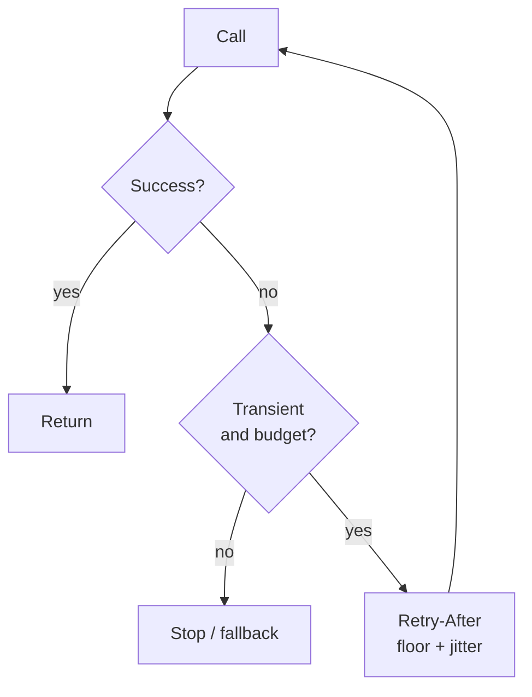

**Retry backoff** is a client policy that waits progressively longer between attempts after a **transient** failure, instead of hammering the same dependency immediately. The delay usually grows exponentially (capped), and production clients almost always add **jitter** (randomness) so many clients do not resynchronize into a thundering herd.

Google SRE practice and the AWS Architecture Blog (Marc Brooker, 2015) treat randomized exponential backoff as the default for remote calls. Without it, a brief blip (timeouts, `429`, `503`) turns into a retry storm that keeps the dependency down and multiplies cost on LLM APIs.

## Intuition

Immediate or fixed-interval retries synchronize clients and recreate the same overload. Increasing delays reduce request pressure; jitter spreads clients across time so they do not retry in lockstep.

| Failure class | Retry? | Why |
|---|---|---|
| Network blip, connection reset, timeout before any response | If safe to repeat (bounded) | The server may have started work before the response was lost |
| HTTP `429` / rate limit, `503` overload | Yes, after wait; honor `Retry-After` | Server is signaling "later" |
| HTTP `500` / `502` on read-only or idempotent work | Maybe (few attempts) | May be a single bad replica |
| HTTP `400` validation, `401`/`403` auth, schema/tool errors | No | Same request will fail again |
| Mid-stream generation already billed or partially applied side effect | Careful | Cost and double-effect risk |

Retries answer "was this a blip on the same path?" They do **not** replace a [circuit breaker](glossary://circuit-breaker) (stop probing a sick dependency) or a [fallback lane](glossary://fallback-lane) (different path under a shared deadline).

## Formula

**Capped exponential backoff** (no jitter) after failed attempt $n = 0, 1, 2, \ldots$:

$$
d_n = \min\bigl(\mathrm{cap},\; \mathrm{base}\cdot 2^{n}\bigr).
$$

Brooker's standard jitter variants (AWS Architecture Blog, 2015; simulator uses $\mathrm{expo}(n)=\min(\mathrm{cap},\,\mathrm{base}\cdot 2^{n})$):

**Full jitter** (recommended default for most clients; spreads load best):

$$
\mathrm{sleep}_n = \mathrm{Uniform}\bigl(0,\; \min(\mathrm{cap},\; \mathrm{base}\cdot 2^{n})\bigr).
$$

**Equal jitter** (always keeps half the exponential delay, randomizes the other half):

$$
t_n = \min(\mathrm{cap},\; \mathrm{base}\cdot 2^{n}),\qquad
\mathrm{sleep}_n = \frac{t_n}{2} + \mathrm{Uniform}\bigl(0,\; \tfrac{t_n}{2}\bigr).
$$

**Decorrelated jitter** (next wait depends on the previous random sleep, not only on $n$):

$$
\mathrm{sleep}_n = \min\bigl(\mathrm{cap},\; \mathrm{Uniform}(\mathrm{base},\; 3\cdot \mathrm{sleep}_{n-1})\bigr)
\quad\text{with }\mathrm{sleep}_{-1} = \mathrm{base}.
$$

In Brooker's contention simulations, plain exponential backoff still clusters retries. Full jitter does the least client work; decorrelated is close on completion time; equal jitter does slightly more work and takes longer than full jitter under the same conditions.

When the server sends HTTP `Retry-After` (RFC 9110 §10.2.3; common on `429`/`503`), treat that as a **floor** for the next wait (seconds or HTTP-date), then still apply a small jitter and your global deadline. OpenAI-style clients also use response headers such as `x-ratelimit-reset-requests` / `x-ratelimit-reset-tokens` when present.

Always cap **both** total attempt count and wall-clock budget:

$$
N < N_{\max}\quad\text{and}\quad t_{\mathrm{now}} + \mathrm{sleep}_n < t_{\mathrm{deadline}}.
$$

Here $N_{\max}$ counts the original call plus retries (so $N_{\max}=4$ allows at most three sleeps with $n=0,1,2$).

## Worked numbers

Take $\mathrm{base} = 0.5\,\mathrm{s}$, $\mathrm{cap} = 8\,\mathrm{s}$, full jitter, $N_{\max}=4$ total attempts (delays $n = 0..2$ after each failure).

| Attempt $n$ after failure | Upper bound $\min(\mathrm{cap}, 0.5\cdot 2^n)$ | Example full-jitter sleep |
|---|---|---|
| $0$ | $0.5\,\mathrm{s}$ | $0.31\,\mathrm{s}$ |
| $1$ | $1.0\,\mathrm{s}$ | $0.74\,\mathrm{s}$ |
| $2$ | $2.0\,\mathrm{s}$ | $1.12\,\mathrm{s}$ |

Worst-case waits sum to $0.5+1+2 = 3.5\,\mathrm{s}$ plus call timeouts. If the user-facing [latency budget](glossary://latency-budget) is $3\,\mathrm{s}$, you cannot afford that schedule: shrink $N_{\max}$, lower the cap, or fail over instead of retrying forever.

For a pure rate-limit case with `Retry-After: 2`, wait at least $2\,\mathrm{s}$ (plus a little jitter), do **not** ignore the header and sleep $50\,\mathrm{ms}$.

## How it works

A production retry loop is a small policy machine, not a blind `for` loop.

1. **Classify the error.** Transient vs permanent vs "do not retry, open breaker / fallback."
2. **Check safety.** Only retry if the call is safe to repeat or protected by [idempotency](glossary://idempotency). An idempotency key helps only when the receiver enforces durable deduplication over the required scope and retention window. A queue worker alone cannot make an external charge or email exactly once.
3. **Compute delay.** Prefer server `Retry-After` / reset headers as a floor; else full (or decorrelated) jitter with base and cap.
4. **Respect budgets.** Max attempts, deadline, and often a **retry budget** (fraction of traffic that may be retries) so a 5% backend error rate cannot become 50% load via multi-layer retries (SRE: avoid retries at every layer; prefer the layer closest to the failure).
5. **Sleep on a monotonic clock**, then re-issue with the same logical operation identity.
6. **Observe.** Log attempt index, error class, delay chosen, whether `Retry-After` was honored, and total tokens/cost for LLM calls.

The synchronous sketch below requires `fn(timeout_s=...)` to enforce the remaining attempt timeout. It cannot interrupt an arbitrary blocking function that ignores that contract.

```python title="full-jitter-backoff.py"
import random
import time

class TransientError(Exception):
    def __init__(self, retry_after_s=None):
        super().__init__("transient failure")
        self.retry_after_s = retry_after_s

class DeadlineExceeded(TimeoutError):
    pass

def full_jitter_delay(attempt: int, *, base: float = 0.5, cap: float = 8.0) -> float:
    # attempt = 0 after first failure
    if attempt < 0 or base <= 0 or cap <= 0:
        raise ValueError("attempt and delay parameters must be valid")
    ceiling = min(cap, base * (2**attempt))
    return random.uniform(0.0, ceiling)

def call_with_backoff(fn, *, max_attempts: int = 4, deadline_s: float = 10.0):
    if max_attempts < 1 or deadline_s <= 0:
        raise ValueError("attempt count and deadline must be positive")
    start = time.monotonic()
    for attempt in range(max_attempts):
        remaining = start + deadline_s - time.monotonic()
        if remaining <= 0:
            raise DeadlineExceeded()
        try:
            return fn(timeout_s=remaining)
        except TransientError as err:
            if attempt + 1 >= max_attempts:
                raise
            delay = full_jitter_delay(attempt)
            if err.retry_after_s is not None:
                # Retry-After is a floor; keep a little jitter above it
                delay = max(delay, err.retry_after_s + random.uniform(0.0, 0.25))
            if time.monotonic() + delay >= start + deadline_s:
                raise DeadlineExceeded() from err
            time.sleep(delay)
```

## Diagram



## Example

A chat gateway calls a model API. The first request fails with HTTP `429` and `Retry-After: 1`. Policy:

- Transient codes: `429`, `503`, connection errors, timeouts with no response body.
- Permanent: `400`, `401`, `403`, content-policy blocks (no blind retry).
- Full jitter with $\mathrm{base}=0.5\,\mathrm{s}$, $\mathrm{cap}=8\,\mathrm{s}$, $N_{\max}=4$ total attempts, deadline $8\,\mathrm{s}$ shared with any fallback.
- After the first failure ($n=0$): wait at least the server floor, then a little jitter, for example $\mathrm{sleep} = 1.0 + \mathrm{Uniform}(0, 0.25)\,\mathrm{s}$. Do not replace `Retry-After` with a shorter full-jitter sample.
- Only retry the completion if no tokens were streamed to the user yet, or if the product accepts a restarted answer under an idempotency key for any tool side effects.

A non-idempotent "send invoice" tool in the same agent must **not** use this loop without an idempotency key: a timeout after the provider already charged can create a second charge on retry.

## Trade-offs

| Choice | Upside | Cost if wrong |
|---|---|---|
| Immediate retry, no backoff | Lowest latency on rare blips | Retry storms; synchronized load |
| Exponential, no jitter | Simple | Clustered retries; still high contention |
| Full jitter + caps | Spreads load; standard SDK pattern | Slightly higher p99 latency for recovered calls |
| High $N_{\max}$ | Survives long brownouts | Burns latency budget, tokens, and money |
| Retry every layer of the stack | Local simplicity | Combinatorial traffic amplification |
| Retry long generations eagerly | Hides flaky networks | Multiplies bill for the same user question |

What fails in production:

- **Thundering herd:** deploy or outage ends, all clients wake on the same schedule.
- **Amplification:** 3 retries at gateway × 3 at service × 3 at client multiplies a 1% fault into overload.
- **Blind POST retries:** double tool side effects without idempotency.
- **Ignoring `Retry-After`:** keeps hammering a rate limiter that already told you when to come back.
- **Retrying permanent errors:** burns budget on `400`s that need a code fix.
- **LLM cost:** each retried completion can re-bill prefill and (if unlucky) full decode; prefer aggressive retry on connection setup and short calls, conservative retry on multi-thousand-token jobs; distinguish rate limit (backoff) from outage (breaker + fallback) from bad request (no retry).

## Why it matters here

LLM products talk to flaky, rate-limited, expensive dependencies: model APIs, embedders, vector stores, and tools. Retry backoff is how a client stays resilient to blips without turning one provider hiccup into a self-inflicted outage or a surprise bill. Paired with idempotency, circuit breakers, rate limits, and shared deadlines, it is table stakes for production AI clients.

## Related terms

- [Circuit breaker](glossary://circuit-breaker)
- [Idempotency](glossary://idempotency)
- [Rate limit](glossary://rate-limit)
- [Backpressure](glossary://backpressure)
- [Fallback lane](glossary://fallback-lane)
