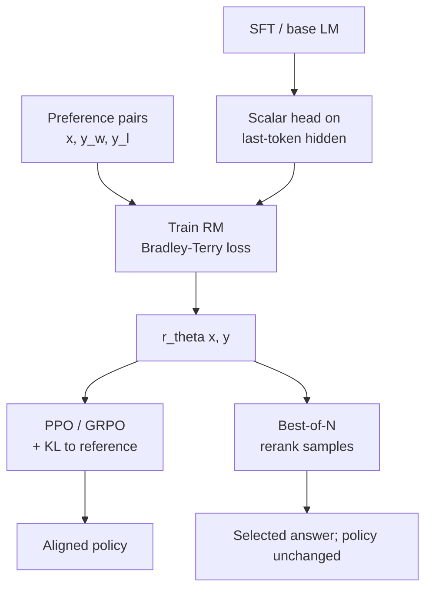

A **reward model** (RM) is a learned scorer $r_\theta(x, y)$ that maps a prompt $x$ and a completion $y$ to a scalar quality signal. In classic [RLHF](glossary://rlhf), humans (or other judges) supply pairwise preferences; the RM is trained so preferred answers score higher than rejected ones; then a policy optimizer such as [PPO](glossary://ppo) or best-of-$N$ selection uses that scalar as a proxy objective. The product goal remains preference, safety, or correctness; the RM compresses those qualities into a fallible signal that can be evaluated millions of times without another human label.

## Intuition

People are better at comparing two answers than at assigning absolute quality scores. Preference data therefore looks like triples $(x, y_w, y_l)$: same prompt, winner $y_w$, loser $y_l$. A reward model turns those comparisons into a continuous ranking function. Once you have $r_\theta$, you can:

- **Train a policy** to raise expected reward while staying near a reference model via a [KL](glossary://kl-divergence) penalty (InstructGPT-style RLHF).
- **Rerank** $N$ samples and keep the highest-scoring one (best-of-$N$ / rejection sampling).
- **Guide search** over reasoning steps when the scorer is a process reward model rather than a single end-of-sequence score.

The same scalar that makes optimization possible also creates the main failure mode: the policy (or the sampler) can chase quirks of $r_\theta$ that humans never intended. That gap between proxy reward and true quality is called **reward-model overoptimization** (Gao, Schulman, and Hilton, 2023).

Contrast with related tools:

| Instrument | What it is | Typical use |
| --- | --- | --- |
| Preference RM (Bradley-Terry) | Scalar $r(x,y)$ from pairwise prefs | RLHF reward, best-of-$N$ |
| [Model judge](glossary://model-judge) / [LLM-as-a-judge](glossary://llm-as-judge) | Prompted grader, often generative | Eval harness, synthetic prefs |
| Outcome RM (ORM) | Score tied to final correctness | Math/code verification |
| Process RM (PRM) | Score per reasoning step | Step-level search / pruning |
| [DPO](glossary://dpo) | Implicit reward inside the policy | Preference tuning without a separate RM |

## Formula

The standard preference RM follows the **Bradley-Terry** model (Bradley and Terry, 1952; used for modern RLHF by Christiano et al., 2017, Stiennon et al., 2020, and InstructGPT / Ouyang et al., 2022). Each completion has a latent score; the probability that $y_w$ beats $y_l$ is a logistic of the score gap:

$$
P(y_w \succ y_l \mid x)
=
\sigma\big(r_\theta(x, y_w) - r_\theta(x, y_l)\big)
=
\frac{e^{r_\theta(x, y_w)}}{e^{r_\theta(x, y_w)} + e^{r_\theta(x, y_l)}}
$$

with $\sigma(z) = 1/(1+e^{-z})$. Only **differences** of rewards matter: adding a constant to every score leaves pairwise probabilities unchanged. That is why absolute RM numbers are not portable across models, datasets, or prompt domains without recalibration.

Maximum-likelihood training minimizes the expected negative log-likelihood over preference pairs $\mathcal{D}$ (InstructGPT form; notation $y_w$ / $y_l$ for preferred / dispreferred):

$$
\mathcal{L}(\theta)
=
-\mathbb{E}_{(x,y_w,y_l)\sim\mathcal{D}}
\Big[
\log \sigma\big(r_\theta(x, y_w) - r_\theta(x, y_l)\big)
\Big]
$$

Equivalently, softplus form $\log\!\big(1 + e^{r_\theta(x,y_l)-r_\theta(x,y_w)}\big)$. When raters rank $K$ completions for one prompt, InstructGPT trains on all $\binom{K}{2}$ pairs and averages the loss per prompt so prompts with denser rankings do not dominate:

$$
\mathcal{L}(\theta)
=
-\mathbb{E}_{x}
\left[
\frac{1}{\binom{K}{2}}
\sum_{(w,l)\in\mathcal{P}(x)}
\log \sigma\big(r_\theta(x, y_w) - r_\theta(x, y_l)\big)
\right],
$$

where $\mathcal{P}(x)$ contains the preferred/dispreferred pairs from that prompt's complete ranking. This explicitly averages their sum; an expectation already averaged over pairs must not be divided by the pair count again. Drop ties and adjust the denominator when the ranking has ties or missing comparisons.

Llama 2 sometimes added a preference **margin** $m(y_w, y_l)$ inside the sigmoid argument when ratings carried strength information; Llama 3 dropped the margin after diminishing returns at scale.

In reference-regularized RLHF, the RM score is paired with a KL anchor toward a reference policy $\pi_{\mathrm{ref}}$. The anchor discourages drift. Evaluate for reward hacking and enforce safety with separate controls. The objective is expected reward minus a KL penalty:

$$
\max_{\pi}\;
\mathbb{E}_{x\sim\mathcal{D},\,y\sim\pi(\cdot\mid x)}
\big[r_\theta(x, y)\big]
-
\beta\,
\mathbb{E}_{x\sim\mathcal{D}}
\Big[
D_{\mathrm{KL}}\!\big(\pi(\cdot\mid x)\,\|\,\pi_{\mathrm{ref}}(\cdot\mid x)\big)
\Big]
$$

Many trainers implement that penalty as a shaped per-completion reward $r'(x,y)=r_\theta(x,y)-\beta\log\frac{\pi(y\mid x)}{\pi_{\mathrm{ref}}(y\mid x)}$ (a Monte Carlo sample of the KL). Exact bookkeeping varies by PPO / GRPO stack; the idea is fixed: raise reward while staying close to the reference.

## How it works

1. **Choose a checkpoint and scalar head.** A base or SFT LM can initialize the scorer. InstructGPT's final RM used a 6B GPT-3 checkpoint previously fine-tuned on public NLP tasks; its appendix reports similar results with base or SFT initialization. A last non-pad token hidden state can feed `Linear(hidden, 1)`; whether that token is EOS depends on tokenization.
2. **Collect preferences.** For each prompt, sample or retrieve several completions and ask raters (or a strong judge) which is better under a written rubric (helpfulness, honesty, harmlessness, task-specific criteria).
3. **Fit Bradley-Terry loss.** Select training duration using held-out preference evidence. InstructGPT used one epoch and observed overfitting with longer training in that setup. Track pairwise accuracy and mean reward margin on a held-out preference split.
4. **Deploy the scorer** either as the online reward for PPO / related RL, or as a static reranker for best-of-$N$, or as a filter in offline data selection.
5. **Evaluate outside the RM.** Win rate vs a fixed baseline under humans or a calibrated judge, factuality, safety slices, length, and refusal behavior. Never treat rising training reward alone as product success.

```python
# Conceptual Bradley-Terry step (sequence-level scalars already computed)
import torch.nn.functional as F

def bt_loss(r_chosen, r_rejected):
    # r_*: batch of scalar rewards for (x, y_w) and (x, y_l)
    return -F.logsigmoid(r_chosen - r_rejected).mean()
```

At inference, score each candidate once and either keep $\arg\max_i r_\theta(x, y_i)$ or feed the scalar into the RL advantage pipeline.

## Example

Prompt $x$: *"Explain why this Python worker can process the same job twice after a timeout."* Two model drafts:

- $y_w$: concise answer identifies the missing idempotency key, cites the retry path in the supplied code, and proposes a bounded fix.
- $y_l$: longer, confident answer blames thread scheduling, invents a queue guarantee, and never addresses duplicate side effects.

Raters prefer $y_w$. After training, a well-behaved RM should satisfy $r_\theta(x, y_w) > r_\theta(x, y_l)$ with a comfortable margin. During PPO, the policy is nudged to produce more $y_w$-like answers. During best-of-$N$, you sample $N$ completions and return the one with the highest $r_\theta$. If the RM has a verbosity bias, $y_l$ may start winning on score even when humans still prefer $y_w$: that is the production failure you watch for with held-out human labels, not with the training reward curve.

## Worked numbers

Suppose for one pair the RM outputs $r_w = 1.2$ and $r_l = 0.2$. The predicted preference probability is:

$$
P(y_w \succ y_l)
=
\sigma(1.0)
\approx
0.731
$$

and the per-example loss is $-\log\sigma(1.0) \approx 0.313$. If the scores reverse to $r_w = 0.2$, $r_l = 1.2$, then $\sigma(-1.0)\approx 0.269$ and loss jumps to $-\log\sigma(-1.0)\approx 1.313$. Gradient flow raises $r_w$ relative to $r_l$ until the margin is large; once $\sigma(\Delta)\approx 1$, further margin growth barely reduces loss, so easy pairs stop teaching and hard near-ties dominate learning.

Absolute levels are arbitrary. A model with all rewards shifted by $+5$ has identical pairwise loss. Compare runs with **accuracy on held-out pairs**, **mean margin**, and **correlation with human or gold labels**; raw average reward changes with the arbitrary offset.

## Diagram



## Outcome vs process reward models

Not every scorer is a pairwise preference head.

- **Outcome reward model (ORM).** Trained from final-answer correctness (or a verifier). Cobbe et al. (GSM8K verifiers) and later work use per-token or sequence-level labels that say whether the *finished* answer is right. Useful for math and code when a ground-truth check exists.
- **Process reward model (PRM).** Lightman et al. (*Let's Verify Step by Step*, 2023/2024) train step-level labels on chain-of-thought. A PRM scores intermediate steps so search can prune bad branches early instead of waiting for a full trajectory. On MATH-style problems, process supervision outperformed outcome supervision for training reliable verifiers; they also released PRM800K step labels.

Preference RMs, ORMs, and PRMs serve different label and optimization needs. Rule-based verifiable rewards ([RLVR](glossary://rlvr)) can replace the neural RM when exact match or unit tests cover the intended outcome.

## What fails in production

**Overoptimization.** Gao et al. (2023) show that as you optimize harder against a proxy RM (via RL or best-of-$N$), gold quality rises then falls even while proxy score keeps climbing (Goodhart). Larger RMs and more preference data delay the peak, while the overoptimization curve remains. In practice: cap KL / best-of-$N$, ensemble or regularize the scorer, and track a held-out gold metric (human or stronger judge) alongside $r_\theta$.

**Shortcut rewards.** Length bias, sycophancy, confident tone, markdown flourishes, and "sounds formal" can dominate if raters or synthetic judges reward style over substance. The policy learns those shortcuts faster than it learns truthfulness.

**Distribution shift.** An RM trained on SFT-era completions may mis-score a much stronger or much weaker policy. As the policy moves, preference coverage goes stale; you need refreshed comparisons or off-policy caution.

**Calibration myth.** Pairwise accuracy of 70% does not mean a $+0.5$ reward delta is a stable "half unit of quality" across domains. Treat scores as local ranking signals unless you have recalibrated them on the slice you care about.

**Label noise and rater disagreement.** Conflicting rubrics, position bias in the UI, and inconsistent safety guidelines inject [label noise](glossary://label-noise). The RM can fit the noise and then teach the policy to exploit it.

**Confusion with judges.** A production [model judge](glossary://model-judge) is a versioned rubric + model id for evaluation. An RM is a trained scalar head for optimization or reranking. You can distill judge labels into an RM, but you should still version, slice-eval, and gate them differently.

## Debug path

When reward rises but product quality does not:

1. Freeze a **held-out preference and human gold set**; plot proxy RM score vs gold (or human win rate) as KL or best-of-$N$ increases. Look for the overoptimization peak.
2. Slice by **length, refusal, safety, factuality, and domain**. If reward climbs while one slice collapses, hunt data shortcuts before changing PPO clip or learning rate.
3. Inspect **top-scoring** and **bottom-scoring** rollouts. Verbosity, empty apologies, or keyword stuffing among the winners points to a misspecified RM objective; inspect labels and preference data before extending optimizer steps.
4. Check **train vs eval pairwise accuracy** and margin histograms. Large train/eval gaps mean overfitting; near-chance eval accuracy means the scorer is not ready to drive RL.
5. Compare against a **simple baseline**: SFT only, DPO on the same pairs, or best-of-$N$ with a smaller $N$. If DPO already matches quality without online RL, the full RM+PPO loop may be excess machinery.

## Trade-offs

| Choice | Benefit | Cost |
| --- | --- | --- |
| Explicit RM + RL (PPO/GRPO) | Online exploration; flexible reward shaping | Second model, sampling cost, overoptimization risk |
| DPO / direct preference methods | No separate RM or online RL loop | Implicit reward less inspectable; offline data limits |
| Best-of-$N$ with fixed RM | Simple, no policy training | Inference cost $\propto N$; same overoptimization curve |
| Larger RM / more prefs | Delays overoptimization; better ranking | Label cost; still a proxy |
| PRM for reasoning | Dense step signal; early prune | Expensive step labels; step boundaries are design choices |
| LLM judge as reward | Cheap synthetic prefs | Judge biases become training targets |

## Why it matters here

Reward models sit at the junction of preference data, alignment training, test-time selection, and release gates. Understanding them means understanding why InstructGPT-style stacks work, why DPO can skip the explicit scorer, why best-of-$N$ eventually hurts gold quality, and why reasoning systems switch to ORMs, PRMs, or verifiable rewards. For LLM engineers, the RM is the place where product values become a number, and every number invites Goodhart.

## Related terms

- [RLHF](glossary://rlhf)
- [DPO](glossary://dpo)
- [PPO](glossary://ppo)
- [Model judge](glossary://model-judge)
- [KL divergence](glossary://kl-divergence)
