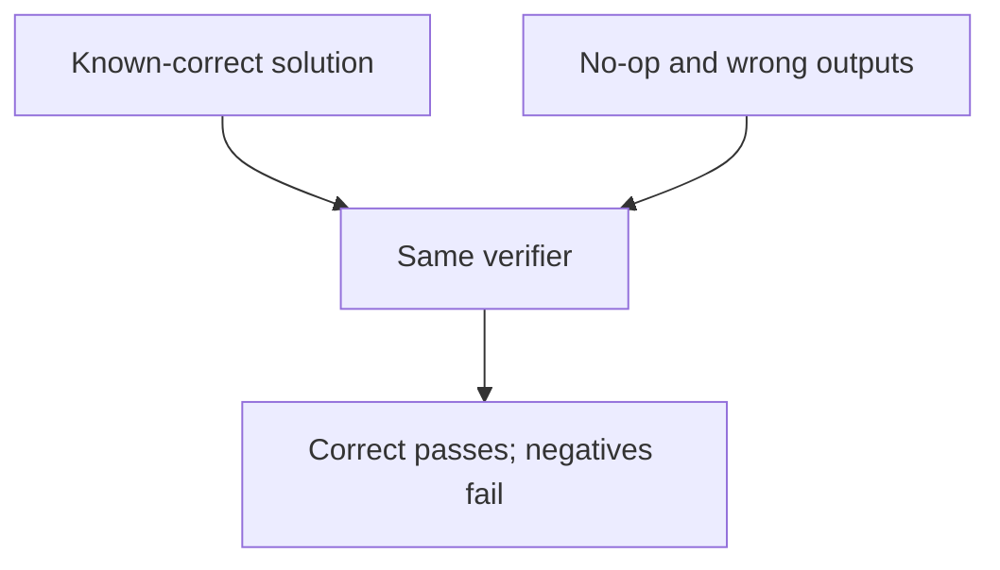

A reward verifier checks whether an agent's output or resulting environment state satisfies a specified task condition. Its result can become part of a reinforcement-learning reward. A verifier might run hidden tests, compare an exact answer, or inspect whether a repair removed a fault. Its result certifies those specified checks, with coverage bounded by their conditions.

## Test the evaluator before trusting its reward

Use a known-correct solution as a positive control. Use a no-op, an unchanged failing state, and plausible but incorrect outputs as negative controls. Also test whether the agent can modify tests, read hidden answers, or exploit parser behavior. A verifier that accepts those shortcuts can train a policy to appear successful without solving the task.

Z.AI's [GLM-5.3 overview](https://docs.z.ai/guides/llm/glm-5.3) describes oracle and no-op checks while developing executable training environments. These checks validate useful paths; assess remaining verifier coverage against the task's failure modes.

## Example

An injected network limit causes database latency. A repair verifier measures whether the limit is removed and latency recovers under the same workload. An agent that merely writes "fixed" must fail. A separate grounding assessment checks whether its explanation cites the trace evidence; the latency test alone can't judge that explanation.

## Why it matters here

RLVR depends on rewards that track the intended outcome. Version verifier code, environment state, fixtures, and thresholds alongside the policy. Treat a timeout or infrastructure error as a measurement failure, then rerun or repair the evaluation before scoring the answer. Keep verifier implementation and credentials outside the agent's writable and readable scope where required.

## Related terms

- [RLVR](glossary://rlvr)
- [Reward function](glossary://reward-function)
- [Reward model](glossary://reward-model)
- [Model judge](glossary://model-judge)
- [Evaluation science](glossary://evaluation-science)
